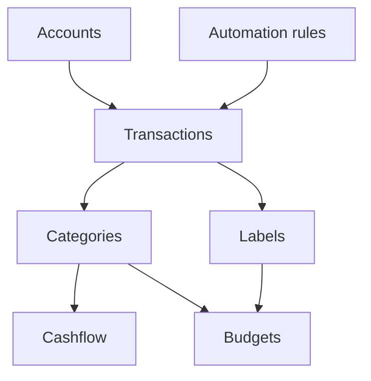
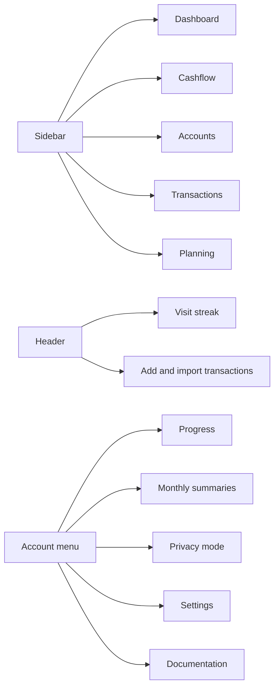

# Getting started

Whisper Money helps you understand where your money is, where it went, and what changed over time.

{{TOC}}

## Quick start

The first time you sign in, a short guided setup walks you through the first
steps below. See [Your first visit](#your-first-visit). After that, or if you
skipped part of it, follow this order.

1. Create your accounts.
2. Add transactions, import them from a bank file, or connect your bank.
3. Review uncategorized transactions.
4. Create automation rules for repeated transactions.
5. Check Cashflow to see income, expenses, what you saved and invested, and what is left available.
6. Add budgets when you want spending limits.

Coming from another finance app? [Import from another app](/documentation/import-from-another-app)
brings its accounts, categories and transactions over in one go, while you set
up your account and for 15 days after.

## Your first visit

A new account opens on a guided setup rather than an empty dashboard. It takes a
few minutes, asks about you before it asks for anything, and ends on a
dashboard that already has your money in it.

1. **Three questions.** What you want to change (keep more at the end of the
   month, understand where it all goes, get out from under a debt, or save for
   something specific), how you keep track today, and a guess of what you spent
   last month. The guess is yours alone and is only used to compare with the
   real figure later.
2. **Your currency.** Above the guess is the currency Whisper Money picked from
   your location. If it is wrong, click it and search for yours by code or
   name. It becomes your account's currency, which you can change later in
   **Settings → User account**.
3. **Your accounts.** Add as many as you like, in any mix: connect a bank,
   connect a broker or exchange with a token, import a file from your bank, or
   add an account by hand, such as a mortgage or a pension. Connecting a bank
   needs a paid plan, and you are asked at that point. See
   [Accounts](/documentation/accounts) and
   [Bank connections](/documentation/accounts/bank-connections).
4. **The real number.** What you actually spent in the month your transactions
   cover (last month, or this month so far) next to your guess, and who you paid
   most. If you only added accounts without transactions, such as a pension or a
   mortgage, you see your net worth instead.
5. **Your merchants, sorted.** The step asks whether to let AI draft your rules,
   which needs a paid plan. If you say yes, Whisper Money reads the merchants
   that repeat and proposes
   [automation rules](/documentation/automation-rules) for them. When you leave
   this step, AI categorizes whatever the rules did not cover, in the background,
   while you finish the next steps.
6. **Teach us your habits.** Categorize a few transactions yourself. You can
   skip it.
7. **Your first target.** Optional. Choose how much of the month you want to
   keep, and Whisper Money creates a monthly catch-all
   [budget](/documentation/budgets) called **Monthly spending** for the rest,
   with a warning before you overspend if you want one.
8. **Open my dashboard.**

If you close the tab halfway, the setup picks up where you left it the next time
you sign in.

## How the pieces fit together

## What's where

The sidebar holds the five main screens. On a phone they sit in a bar along the
bottom, with shorter names: Home, Cashflow, Accounts, Movements and Plan.

- **[Dashboard](/documentation/dashboard)**: your net worth over time, your account balances, the month's
  cashflow, and your top categories and labels.
- **[Cashflow](/documentation/cashflow)**: income, expenses and what you set
  aside, for a month, a quarter or a year.
- **[Accounts](/documentation/accounts)**: every account with its balance, and
  each account's own transactions.
- **[Transactions](/documentation/transactions)**: the full list, with filters,
  search and bulk actions.
- **Planning**: your [budgets](/documentation/budgets) and
  [savings goals](/documentation/savings-goals) in one list.

The header at the top of every screen has your
[visit streak](/documentation/achievements#your-visit-streak-in-the-header), a
button to [add a transaction](/documentation/transactions/create) if you add
them by hand, and **Import transactions** to
[bring in a file](/documentation/transactions/import).

Your account menu, at the bottom of the sidebar (top right on a phone), leads to:

- **Progress**: your [achievements](/documentation/achievements).
- **Monthly summaries**: every [monthly summary](/documentation/monthly-summary)
  you have been sent.
- **Enable privacy mode**: hide amounts on screen. See
  [privacy mode](/documentation/dashboard#privacy-mode).
- **Appearance**: light, dark or your system's theme.
- **Settings**: bank accounts and
  [connections](/documentation/accounts/bank-connections),
  [automation rules](/documentation/automation-rules),
  [categories](/documentation/categories), [labels](/documentation/labels), the
  [AI Connector](/documentation/ai-connector), and your profile, notifications
  and plan.
- **Documentation**: these pages.
- **Support**, along with the community, feedback and roadmap links.

The bell next to the account menu collects notifications: a new monthly summary,
a medal, or a month closed on a monthly savings goal.

## Main concepts

### Accounts

Accounts are where money lives.

Examples:

- Checking account
- Credit card
- Savings account
- Loan
- Real estate

### Transactions

Transactions are money movements.

Examples:

- Salary payment
- Grocery purchase
- Card payment
- Bank transfer

### Categories

Categories explain what a transaction means.

Examples:

- Groceries
- Salary
- Rent
- Transfer

### Automation rules

Rules save time by applying categories and labels for you.

Example:

- If description contains "Netflix", set category to "Subscriptions".

## Recommended weekly routine

A simple routine is enough for most people.

1. Import or sync new transactions.
2. Categorize anything uncategorized, and check what was categorized for you.
3. Fix transfers between your own accounts.
4. Check Cashflow for the month, quarter or year.
5. Review budgets if you use them.

## What to do when reports look wrong

Start with the basics.

- Check that the right accounts exist.
- Look for uncategorized transactions.
- Make sure transfers are not counted as income or spending.
- Check that dates are correct.
- Check whether a transaction belongs to a different currency account.

## FAQ

### Do I need budgets to use Whisper Money?

No. You can start with accounts, transactions, and categories. Add budgets later if you want limits.

### Should I categorize every transaction?

Yes, if you want accurate reports. Automation rules make this much faster.

### What should I set up first?

Start with accounts. Then add transactions. Categories and reports depend on those two things.

### Do I have to connect my bank?

No. [Connecting a bank](/documentation/accounts/bank-connections) is one way to
get transactions in, and it needs a paid
plan. Adding them by hand or importing a file from your bank works the same way
for everything downstream.
