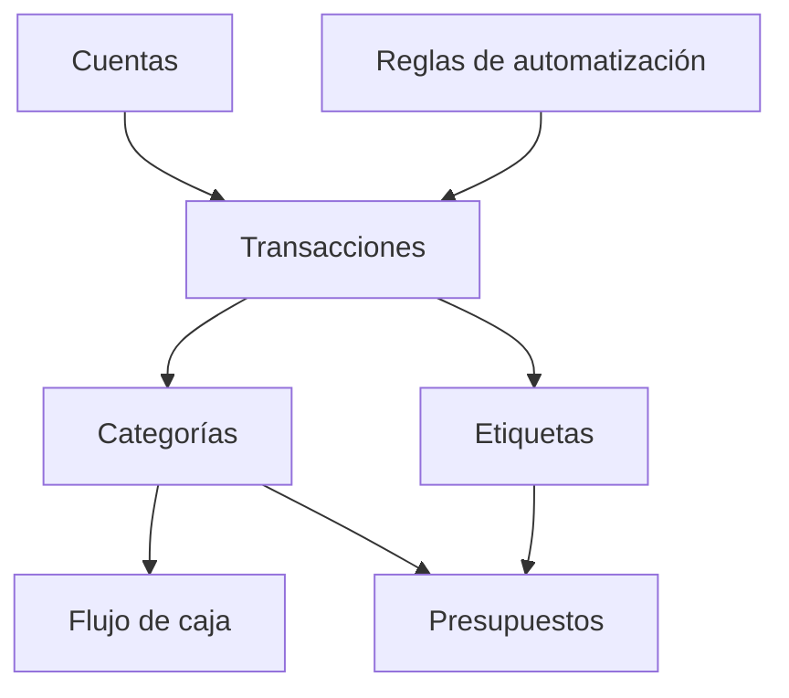
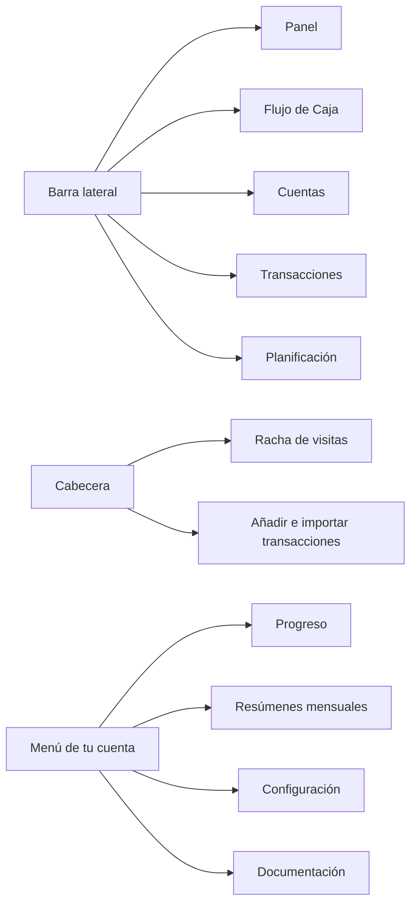

# Primeros pasos

Whisper Money te ayuda a entender dónde está tu dinero, dónde se fue y qué cambió con el tiempo.

{{TOC}}

## Inicio rápido

La primera vez que entras, una configuración guiada te acompaña por los primeros
pasos de esta lista. Consulta [Tu primera visita](#tu-primera-visita). Después,
o si te saltaste una parte, sigue este orden.

1. Crea tus cuentas.
2. Añade transacciones, impórtalas desde un archivo del banco o conecta tu banco.
3. Revisa las transacciones sin categoría.
4. Crea reglas de automatización para transacciones repetidas.
5. Revisa Flujo de caja para ver ingresos, gastos, lo que has ahorrado e invertido y lo que queda disponible.
6. Añade presupuestos cuando quieras límites de gasto.

¿Vienes de otra app de finanzas? [Importar desde otra app](/documentation/import-from-another-app)
trae sus cuentas, categorías y transacciones de una vez, mientras configuras tu
cuenta y durante los 15 días siguientes.

## Tu primera visita

Una cuenta nueva no se abre en un panel vacío, sino en una configuración guiada.
Lleva unos minutos, pregunta por ti antes de pedirte nada y termina en un panel
que ya tiene tu dinero dentro.

1. **Tres preguntas.** Qué quieres cambiar (llegar a fin de mes con más, entender
   a dónde va todo, salir de una deuda o ahorrar para algo concreto), cómo lo
   llevas hoy y cuánto crees que gastaste el mes pasado. Esa estimación es solo
   tuya y sirve únicamente para compararla luego con la cifra real.
2. **Tu moneda.** Encima de la estimación está la moneda que Whisper Money ha
   elegido según dónde estás. Si no es la tuya, púlsala y busca la correcta por
   código o por nombre. Pasa a ser la moneda de tu cuenta, que puedes cambiar
   después en **Configuración → Cuenta de usuario**.
3. **Tus cuentas.** Añade las que quieras, mezcladas como quieras: conecta un
   banco, conecta un bróker o un exchange con un token, importa un archivo de tu
   banco o añade una cuenta a mano, como una hipoteca o un plan de pensiones.
   Conectar un banco requiere un plan de pago, y se te pregunta en ese momento.
   Consulta [Cuentas](/documentation/accounts).
4. **La cifra real.** Lo que de verdad gastaste el mes pasado junto a tu
   estimación, y a quién pagaste más.
5. **Tus comercios, ordenados.** En un plan de pago con la IA activada, Whisper
   Money lee los comercios que se repiten y te propone
   [reglas de automatización](/documentation/automation-rules) para ellos. Al
   salir de este paso, la IA categoriza en segundo plano lo que las reglas no
   cubrieron, mientras terminas los pasos siguientes.
6. **Enséñanos tus costumbres.** Categoriza tú unas cuantas transacciones. Te lo
   puedes saltar.
7. **Tu primer objetivo.** Opcional. Elige cuánto del mes quieres guardar, y
   Whisper Money crea para el resto un [presupuesto](/documentation/budgets)
   mensual para todo lo demás llamado **Gasto mensual**, con un aviso antes de
   que te pases si lo quieres.
8. **Abrir mi panel.**

Si cierras la pestaña a medias, la configuración sigue donde la dejaste la
próxima vez que entres.

## Cómo encajan las piezas

## Qué hay en cada sitio

La barra lateral, que en el móvil es una barra en la parte de abajo, reúne las
cinco pantallas principales:

- **Panel**: tu patrimonio neto a lo largo del tiempo, los saldos de tus
  cuentas, el flujo de caja del mes y tus categorías y etiquetas principales.
- **[Flujo de Caja](/documentation/cashflow)**: ingresos, gastos y lo que
  apartas, por mes, trimestre o año.
- **[Cuentas](/documentation/accounts)**: todas tus cuentas con su saldo, y las
  transacciones de cada una.
- **[Transacciones](/documentation/transactions)**: la lista completa, con
  filtros, búsqueda y acciones en bloque.
- **Planificación**: tus [presupuestos](/documentation/budgets) y tus
  [objetivos de ahorro](/documentation/savings-goals) en una sola lista.

La cabecera de cada pantalla tiene tu
[racha de visitas](/documentation/achievements#tu-racha-de-visitas-en-la-cabecera),
un botón para [añadir una transacción](/documentation/transactions/create) si
las añades a mano, e **Importar transacciones** para
[traer un archivo](/documentation/transactions/import).

El menú de tu cuenta, abajo en la barra lateral (arriba a la derecha en el
móvil), lleva a:

- **Progreso**: tus [logros](/documentation/achievements).
- **Resúmenes mensuales**: todos los
  [resúmenes mensuales](/documentation/monthly-summary) que te hemos enviado.
- **Activar modo privado**: oculta los importes en pantalla.
- **Configuración**: cuentas bancarias y conexiones,
  [reglas de automatización](/documentation/automation-rules),
  [categorías](/documentation/categories), [etiquetas](/documentation/labels),
  el [Conector de IA](/documentation/ai-connector), tu perfil, notificaciones,
  plan y apariencia, e
  [Importar desde otra app](/documentation/import-from-another-app).
- **Documentación**: estas páginas.

La campana junto al menú de tu cuenta reúne las notificaciones: un resumen
mensual nuevo, una medalla o el cierre de un mes en un objetivo de ahorro
mensual.

## Conceptos principales

### Cuentas

Las cuentas son donde vive el dinero.

Ejemplos:

- Cuenta corriente
- Tarjeta de crédito
- Cuenta de ahorro
- Préstamo
- Inmueble

### Transacciones

Las transacciones son movimientos de dinero.

Ejemplos:

- Pago de salario
- Compra en supermercado
- Pago de tarjeta
- Transferencia bancaria

### Categorías

Las categorías explican qué significa una transacción.

Ejemplos:

- Supermercado
- Salario
- Alquiler
- Transferencia

### Reglas de automatización

Las reglas ahorran tiempo aplicando categorías y etiquetas por ti.

Ejemplo:

- Si la descripción contiene "Netflix", usar categoría "Suscripciones".

## Rutina semanal recomendada

Una rutina simple es suficiente para la mayoría de personas.

1. Importa o sincroniza nuevas transacciones.
2. Categoriza lo que esté sin categoría y revisa lo que se ha categorizado por ti.
3. Corrige transferencias entre tus propias cuentas.
4. Revisa el Flujo de caja del mes, el trimestre o el año.
5. Revisa presupuestos si los usas.

## Qué hacer si los informes parecen incorrectos

Empieza por lo básico.

- Comprueba que existen las cuentas correctas.
- Busca transacciones sin categoría.
- Asegúrate de que las transferencias no cuentan como ingreso o gasto.
- Revisa que las fechas sean correctas.
- Comprueba si una transacción pertenece a una cuenta en otra moneda.

## Preguntas frecuentes

### ¿Necesito presupuestos para usar Whisper Money?

No. Puedes empezar con cuentas, transacciones y categorías. Añade presupuestos después si quieres límites.

### ¿Debería categorizar todas las transacciones?

Sí, si quieres informes precisos. Las reglas de automatización lo hacen mucho más rápido.

### ¿Qué debería configurar primero?

Empieza por las cuentas. Después añade transacciones. Las categorías y los informes dependen de esas dos cosas.

### ¿Tengo que conectar mi banco?

No. Conectar el banco es una forma de traer transacciones, y requiere un plan de
pago. Añadirlas a mano o importar un archivo de tu banco funciona igual para todo
lo que viene después.
