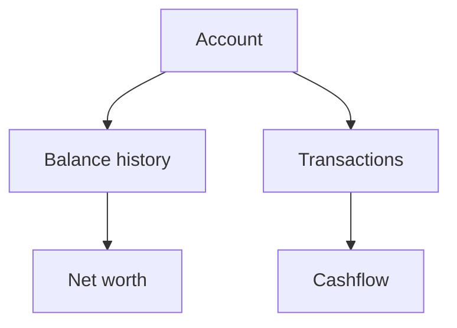

# Accounts

Accounts are the foundation of Whisper Money. They hold balances, transactions, and account history.

{{TOC}}

## Quick start

1. Create one account for each place where you keep or owe money.
2. Pick the account type that best matches the real account.
3. Add balances for accounts that are balance-only. A credit card takes its
   credit limit instead.
4. Import transactions for accounts that have day-to-day activity.
5. Review the Accounts page to see balances and net worth movement.

Moving from another app? [Import from another app](/documentation/import-from-another-app)
creates your accounts from its export, with their bank, type, currency and daily
balances.

## Account map

## Account types

### Checking

Use this for everyday bank accounts.

Good for:

- Salary deposits
- Card payments
- Bill payments
- Daily spending

### Savings

Use this for cash you keep aside.

Good for:

- Emergency funds
- Short-term goals
- Money you do not spend daily

### Credit card

Use this for credit cards.

A credit card has no balance. It has a credit limit, what you have used of it,
and an estimate of the next statement it will be charged. Credit cards are left
out of net worth entirely.

[Credit cards](/documentation/accounts/credit-cards) explains how it all works.

### Investment

Use this for broker or investment accounts.

These are usually balance-only accounts. You track value over time instead of daily transactions.

Record what you put in, and the account shows what it has gained. Savings and
retirement accounts can do the same.

### Retirement

Use this for pension or retirement accounts.

Like investments, these usually focus on balance history and long-term growth.

### Loan

Use this for money you owe.

Examples:

- Mortgage
- Personal loan
- Student loan

Add the loan details to follow its amortization: the annual interest rate
(from 0% to 100%), the term in months and the original amount go together, with
an optional start date.

When loans are included in net worth, they are the only account type that
reduces it: the amount owed is subtracted from your assets.

### Real estate

Use this for property value.

You can track market value and link a loan account when the property has a mortgage.

### Others

Use this when none of the other types fit.

Keep the name clear so you remember what the account represents.

## Transactional and balance-only accounts

Some accounts are best tracked with transactions. Others are best tracked with balances.

Use transactions for:

- Checking accounts
- Credit cards
- Savings accounts with regular movements

Use balances for:

- Investment accounts
- Retirement accounts
- Real estate
- Loans

## Balances, market values, and owed amounts

Whisper Money uses different words depending on the account type.

- Normal accounts use **balance**.
- Loan accounts use **owed amount**.
- Real estate accounts use **market value**.
- Credit cards have no balance at all: they use **credit limit** and **used**.

This keeps the language closer to what the number means.

## Invested amount and gain

Investment, retirement and savings accounts can record an **invested amount**
next to the balance: what you put in, not what it is worth now. Enter it when you
create the account, or with each balance when you update it. If you only know
what you put in, the account opens with a balance equal to it.

Once an invested amount is recorded, the account page shows three cards:

- **Current Value**, the latest balance.
- **Invested**, what you put in.
- **Gain**, the difference, and what it is as a percent of what you invested.
  Below what you invested, it reads as a loss.

The invested amount is always in the account's own currency, like its balance.

## Net worth

Net worth adds up your accounts' balances. Not every account type counts the
same way:

- Checking, savings, investment, retirement and other accounts add to it.
- Credit cards never count: what you owe on them is neither added nor
  subtracted.
- Loans subtract what is owed, and real estate adds its market value, but only
  when you include them.

Use the settings button on the net worth chart to switch **Include loans** and
**Include real estate** on or off. The choice applies to your net worth
everywhere, not just the chart: the dashboard totals, your achievements and the
monthly summary email follow it too. Both start off for new users, so your first
chart shows money you can use rather than a mortgage or a flat. Users who were
already here keep the setting they had.

## Connected and manual accounts

You can track accounts manually or connect supported providers.

Manual accounts are good when:

- Your bank is not supported.
- You want full control.
- You only need occasional updates.

Connected accounts are good when:

- You want automatic transaction updates.
- You want less manual work.
- Your bank connection is available and healthy.

Only checking, savings, credit card, and other accounts can receive synced
transactions. Investment, retirement, real estate, and loan accounts are tracked
by value, so a connection updates their balance rather than filling a ledger.

Connecting a bank is part of the paid plan. Manual accounts, imports, and
everything built on top of them work without one.

The [integrations page](/integrations) lists every bank and app that can be
connected today.

## Archiving an account

Archive an account you no longer use instead of deleting it.

An archived account:

- Disappears from the accounts page and from every picker for new data.
- Keeps its transactions and its balance history, so past months keep the
  figures they already had.
- Can be brought back at any time from the Bank accounts settings.

Archiving is not the same as hiding an account from the dashboard. Hiding only
removes it from that one view; the account stays selectable everywhere else.

## Shared accounts

An account can record the share of it that is yours. Use it for accounts you
genuinely co-own, such as a shared household account or a property owned with
someone else.

Open **Edit account** and fill in **My share of this account (%)**. The share
goes from 1 to 100, and 100 means the whole account is yours. Leaving the field
empty keeps the share the account already has.

From then on, income and expenses only count towards your own figures by that
percentage. On an account held 50/50, a shared grocery bill counts as half of
what the bank charged in:

- Cashflow
- Budgets
- Label spending

The account itself is left alone. It keeps showing the real balance and the real
amount of every transaction, because that is what actually moved. Inside a
budget, entries coming from an account with a share below 100% are marked, so you
can tell which ones only count in part.

The balance stays whole by default, so all of it counts towards net worth. When
the share is below 100%, a checkbox appears under the field: **Apply it to the
balance too, so only my share counts towards net worth**. Tick it for something
like a flat you own half of, where only half the value is really yours.

Changing the share later also rewrites what the account has already spent in
your budgets, past periods included. Budgets store what each transaction
contributed at the moment it was assigned, so they are recalculated for the new
share. Cashflow and net worth are worked out as you read them, so they pick up
the new share on their own.

## FAQ

### Why is my loan reducing net worth?

A loan is money owed. When loans are included, Whisper Money subtracts it from
assets when calculating net worth. Switch **Include loans** off in the net worth
chart settings to leave it out.

### Why don't my loan or my flat show up in net worth?

Loans and real estate start off for new users. Switch on **Include loans** or
**Include real estate** in the net worth chart settings.

### Why is my credit card not reducing net worth?

A credit card is a spending account, not wealth. Whisper Money tracks how much
of its limit you have used on the card itself and leaves it out of the net worth
total, so paying the card off does not move that number.

### Why does real estate use market value?

The important number for property is its estimated value today. That value can change over time.

### Should I create one account or combine several?

Create separate accounts when the money is stored separately in real life. Reports are clearer that way.

### Why did my past budgets change after I edited the share of an account?

Budgets record what each transaction contributed at the moment it was assigned,
so changing the share rewrites that contribution in every period, closed ones
included. It keeps a 50/50 account looking the same in January as it does
today.
