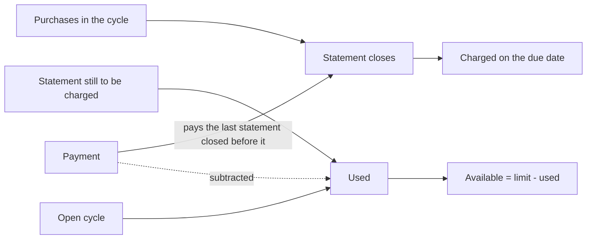

# Credit cards

A credit card has no balance in Whisper Money. It has a credit limit, what you have used of it, and a statement that gets charged on a set day. The card's page shows all three, worked out from the transactions on the card.

{{TOC}}

## Quick start

1. Create an account and pick **Credit Card** as its type.
2. Enter its **Credit limit**: the most your bank lets you spend on it.
3. Import or add the card's transactions.
4. On the card's page, click **Set statement dates** and enter one closing date and the day that statement is charged.
5. Read the **Credit limit** panel and **Next card payment** on the card's page.

## A limit instead of a balance

A credit card is a spending account, so there is no balance to ask for, update or chart. When you create one, the form asks for the credit limit instead, and the limit is optional: you can add it later with **Set credit limit** on the card's page.

On the card's page, the **Credit limit** panel takes the place of the balance chart. It names the period it covers and shows:

- **Used**, **Available** and **Limit**, where available is the limit minus what is used.
- A bar with the share of the limit in use. Past the limit, an **Over limit** badge appears and the bar and **Available** turn red.
- A chart of how the credit used builds up day by day, with the limit as a dashed line.

Without a limit, the panel is called **Credit used** and shows what is used and a **Set credit limit** button.

The accounts list and the dashboard show the same thing on the card's tile: the amount in use, "In use of" the limit with a small bar, and a sparkline of the period. Without a limit it just reads "In use". Usage stays in the card's own currency.

## What counts as used

With statement dates, **Used** adds up the purchases that have not been charged yet: the statement still waiting for its charge, plus the open cycle. Payments made on those statements are subtracted from the day they are booked. A payment on an older statement is not, since it pays purchases that are no longer counted. Used never goes below zero.

Without statement dates, **Used** adds up this calendar month's purchases, and payments are not subtracted, because nothing says which purchases they pay.

Either way:

- Refunds lower what is used.
- Payments to the card are recognised as transactions in a transfer category, or as money coming in with no category. They never count as spending.
- Transactions dated after today don't count yet.
- The full amount counts, even on an account where only part is yours: your bank charges all of it.
- Transactions in another currency are converted to the card's currency.

## Statement dates

A statement collects the purchases of one cycle. It closes on a day, and the bank charges it on the payment due date.

Open the card's page and click **Set statement dates**, or **Edit card details** once something is set. The dialog has:

- **Credit limit**.
- **Statement frequency**: **Monthly** for a statement that closes on the same day every month, **Weekly** for one that closes on the same weekday every week.
- **Statement closing date**: any closing date of the card, past or upcoming.
- **Payment due date**: the day that statement is charged. It can be the same day it closes, or up to 45 days later on a monthly card and 7 on a weekly one.

Every field is optional, but the two dates go together. Later statements are projected from the dates you enter. A closing on the 31st lands on the last day of shorter months. If your bank moves the dates, enter the new ones and they become the new starting point. **Remove dates** clears the dates and keeps the limit.

## Next card payment

With statement dates set, the **Next card payment** card estimates how much will be charged next and when.

- Between a statement's closing and its charge, the next payment is that closed statement: **Estimated amount**. It can still change if you add or edit transactions from that period.
- With a long gap between closing and charge, two statements can be waiting at once. The older one, which is charged first, is the one shown.
- The rest of the time, it is the cycle still open: **Estimated amount so far**, which grows with every purchase until it closes.
- When a statement is charged the same day it closes, the cycle stays open until the end of that day, since purchases made that day still land on it.

Under the amount, "Expected on" gives the day it will be charged.

The amount is the cycle's purchases less its refunds. Payments to the card are left out. When refunds outweigh the purchases, the card reads **Nothing to pay** and shows the credit in your favour. If something has already been paid on that statement, **Already paid** shows how much.

Below it, **Current cycle** shows what the open cycle adds up to so far, when it closes and when it is charged, with the frequency beside it.

It is an estimate built from the transactions recorded on the card. Your bank statement is the final word.

## Payments and the statement they pay

A payment usually settles a statement that has already closed. Whisper Money attributes each payment to the last statement that closed before the day it is booked. On a card that is charged the same day it closes, a payment on that day pays the statement closing that day.

You see the attribution in three places on the card's page:

- **Credit limit**: a dot on the chart marks each payment day. Its tooltip names the amount and the statement it pays.
- **Next card payment**: a line for the previous statement shows its **Purchases**, what was **Paid** and what is **Pending**. When no purchases from that period are recorded, it says so instead of reading the payment as an overpayment. When more was paid than the recorded purchases, it notes that some purchases may be missing.
- **Transactions**: under each payment, a line reads "Statement payment" with the statement's dates.

Only payments booked within the period the panel covers carry the attribution.

## Credit cards and balances

Nothing writes a balance on a credit card:

- Adding, editing or deleting a transaction on a card doesn't offer to update a balance.
- [Importing transactions](/documentation/transactions/import) into a card hides the balance column and the balance options, and writes no balances.
- **Update balance**, **Import balances** and **See balances** are not on a card's page.

Balances a card already had are kept, just not shown.

## Credit cards and net worth

Credit cards are left out of net worth: what you owe on them is neither added nor subtracted. Paying the card off doesn't move your net worth either.

## Connected cards

A card connected to your bank works the same way. Its transactions sync like any other account's, and the limit, usage and statement estimate come from them. Enter the limit and the statement dates yourself: they don't come from the bank.

## FAQ

### Why doesn't my credit card have a balance?

What matters on a card is how much of the limit you have used and what will be charged next, so that is what Whisper Money shows.

### Why didn't my payment lower the credit used?

Either the card has no statement dates, so nothing says which purchases the payment covers, or the payment paid an older statement whose purchases are no longer counted. Set the statement dates and check the payment's "Statement payment" line.

### Why isn't my payment recognised as a payment?

Payments are recognised by their category: a transfer category, or no category at all. A payment filed under a spending category counts as a refund instead.

### My bank charges the statement the same day it closes. Can I set that?

Yes. Enter the same date as the closing date and the payment due date.

### The estimate doesn't match my bank. Why?

The estimate only knows the transactions recorded on the card. A missing purchase, a transaction dated differently from the bank, or a statement date your bank moved will make it differ. Your bank statement is the final word.
