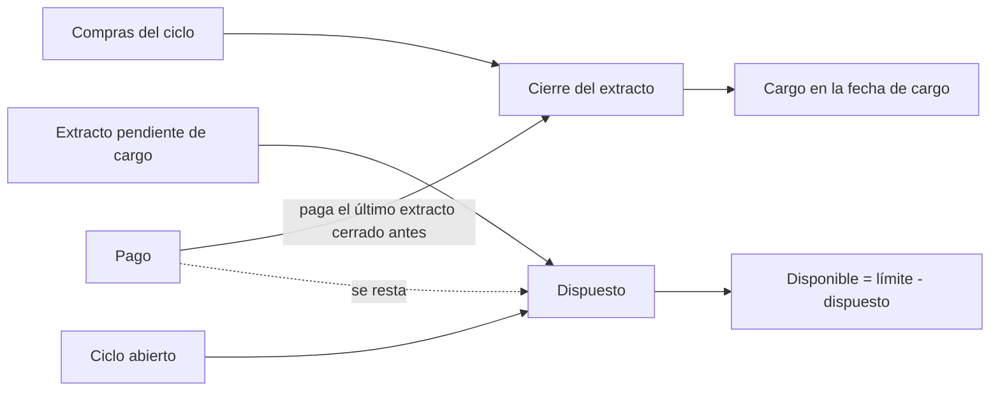

# Tarjetas de crédito

En Whisper Money una tarjeta de crédito no tiene saldo. Tiene un límite de crédito, lo que has dispuesto de él y un extracto que se carga un día concreto. La página de la tarjeta muestra las tres cosas, calculadas a partir de las transacciones de la tarjeta.

{{TOC}}

## Inicio rápido

1. Crea una cuenta y elige **Tarjeta de Crédito** como tipo.
2. Escribe su **Límite de crédito**: lo máximo que tu banco te deja gastar con ella.
3. Importa o añade las transacciones de la tarjeta.
4. En la página de la tarjeta, pulsa **Configurar fechas del extracto** y escribe una fecha de cierre y el día en que se carga ese extracto.
5. Consulta el panel **Límite de crédito** y **Próximo pago de la tarjeta** en la página de la tarjeta.

## Un límite en lugar de un saldo

Una tarjeta de crédito es una cuenta para gastar, así que no hay saldo que pedir, actualizar ni dibujar. Al crearla, el formulario te pide el límite de crédito, y es opcional: puedes añadirlo después con **Añadir límite de crédito** en la página de la tarjeta.

En la página de la tarjeta, el panel **Límite de crédito** ocupa el sitio del gráfico de saldo. Indica el periodo que cubre y muestra:

- **Dispuesto**, **Disponible** y **Límite**, donde el disponible es el límite menos lo dispuesto.
- Una barra con la parte del límite en uso. Si te pasas del límite, aparece la etiqueta **Límite superado** y la barra y el **Disponible** se ponen en rojo.
- Un gráfico de cómo crece el crédito dispuesto día a día, con el límite como línea discontinua.

Sin límite, el panel se llama **Crédito dispuesto** y muestra lo dispuesto y un botón **Añadir límite de crédito**.

La lista de cuentas y el panel principal muestran lo mismo en la ficha de la tarjeta: el importe en uso, «Dispuesto de» el límite con una barra pequeña y una línea con la evolución del periodo. Sin límite, solo pone «Dispuesto». El uso se muestra siempre en la moneda de la tarjeta.

## Qué cuenta como dispuesto

Con fechas de extracto, **Dispuesto** suma las compras que aún no se han cargado: el extracto que espera su cargo más el ciclo abierto. Los pagos de esos extractos se restan desde el día en que se registran. Un pago de un extracto anterior no, porque paga compras que ya no se cuentan. El dispuesto nunca baja de cero.

Sin fechas de extracto, **Dispuesto** suma las compras de este mes natural, y los pagos no se restan, porque nada dice qué compras pagan.

En los dos casos:

- Las devoluciones reducen lo dispuesto.
- Los pagos a la tarjeta se reconocen como transacciones en una categoría de transferencia o como dinero que entra sin categoría. Nunca cuentan como gasto.
- Las transacciones con fecha posterior a hoy todavía no cuentan.
- Se cuenta el importe completo, aunque la cuenta solo sea tuya en parte: el banco te cobra todo.
- Las transacciones en otra moneda se convierten a la moneda de la tarjeta.

## Fechas del extracto

Un extracto reúne las compras de un ciclo. Cierra un día y el banco lo carga en la fecha de cargo.

Abre la página de la tarjeta y pulsa **Configurar fechas del extracto**, o **Editar datos de la tarjeta** si ya tiene algo guardado. El diálogo tiene:

- **Límite de crédito**.
- **Frecuencia del extracto**: **Mensual** para un extracto que cierra el mismo día cada mes, **Semanal** para uno que cierra el mismo día de la semana cada semana.
- **Fecha de cierre del extracto**: cualquier fecha de cierre de la tarjeta, pasada o próxima.
- **Fecha de cargo**: el día en que se cobra ese extracto. Puede ser el mismo día del cierre o hasta 45 días después en una tarjeta mensual, y hasta 7 en una semanal.

Todos los campos son opcionales, pero las dos fechas van juntas. Los extractos siguientes se calculan a partir de las fechas que escribas. Un cierre el día 31 cae en el último día de los meses más cortos. Si tu banco cambia las fechas, escribe las nuevas y pasan a ser el nuevo punto de partida. **Quitar fechas** borra las fechas y mantiene el límite.

## Próximo pago de la tarjeta

Con las fechas del extracto puestas, la tarjeta **Próximo pago de la tarjeta** estima cuánto se cobrará la próxima vez y cuándo.

- Entre el cierre de un extracto y su cargo, el próximo pago es ese extracto cerrado: **Importe estimado**. Todavía puede cambiar si añades o editas transacciones de ese periodo.
- Si pasa mucho tiempo entre el cierre y el cargo, puede haber dos extractos esperando a la vez. Se muestra el más antiguo, que es el que se carga antes.
- El resto del tiempo es el ciclo que sigue abierto: **Importe estimado hasta ahora**, que crece con cada compra hasta que cierra.
- Cuando un extracto se carga el mismo día en que cierra, el ciclo sigue abierto hasta que acaba ese día, porque las compras de ese día todavía entran en él.

Debajo del importe, «Previsto para el» indica el día en que se cargará.

El importe son las compras del ciclo menos sus devoluciones. Los pagos a la tarjeta no se cuentan. Cuando las devoluciones superan a las compras, pone **Nada que pagar** y muestra el saldo a tu favor. Si ya se ha pagado algo de ese extracto, **Ya pagado** dice cuánto.

Debajo, **Ciclo actual** muestra lo que suma el ciclo abierto hasta ahora, cuándo cierra y cuándo se carga, con la frecuencia al lado.

Es una estimación hecha con las transacciones registradas en la tarjeta. Lo que manda es el extracto de tu banco.

## Los pagos y el extracto que pagan

Un pago suele saldar un extracto que ya ha cerrado. Whisper Money asigna cada pago al último extracto que cerró antes del día en que se registra. En una tarjeta que se carga el mismo día en que cierra, un pago de ese día paga el extracto que cierra ese día.

La asignación se ve en tres sitios de la página de la tarjeta:

- **Límite de crédito**: un punto en el gráfico marca cada día de pago. Su descripción emergente dice el importe y el extracto que paga.
- **Próximo pago de la tarjeta**: una línea para el extracto anterior muestra sus **Compras**, lo **Pagado** y lo **Pendiente**. Si no hay compras registradas de ese periodo, lo dice en lugar de leer el pago como un pago de más. Si se pagó más de lo que suman las compras registradas, avisa de que puede faltar alguna compra.
- **Transacciones**: bajo cada pago, una línea pone «Pago extracto» con las fechas del extracto.

Solo llevan esta asignación los pagos registrados dentro del periodo que cubre el panel.

## Tarjetas de crédito y saldos

Nada escribe un saldo en una tarjeta de crédito:

- Al añadir, editar o borrar una transacción de una tarjeta no se ofrece actualizar el saldo.
- Al [importar transacciones](/documentation/transactions/import) a una tarjeta, la columna de saldo y las opciones de saldo desaparecen, y no se guarda ningún saldo.
- **Actualizar balance**, **Importar balances** y **Ver balances** no están en la página de una tarjeta.

Los saldos que una tarjeta tuviera guardados de antes se conservan, solo que no se muestran.

## Tarjetas de crédito y patrimonio neto

Las tarjetas de crédito se quedan fuera del patrimonio neto: lo que debes en ellas ni se suma ni se resta. Pagar la tarjeta tampoco mueve tu patrimonio neto.

## Tarjetas conectadas

Una tarjeta conectada a tu banco funciona igual. Sus transacciones se sincronizan como las de cualquier otra cuenta, y el límite, el uso y la estimación del extracto salen de ellas. El límite y las fechas del extracto los pones tú: no vienen del banco.

## Preguntas frecuentes

### ¿Por qué mi tarjeta de crédito no tiene saldo?

Lo que importa en una tarjeta es cuánto has dispuesto del límite y qué se va a cobrar la próxima vez, así que eso es lo que muestra Whisper Money.

### ¿Por qué mi pago no ha reducido el crédito dispuesto?

O la tarjeta no tiene fechas de extracto, y entonces nada dice qué compras cubre el pago, o el pago saldó un extracto anterior cuyas compras ya no se cuentan. Pon las fechas del extracto y mira la línea «Pago extracto» del pago.

### ¿Por qué mi pago no se reconoce como pago?

Los pagos se reconocen por su categoría: una categoría de transferencia o ninguna categoría. Un pago archivado en una categoría de gasto cuenta como una devolución.

### Mi banco carga el extracto el mismo día en que cierra. ¿Puedo configurarlo?

Sí. Pon la misma fecha en el cierre y en el cargo.

### La estimación no coincide con mi banco. ¿Por qué?

La estimación solo conoce las transacciones registradas en la tarjeta. Una compra que falta, una transacción con una fecha distinta a la del banco o una fecha de extracto que tu banco ha cambiado hacen que no cuadre. Lo que manda es el extracto de tu banco.
