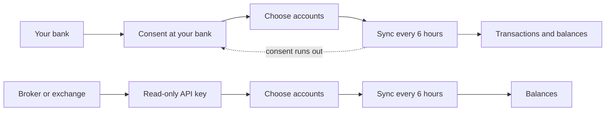

# Bank connections

A connection keeps an account up to date on its own. Banks connect through open banking: you approve access on your bank's own site, and Whisper Money brings in transactions and balances. Brokers and crypto exchanges connect with a read-only API key you create in their app, and Whisper Money brings in the value of what you hold.

{{TOC}}

## Quick start

1. Go to **Settings → Connections** and click **Connect Bank**. You can also click
   **Create Account** on the accounts page and choose **Connected**.
2. Pick your country, then your bank, broker or exchange.
3. For a bank, click **Connect** and approve access on your bank's site. For a
   broker or exchange, paste its API key and click **Connect**.
4. Decide what to do with each account it found: create a new one, link it to one
   you already have, or skip it. Click **Save & Sync**.
5. Wait for the first sync to finish. From then on it runs by itself.

Connecting is part of the paid plan. Manual accounts and imports work without it.

## How a connection works

There are two kinds of connection, and they bring in different things:

| | Banks | Brokers and exchanges |
| --- | --- | --- |
| How you connect | You approve access on your bank's site | You paste an API key from their app |
| What it brings in | Transactions and balances | Balances (the value of what you hold) |
| How long it lasts | Until the bank's consent runs out | Until you revoke or change the key |

## Connecting a bank

Banks are connected through [Enable Banking](https://enablebanking.com), an open banking provider that talks to European banks on Whisper Money's behalf.

### Pick your bank

Choose the country where your bank is, then find it in the list. The search box filters as you type. The list also has the brokers and exchanges available in that country, so everything you can connect is in one place.

If your bank is not there, click **Can't find your bank? Request or vote for it**. The [integrations page](/integrations) lists every bank and app that can be connected today.

### Approve access at your bank

Click **Connect** and you are taken to your bank's own site or app. You sign in there, never in Whisper Money, and approve read access to your accounts' balances and transactions. Whisper Money asks for 90 days of access; some banks grant less. When you are done, your bank sends you back to Whisper Money.

If you already have a working connection to the same bank, a warning appears before you continue. Approving with the same bank login replaces the earlier session, so that connection stops working. Tick **I will use a different bank login** only if you are adding a different set of accounts, such as a partner's.

### Choose what to sync

Your bank shares every account your login can see. On **Map Bank Accounts** you decide, one by one:

- **Create new account**: a new account in Whisper Money, named after the one at your bank.
- **Link to existing account**: feed an account you already track by hand. Its transactions and balance history stay as they are, and the connection adds to them.
- **Skip**: leave it out.

Click **Save & Sync** to start the first sync. During sign-up, if your bank shares a single account, it is created for you without asking.

New accounts start as checking accounts. If one is really a savings account or a credit card, change its type afterwards. Only checking, savings, credit card and other accounts show a list of transactions; investment, retirement, real estate and loan accounts are followed by their balance.

An account your bank sends without an identifier cannot be synced. It is listed under the accounts and left out.

### The first sync

The first sync asks your bank for up to a year of transactions. Many banks give less, and Whisper Money takes whatever they allow. It also reads today's balance and, for accounts the connection created, works out the balance of each past day from those transactions, so the balance chart has history from day one.

## Connecting a broker or an exchange

These providers have no open banking, so they connect with an API key you create in their own app:

| Provider | What you paste |
| --- | --- |
| Binance | API Key and API Secret |
| Bitpanda | API Key |
| Coinbase | App Key ID and Secret of a CDP API key |
| Indexa Capital (Spain only) | API Token |
| Interactive Brokers | Flex Web Service Token and Flex Query ID |
| Kraken | API Key and Private Key |
| Wise | Personal API Token |

Pick the provider in the same list as the banks. The form shows its fields and tells you where to create the key, with a link to that page.

Always create a **read-only** key. Whisper Money only reads what you hold, so it never needs permission to trade, withdraw or move money. Some providers need specific settings:

- **Kraken**: create the key under **Account → Connections & APIs**. Enable only "Query Funds", "Query Open Orders & Trades", "Query Closed Orders & Trades" and "Query Ledger Entries", and leave everything else off. Whisper Money checks that the key can query funds and ledger entries, and tells you which one is missing.
- **Coinbase**: create a view-only CDP API key (Ed25519 recommended) and tick "Opt-out of IP allowlisting", so the key works from Whisper Money's servers.
- **Interactive Brokers**: in Client Portal, create an Activity Flex Query that includes the "Net Asset Value (NAV)" and "Open Positions" sections, then generate a Flex Web Service token.

When you click **Connect**, the key is checked right away. If it does not work, you see why and nothing is saved. If it works, you choose what to sync on the same **Map Bank Accounts** screen as a bank. Accounts from a broker or an exchange start as investment accounts, and Wise accounts as checking accounts.

### Balances, not transactions

A broker or an exchange reports what you hold, not every trade, so these connections write a balance each day rather than a list of transactions. Most of them also record your **invested amount**, what you put in, so the account can show your gain. See [Invested amount and gain](/documentation/accounts#invested-amount-and-gain).

How much history arrives on the first sync depends on the provider. Some send past values, others start the chart on the day you connect. You can [import older balances](/documentation/accounts/import-balances) to fill in the rest.

Wise is the exception: it works like a current account, so it brings in transactions as well as balances, with up to a year of history on the first sync.

## Keeping it in sync

Every connection syncs on its own every six hours. You do not need to keep the app open.

On **Settings → Connections**, each connection shows its status, when it last synced and, for a bank, when its consent expires. The menu next to it has **Sync Now** if you want fresh data straight away.

Banks limit how many times a day an app can read your data. When that limit is reached, **Sync Now** disappears from the menu and the connection tries again on its own once the bank allows another read. If it happens on the very first sync, the connection shows **Waiting for the bank** until then.

### What the sync brings in

- **New transactions only.** Each sync asks for what is new, plus the last few days again, because banks sometimes add transactions with an earlier date.
- **Booked transactions only.** A pending card payment is brought in once your bank books it.
- **No duplicates.** Each transaction gets a fingerprint from its details. If a transaction is already in the account, it is skipped, even when the bank sends it again under a different reference.
- **Deleted stays deleted.** A transaction you delete is not brought back by the next sync.
- **Today's balance.** Each sync writes the balance for today.

### Editing the balance of a connected account

A connected account can still have its balances updated, imported and edited. Every date before today is yours: a sync never touches it. Today's balance, and a future date once that day arrives, come from the connection and are overwritten on every sync. See [Edit balances](/documentation/accounts/edit-balances).

### Managing which accounts sync

For a bank connection, **Manage Accounts** in the connection's menu shows which accounts are syncing. From there you can:

- **Add accounts** that your bank shares but you skipped at first.
- **Move syncing to…** another account you already have.
- **Stop syncing** one account. It becomes a manual account and keeps all its transactions and balances.

## When a connection needs you

### Consent expiry and reconnecting

A bank's consent lasts a limited time, up to 90 days. A week before it ends, the connection shows **Expiring soon** and you get an email. Click **Reconnect**, approve access at your bank again, and syncing carries on without a gap.

If the consent runs out first, the connection shows as expired and you get an email. Click **Reconnect** next to it. Your accounts and their history stay as they were, and the next sync picks up the transactions you missed.

API keys do not expire on Whisper Money's side. They keep working until you revoke or change them at the provider.

### Errors

If a sync fails, the connection shows the error and a **Retry** button. If your bank rejected the session, you see **Reconnect** instead: approve access at your bank again. Temporary problems at the bank or provider are retried on their own. A connection that keeps failing stops syncing on schedule until you retry it or reconnect.

If an API key stops working, for example because you deleted it or it lost a permission, you get an email. Choose **Update Credentials** in the connection's menu and paste a new key. The connection keeps its accounts.

### Banks in beta

Some banks have a **Beta** badge, in the bank picker and on your connections. It marks the few banks whose connections fail or pause more often than the rest. They usually work, and you can reconnect or disconnect whenever you want.

The badge comes from a list Whisper Money keeps itself, based on how each bank actually behaves, not from the open banking provider. A new integration, such as Kraken, is also marked beta for a while after it launches.

## Disconnecting

Choose **Disconnect** in the connection's menu. For a bank, this also revokes Whisper Money's access. If the connection has accounts, you choose what happens to them:

- **Keep accounts**: they become manual accounts with all their transactions and balances.
- **Delete accounts**: the accounts, their transactions and their balances are deleted for good. You have to type "delete all" to confirm.

## Privacy and security

- **Your bank password never reaches Whisper Money.** You sign in on your bank's own site; Whisper Money only receives the access you approved there.
- **Access is read-only.** A bank consent covers balances and transactions. Nothing can move money.
- **API keys are encrypted** before they are stored, and they are never sent back to your browser. Even on the connection's settings, a key can only be replaced, not read.
- **You can revoke access at any time** by disconnecting, or by deleting the key at the provider.

## On a self-hosted install

Connecting banks needs Enable Banking credentials on the server. Without them, the app simply does not offer banks: the connect dialog becomes **Connect an account** and lists only the brokers and exchanges, which work with their own API keys. During sign-up, choosing another bank takes you to the form for a manual account.

An install with subscriptions turned off has no paid plan, so connecting is open to everyone on it.

## FAQ

### Why can't I find my bank?

It may not be supported yet, or it may be listed under a slightly different name. Check that you picked the right country. If it is still missing, click **Can't find your bank? Request or vote for it**.

### Why didn't my bank send a full year of history?

Each bank decides how far back it lets an app read. Whisper Money asks for a year and takes what the bank gives. You can [import](/documentation/transactions/import) older transactions from a file, and possible duplicates are flagged.

### Why is my investment account not showing transactions?

Investment, retirement, real estate and loan accounts are followed by their balance, so they have no list of transactions. Brokers and exchanges only report balances anyway.

### I connected the same bank twice and the first connection stopped working.

Banks keep one session per login. Approving again with the same login replaces the earlier session. Reconnect the first connection, and only use a second connection for a different bank login.

### What happens to my connections if my subscription ends?

At the end of the month, bank connections are closed and you get an email. Their accounts stay as manual accounts, with all their transactions and balances. Broker and exchange connections are not closed.

### Do I have to keep Whisper Money open for the sync to run?

No. Syncing runs on the server every six hours, whether you are using the app or not.
