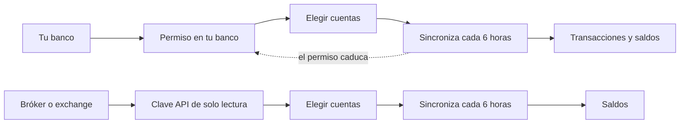

# Conexiones bancarias

Una conexión mantiene una cuenta al día por sí sola. Los bancos se conectan mediante open banking: das permiso en la web de tu propio banco y Whisper Money trae las transacciones y los saldos. Los brókers y los exchanges de criptomonedas se conectan con una clave API de solo lectura que creas en su aplicación, y Whisper Money trae el valor de lo que tienes.

{{TOC}}

## Inicio rápido

1. Ve a **Configuración → Conexiones** y haz clic en **Conectar Banco**. También
   puedes hacer clic en **Crear Cuenta** en la página de cuentas y elegir
   **Conectado**.
2. Elige tu país y después tu banco, bróker o exchange.
3. Si es un banco, haz clic en **Conectar** y da permiso en la web de tu banco. Si
   es un bróker o un exchange, pega su clave API y haz clic en **Conectar**.
4. Decide qué hacer con cada cuenta que encuentre: crear una nueva, vincularla a
   una que ya tienes o saltarla. Haz clic en **Guardar y Sincronizar**.
5. Espera a que termine la primera sincronización. A partir de ahí funciona sola.

Conectar forma parte del plan de pago. Las cuentas manuales y las importaciones
funcionan sin él.

## Cómo funciona una conexión

Hay dos tipos de conexión, y cada uno trae cosas distintas:

| | Bancos | Brókers y exchanges |
| --- | --- | --- |
| Cómo se conecta | Das permiso en la web de tu banco | Pegas una clave API de su aplicación |
| Qué trae | Transacciones y saldos | Saldos (el valor de lo que tienes) |
| Cuánto dura | Hasta que caduca el permiso del banco | Hasta que revocas o cambias la clave |

## Conectar un banco

Los bancos se conectan a través de [Enable Banking](https://enablebanking.com), un proveedor de open banking que habla con los bancos europeos en nombre de Whisper Money.

### Elige tu banco

Elige el país de tu banco y búscalo en la lista. El buscador filtra mientras escribes. La lista también incluye los brókers y exchanges disponibles en ese país, así que todo lo que puedes conectar está en el mismo sitio.

Si tu banco no aparece, haz clic en **¿No encuentras tu banco? Solicítalo o vótalo**. La [página de integraciones](/integraciones) lista todos los bancos y aplicaciones que se pueden conectar hoy.

### Da permiso en tu banco

Haz clic en **Conectar** y te llevará a la web o la app de tu banco. Inicias sesión allí, nunca en Whisper Money, y das acceso de lectura a los saldos y las transacciones de tus cuentas. Whisper Money pide 90 días de acceso; algunos bancos conceden menos. Al terminar, tu banco te devuelve a Whisper Money.

Si ya tienes una conexión activa con el mismo banco, aparece un aviso antes de continuar. Dar permiso con el mismo acceso del banco sustituye la sesión anterior, así que esa conexión deja de funcionar. Marca **Voy a usar un nuevo acceso del banco** solo si vas a añadir otras cuentas distintas, como las de tu pareja.

### Elige qué sincronizar

Tu banco comparte todas las cuentas que ve tu acceso. En **Mapear Cuentas Bancarias** decides, una a una:

- **Crear nueva cuenta**: una cuenta nueva en Whisper Money, con el nombre que tiene en tu banco.
- **Vincular a cuenta existente**: alimentar una cuenta que ya llevas a mano. Sus transacciones y su historial de saldos se quedan como están, y la conexión los completa.
- **Saltar**: dejarla fuera.

Haz clic en **Guardar y Sincronizar** para empezar la primera sincronización. Durante el registro, si tu banco comparte una sola cuenta, se crea sin preguntarte.

Las cuentas nuevas empiezan como cuentas corrientes. Si alguna es en realidad una cuenta de ahorro o una tarjeta de crédito, cambia su tipo después. Solo las cuentas corrientes, de ahorro, de tarjeta de crédito y de tipo «otros» muestran una lista de transacciones; las de inversión, jubilación, inmueble y préstamo se siguen por su saldo.

Una cuenta que tu banco envía sin identificador no se puede sincronizar. Aparece nombrada bajo las demás y se queda fuera.

### La primera sincronización

La primera sincronización pide a tu banco hasta un año de transacciones. Muchos bancos dan menos, y Whisper Money toma lo que permitan. También lee el saldo de hoy y, en las cuentas que ha creado la conexión, calcula el saldo de cada día anterior a partir de esas transacciones, así que el gráfico de saldo tiene historial desde el primer día.

## Conectar un bróker o un exchange

Estos proveedores no tienen open banking, así que se conectan con una clave API que creas en su propia aplicación:

| Proveedor | Qué pegas |
| --- | --- |
| Binance | Clave API y Secreto API |
| Bitpanda | Clave API |
| Coinbase | ID de la Clave API y Secreto de una clave API de CDP |
| Indexa Capital (solo España) | Token API |
| Interactive Brokers | Token del Flex Web Service y Query ID de Flex |
| Kraken | Clave API y Clave Privada |
| Wise | Token API personal |

Elige el proveedor en la misma lista que los bancos. El formulario muestra sus campos y te dice dónde crear la clave, con un enlace a esa página.

Crea siempre una clave de **solo lectura**. Whisper Money solo lee lo que tienes, así que nunca necesita permiso para operar, retirar ni mover dinero. Algunos proveedores necesitan ajustes concretos:

- **Kraken**: crea la clave en **Cuenta → Conexiones y APIs**. Activa solo "Consulta" (fondos), "Consultar órdenes y operaciones abiertas", "Consultar órdenes y operaciones cerradas" y "Consultar entradas en el libro mayor", y deja el resto desactivado. Whisper Money comprueba que la clave puede consultar los fondos y el libro mayor, y te dice qué permiso falta.
- **Coinbase**: crea una clave API de CDP de solo lectura (Ed25519 recomendado) y marca «Opt-out of IP allowlisting», para que la clave funcione desde los servidores de Whisper Money.
- **Interactive Brokers**: en el Client Portal, crea una Activity Flex Query que incluya las secciones "Net Asset Value (NAV)" y "Open Positions", y luego genera un token del Flex Web Service.

Al hacer clic en **Conectar**, la clave se comprueba en el momento. Si no funciona, ves el motivo y no se guarda nada. Si funciona, eliges qué sincronizar en la misma pantalla **Mapear Cuentas Bancarias** que con un banco. Las cuentas de un bróker o un exchange empiezan como cuentas de inversión, y las de Wise como cuentas corrientes.

### Saldos, no transacciones

Un bróker o un exchange informa de lo que tienes, no de cada operación, así que estas conexiones escriben un saldo cada día en lugar de una lista de transacciones. La mayoría también registra tu **cantidad invertida**, lo que has aportado, para que la cuenta pueda mostrar tu ganancia. Consulta [Cantidad invertida y ganancia](/documentation/accounts#cantidad-invertida-y-ganancia).

Cuánto historial llega en la primera sincronización depende del proveedor. Algunos envían valores pasados y otros empiezan el gráfico el día que conectas. Puedes [importar saldos antiguos](/documentation/accounts/import-balances) para completar el resto.

Wise es la excepción: funciona como una cuenta corriente, así que trae transacciones además de saldos, con hasta un año de historial en la primera sincronización.

## Mantenerla sincronizada

Cada conexión se sincroniza sola cada seis horas. No hace falta que tengas la aplicación abierta.

En **Configuración → Conexiones**, cada conexión muestra su estado, cuándo se sincronizó por última vez y, si es un banco, cuándo vence el permiso. El menú de al lado tiene **Sincronizar Ahora** si quieres datos frescos en ese momento.

Los bancos limitan cuántas veces al día una aplicación puede leer tus datos. Cuando se alcanza ese límite, la conexión muestra **Esperando al banco** y vuelve a intentarlo sola cuando el banco lo permite. Hasta entonces, **Sincronizar Ahora** no aparece.

### Qué trae la sincronización

- **Solo transacciones nuevas.** Cada sincronización pide lo nuevo y repasa los últimos días, porque a veces los bancos añaden transacciones con una fecha anterior.
- **Solo transacciones contabilizadas.** Un pago con tarjeta pendiente llega cuando tu banco lo contabiliza.
- **Sin duplicados.** Cada transacción recibe una huella a partir de sus datos. Si ya está en la cuenta, se salta, aunque el banco la vuelva a enviar con otra referencia.
- **Lo borrado sigue borrado.** Una transacción que eliminas no vuelve en la siguiente sincronización.
- **El saldo de hoy.** Cada sincronización escribe el saldo del día.

### Editar el saldo de una cuenta conectada

En una cuenta conectada también puedes actualizar, importar y editar saldos. Todas las fechas anteriores a hoy son tuyas: una sincronización nunca las toca. El saldo de hoy, y el de una fecha futura cuando llega ese día, vienen de la conexión y se sobrescriben en cada sincronización. Consulta [Editar saldos](/documentation/accounts/edit-balances).

### Elegir qué cuentas se sincronizan

En una conexión bancaria, **Gestionar cuentas** en el menú de la conexión muestra qué cuentas se están sincronizando. Desde ahí puedes:

- **Añadir cuentas** que tu banco comparte pero saltaste al principio.
- **Mover la sincronización a…** otra cuenta que ya tienes.
- **Dejar de sincronizar** una cuenta. Pasa a ser manual y conserva todas sus transacciones y saldos.

## Cuando una conexión te necesita

### El permiso caduca: reconectar

El permiso de un banco dura un tiempo limitado, hasta 90 días. Una semana antes de que termine, la conexión muestra **Caduca pronto** y recibes un email. Haz clic en **Reconectar**, vuelve a dar permiso en tu banco y la sincronización sigue sin huecos.

Si el permiso caduca antes, la conexión aparece como caducada y recibes un email. Haz clic en **Reconectar** junto a ella. Tus cuentas y su historial se quedan como estaban, y la siguiente sincronización recoge las transacciones que faltan.

Las claves API no caducan por parte de Whisper Money. Siguen funcionando hasta que las revocas o las cambias en el proveedor.

### Errores

Si una sincronización falla, la conexión muestra el error y un botón **Reintentar**. Los problemas temporales del banco o del proveedor se reintentan solos. Una conexión que sigue fallando deja de sincronizarse de forma programada hasta que la reintentas o la reconectas.

Si una clave API deja de funcionar, por ejemplo porque la borraste o perdió un permiso, recibes un email. Elige **Actualizar Credenciales** en el menú de la conexión y pega una clave nueva. La conexión conserva sus cuentas.

### Bancos en beta

Algunos bancos llevan la etiqueta **Beta**, en el selector de bancos y en tus conexiones. Marca los pocos bancos cuyas conexiones fallan o se pausan más que el resto. Normalmente funcionan, y puedes reconectar o desconectar cuando quieras.

La etiqueta sale de una lista que mantiene el propio Whisper Money según cómo se comporta cada banco en la práctica, no del proveedor de open banking. Una integración nueva, como Kraken, también aparece en beta durante un tiempo tras su lanzamiento.

## Desconectar

Elige **Desconectar** en el menú de la conexión. Si es un banco, también se revoca el acceso de Whisper Money. Si la conexión tiene cuentas, eliges qué pasa con ellas:

- **Mantener cuentas**: pasan a ser cuentas manuales con todas sus transacciones y saldos.
- **Eliminar cuentas**: las cuentas, sus transacciones y sus saldos se borran para siempre. Tienes que escribir "delete all" para confirmarlo.

## Privacidad y seguridad

- **Tu contraseña del banco nunca llega a Whisper Money.** Inicias sesión en la web de tu propio banco; Whisper Money solo recibe el acceso que diste allí.
- **El acceso es de solo lectura.** El permiso de un banco cubre saldos y transacciones. Nada puede mover dinero.
- **Las claves API se cifran** antes de guardarse y nunca se envían de vuelta a tu navegador. Ni siquiera en la configuración de la conexión se puede leer una clave: solo se puede sustituir.
- **Puedes retirar el acceso cuando quieras** desconectando, o borrando la clave en el proveedor.

## En una instalación propia

Conectar bancos necesita credenciales de Enable Banking en el servidor. Sin ellas, la aplicación simplemente no ofrece bancos: el diálogo de conexión pasa a ser **Conectar una cuenta** y solo lista los brókers y exchanges, que funcionan con sus propias claves API. Durante el registro, elegir otro banco te lleva al formulario de una cuenta manual.

## Preguntas frecuentes

### ¿Por qué no encuentro mi banco?

Puede que todavía no esté disponible, o que aparezca con un nombre algo distinto. Comprueba que has elegido el país correcto. Si sigue sin aparecer, haz clic en **¿No encuentras tu banco? Solicítalo o vótalo**.

### ¿Por qué mi banco no ha enviado un año entero de historial?

Cada banco decide hasta dónde deja leer a una aplicación. Whisper Money pide un año y toma lo que el banco da. Puedes [importar](/documentation/transactions/import) transacciones más antiguas desde un archivo, y los posibles duplicados se señalan.

### ¿Por qué mi cuenta de inversión no muestra transacciones?

Las cuentas de inversión, jubilación, inmueble y préstamo se siguen por su saldo, así que no tienen lista de transacciones. De todos modos, los brókers y exchanges solo informan de saldos.

### He conectado el mismo banco dos veces y la primera conexión ha dejado de funcionar.

Los bancos mantienen una sesión por acceso. Dar permiso de nuevo con el mismo acceso sustituye la sesión anterior. Reconecta la primera conexión y usa una segunda solo con otro acceso del banco.

### ¿Qué pasa con mis conexiones si termina mi suscripción?

A final de mes se cierran las conexiones bancarias y recibes un email. Sus cuentas se quedan como cuentas manuales, con todas sus transacciones y saldos.

### ¿Tengo que tener Whisper Money abierto para que se sincronice?

No. La sincronización se ejecuta en el servidor cada seis horas, uses la aplicación o no.
