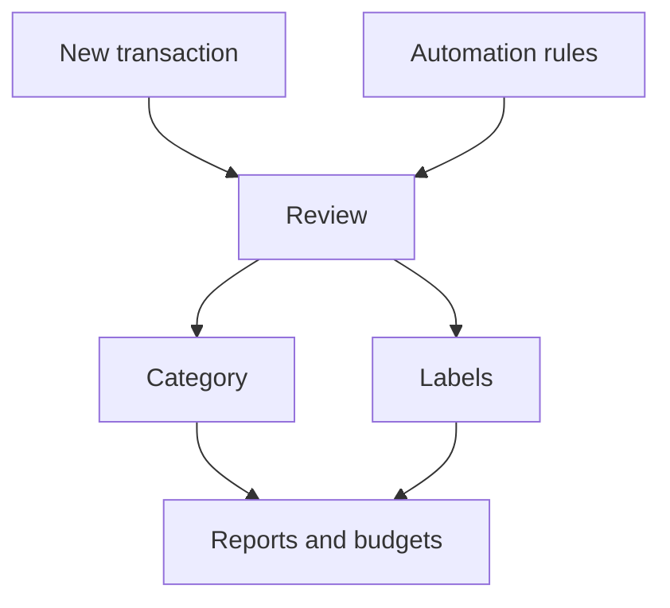

# Transactions

Transactions are the individual money movements in your accounts. They power categories, cashflow, budgets, and automation rules.

{{TOC}}

## Quick start

1. Add transactions manually, import them from a file, or sync them from a connected account.
2. Check dates, descriptions, and amounts.
3. Add categories and labels.
4. Use filters to find groups of transactions.
5. Use bulk actions when many transactions need the same update.

## Transaction flow

## What a transaction contains

### Date

The day the money moved.

Dates control which month the transaction appears in.

You can move any transaction's date, including one that came from your bank.

### Description

The text from your bank or the text you entered manually.

Descriptions are useful for search and automation rules.

### Amount

The money value.

Positive amounts usually mean money coming in. Negative amounts usually mean money going out.

### Category

The meaning of the transaction.

Categories decide where the transaction appears in reports.

### Labels

Extra tags you can use for filtering and budgets.

A transaction can have more than one label.

### Creditor and debtor name

Who received the money, and who sent it.

Banks supply these separately from the description on connected accounts. They
are often cleaner than the description, which makes them good for both filters
and automation rules.

### Notes

Private context for yourself.

Use notes when the bank description is not enough.

## Filtering and search

Use filters when the list is too large.

You can filter by:

- Date range, or a whole month, quarter or year in one click
- Amount range
- Category
- Account
- Label
- Creditor or debtor name
- How the category was set: by you, by a rule, by Whisper Money, or by your bank
- Search text

A good search often starts with the merchant name or a word from the bank
description.

In the Filters menu, next to the date, the **Month**, **Quarter** and **Year**
buttons set the range to the whole calendar month, quarter or year that contains
the start date, or today if there is none. The button that matches the current
range shows as pressed.

### Cashflow block

The [Cashflow](/documentation/cashflow) page splits your money into blocks:
fixed, variable and general expenses, and what you saved and invested. Every
block there, in the Expenses card and in the "Where your money goes" panel, has
an arrow that opens this list showing exactly the
transactions behind that figure, for the same dates.

The list shows the block as a chip above the transactions, such as **Block:
Fixed expense**. The blocks are:

- **Fixed expense**: what your fixed budgets track.
- **Variable expense**: what your variable budgets track, and no fixed one does.
- **General expense**: spending no budget tracks.
- **Saved**: money set aside with a savings category.
- **Invested**: money set aside with an investment category.

How expenses fall into each block is explained in
[Budgets](/documentation/budgets#expense-type).

A block only makes sense over a period, so it needs both a start and an end
date. Change the dates, or use the Month, Quarter and Year buttons, to see the
same block over another period. Clearing either date drops the block. To go back
to the full list, remove the chip with its cross. You can combine the block with
any other filter.

The block filter is not in the filter menu. You reach it from the Cashflow page.

### Saved filters

A filter combination you keep coming back to can be saved and given a name. It
then sits alongside the transaction list, one click away, instead of being
rebuilt every time.

Saved filters are useful for the reviews you repeat: uncategorized transactions,
one account's month, a merchant you are keeping an eye on.

## Bulk actions

Bulk actions help when many transactions need the same change. Selecting rows
brings up a bar with everything that can be applied to all of them at once.

Good uses:

- Assign one category to several transactions.
- Add the same label to a group.
- Update notes for matching transactions.
- Re-evaluate automation rules for selected transactions.

Before bulk editing, double-check the filtered list. Bulk actions can update many rows at once.

## Uncategorized transactions

Uncategorized transactions make reports less useful.

Try this approach:

1. Filter for uncategorized transactions.
2. Categorize obvious merchants first.
3. Create automation rules for repeated merchants.
4. Leave unclear items for later instead of guessing.

## Re-evaluating automation rules

If you create or change rules after transactions already exist, older transactions may not update automatically.

Use re-evaluation when you want rules to run again on existing transactions.

Use it after:

- Creating a new rule.
- Fixing a rule condition.
- Importing many transactions.
- Cleaning up old uncategorized items.

## FAQ

### Why does a transaction show in the wrong month?

Check the transaction date. Reports use that date.

### Can I move the date of a transaction my bank sent?

Yes. Open the transaction and change the date. This is what you want when your
payroll lands on the 27th but belongs to next month's budget.

Moving the date changes which month, budget and cashflow period the transaction
counts towards. It changes nothing else: the amount and the account stay as your
bank reported them, and the dialog keeps showing the original date underneath so
you can always see where the transaction started.

Your bank's own timeline is kept too, so moving a date never makes the next sync
skip transactions or re-import the same one twice.

Parts of a split transaction are the exception. Their date stays locked, so the
parts keep adding up to the transaction they came from.

### Can one transaction have multiple categories?

No. A transaction has one category. Use labels when you need extra tags.

### What is the difference between categories and labels?

Categories define the main meaning. Labels add flexible tags for filtering and budgets.
