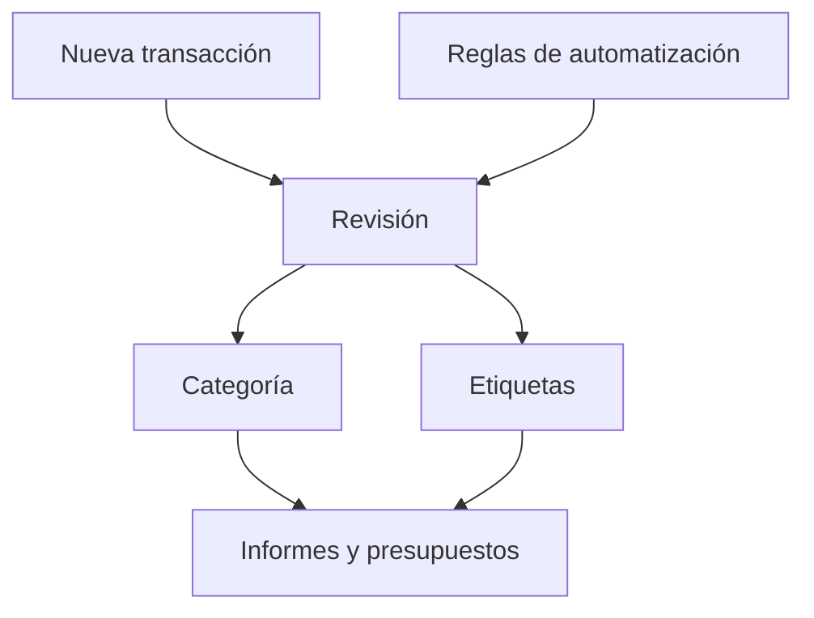

# Transacciones

Las transacciones son los movimientos individuales de dinero en tus cuentas. Alimentan categorías, flujo de caja, presupuestos y reglas de automatización.

{{TOC}}

## Inicio rápido

1. [Añade transacciones a mano](/documentation/transactions/create), [impórtalas desde un archivo](/documentation/transactions/import) o sincronízalas desde una cuenta conectada.
2. Revisa fechas, descripciones e importes.
3. Añade categorías y etiquetas.
4. Usa filtros para encontrar grupos de transacciones.
5. Usa acciones masivas cuando muchas transacciones necesitan el mismo cambio.

## Flujo de una transacción

## Qué contiene una transacción

### Fecha

El día en que se movió el dinero.

La fecha controla en qué mes aparece la transacción.

Puedes cambiar la fecha de cualquier transacción, incluso de una que venga de tu
banco.

### Descripción

El texto de tu banco o el texto que escribiste manualmente.

Las descripciones son útiles para búsqueda y reglas de automatización.

### Importe

El valor del movimiento.

Los importes positivos suelen ser dinero que entra. Los negativos suelen ser dinero que sale.

### Categoría

El significado de la transacción.

Las categorías deciden dónde aparece la transacción en los informes.

### Etiquetas

Tags extra para filtrar y presupuestar.

Una transacción puede tener más de una etiqueta.

### Nombre del acreedor y del deudor

Quién recibió el dinero y quién lo envió.

En las cuentas conectadas, los bancos envían estos datos aparte de la
descripción. Suelen ser más limpios que la descripción, así que van bien tanto
para filtros como para reglas de automatización.

### Notas

Contexto privado para ti.

Usa notas cuando la descripción del banco no sea suficiente.

## Filtros y búsqueda

Usa filtros cuando la lista sea demasiado grande.

Puedes filtrar por:

- Rango de fechas, o un mes, trimestre o año entero con un clic
- Importe: cuánto fue un gasto o un ingreso
- Categoría
- Cuenta
- Etiqueta
- Nombre del acreedor o del deudor
- Quién asignó la categoría: tú, una regla, Whisper Money o tu banco
- Texto de búsqueda

Una buena búsqueda suele empezar con el nombre del comercio o una palabra de la
descripción bancaria.

En el menú de filtros, junto a la fecha, los botones **Mes**, **Trimestre** y
**Año** ajustan el rango al mes, trimestre o año natural completo que contiene
la fecha de inicio, o el día de hoy si no hay ninguna. El botón que coincide con
el rango actual aparece pulsado.

Al buscar una categoría padre en el filtro de categorías salen también sus
subcategorías, así que puedes marcar la padre o solo la que buscas.

### Importe

El filtro **Valor** mira cuánto es una transacción. Elige primero **Gasto** o
**Ingresos** y luego escribe **Mín** y **Máx** como importes normales, sin signo.
Empieza en **Gasto**.

- **Gasto**, **Máx** 30: todos los gastos de 30 o menos.
- **Gasto**, **Mín** 100: todos los gastos de 100 o más.
- **Ingresos**, **Mín** 1000 y **Máx** 3000: los ingresos de entre 1000 y 3000.

Un filtro guardado o un enlace de antes de este cambio puede abarcar gastos e
ingresos a la vez. En ese caso aparece sin ningún lado elegido y con una nota que
lo explica. Al elegir un lado, sus límites pasan a ser importes normales de ese
lado.

### Bloque de flujo de caja

La página de [Flujo de caja](/documentation/cashflow) reparte tu dinero en
bloques: gasto fijo, variable y general, y lo que has ahorrado e invertido. Cada
bloque, en la tarjeta de Gastos y en el panel «A dónde va tu dinero», tiene una
flecha que abre esta lista con exactamente las
transacciones que hay detrás de esa cifra, para las mismas fechas.

La lista muestra el bloque como una etiqueta sobre las transacciones, por
ejemplo **Bloque: Gasto fijo**. Los bloques son:

- **Gasto fijo**: lo que siguen tus presupuestos fijos.
- **Gasto variable**: lo que siguen tus presupuestos variables y ninguno fijo.
- **Gasto general**: lo que no sigue ningún presupuesto.
- **Ahorrado**: el dinero apartado con una categoría de ahorro.
- **Invertido**: el dinero apartado con una categoría de inversión.

Cómo cae cada gasto en un bloque se explica en
[Presupuestos](/documentation/budgets#tipo-de-gasto).

Un bloque solo tiene sentido dentro de un periodo, así que necesita fecha de
inicio y de fin. Cambia las fechas, o usa los botones Mes, Trimestre y Año, para
ver el mismo bloque en otro periodo. Si borras cualquiera de las dos fechas, el
bloque desaparece. Para volver a la lista completa, quita la etiqueta con su
aspa. Puedes combinar el bloque con cualquier otro filtro.

El filtro de bloque no está en el menú de filtros. Llegas a él desde la página
de Flujo de caja.

### Filtros guardados

Una combinación de filtros a la que vuelves a menudo se puede guardar con un
nombre. Queda junto a la lista de transacciones, a un clic, en lugar de tener que
rehacerla cada vez.

Los filtros guardados sirven para las revisiones que repites: transacciones sin
categoría, el mes de una cuenta, un comercio que estás vigilando.

## Acciones masivas

Las acciones masivas ayudan cuando muchas transacciones necesitan el mismo cambio.
Al seleccionar filas aparece una barra con todo lo que se puede aplicar a la vez.

Buenos usos:

- Asignar una categoría a varias transacciones.
- Añadir la misma etiqueta a un grupo.
- Actualizar notas para transacciones coincidentes.
- Reevaluar reglas de automatización en transacciones seleccionadas.

Antes de editar en masa, revisa bien la lista filtrada. Las acciones masivas pueden actualizar muchas filas a la vez.

## Transacciones sin categoría

Las transacciones sin categoría hacen que los informes sean menos útiles.

Prueba este enfoque:

1. Filtra transacciones sin categoría.
2. Categoriza primero los comercios obvios.
3. Crea reglas de automatización para comercios repetidos.
4. Deja los casos poco claros para más tarde en vez de adivinar.

## Reevaluar reglas de automatización

Si creas o cambias reglas después de que existan transacciones, las antiguas pueden no actualizarse automáticamente.

Usa la reevaluación cuando quieras que las reglas vuelvan a ejecutarse sobre transacciones existentes.

Lánzala sobre toda la lista con **Actualizar categorías automáticamente**, en el
menú **Más acciones** que hay encima de la lista, o solo sobre las filas que
hayas seleccionado con **Reevaluar reglas** en la barra de acciones masivas.

Úsala después de:

- Crear una regla nueva.
- Corregir una condición.
- Importar muchas transacciones.
- Limpiar transacciones antiguas sin categoría.

Puede tardar un poco. Los lotes pequeños terminan mientras miras, con un aviso
que cuenta las transacciones que ha cambiado. Cuando le toca esperar turno, un
aviso de **Reevaluación en cola** indica que terminará en segundo plano: no hay
nada que reintentar, recarga la página más tarde para ver el resultado.

## Preguntas frecuentes

### ¿Por qué una transacción aparece en el mes equivocado?

Revisa la fecha de la transacción. Los informes usan esa fecha.

### ¿Puedo cambiar la fecha de una transacción que envió mi banco?

Sí. Abre la transacción y cambia la fecha. Es lo que necesitas cuando tu nómina
entra el día 27 pero pertenece al presupuesto del mes siguiente.

Cambiar la fecha cambia en qué mes, presupuesto y periodo de flujo de caja cuenta
la transacción. No cambia nada más: el importe y la cuenta se quedan como los
reportó tu banco, y el diálogo sigue mostrando debajo la fecha original para que
siempre puedas ver de dónde salió la transacción.

También se conserva la línea temporal de tu banco, así que cambiar una fecha
nunca hace que la siguiente sincronización se salte transacciones ni que importe
la misma dos veces.

Las partes de una transacción dividida son la excepción. Su fecha se queda
bloqueada, para que las partes sigan sumando lo mismo que la transacción de la
que salieron.

### ¿Una transacción puede tener varias categorías?

No. Una transacción tiene una categoría. Usa etiquetas cuando necesites tags extra.

### ¿Cuál es la diferencia entre categorías y etiquetas?

Las categorías definen el significado principal. Las etiquetas añaden tags flexibles para filtrar y presupuestar.
