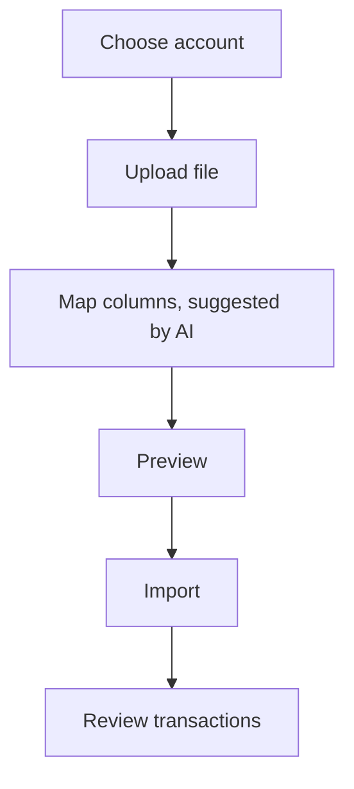
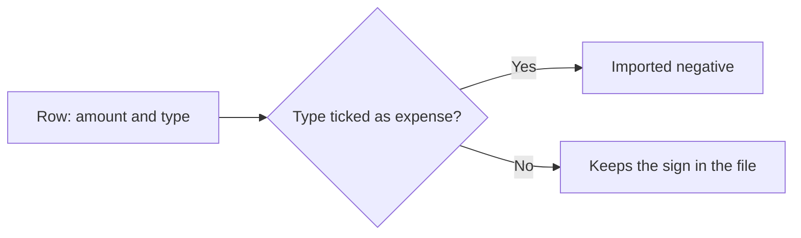

# Import transactions

Importing brings a bank file into Whisper Money when automatic syncing is not available for that bank, or when you would rather do it yourself.

This imports one file into one account. To bring over a whole export from
another app, with many accounts and its categories, use
[Import from another app](/documentation/import-from-another-app).

{{TOC}}

## Quick start

1. Choose the account.
2. Upload the bank file.
3. Check the column mapping. The AI suggests it; you correct what is wrong.
4. Check the preview.
5. Import selected transactions.
6. Review categories and duplicates after import.

## Import flow

The drawer asks which account the file belongs to, then for the file itself:
CSV, XLS, XLSX or Numbers. CSV files are read as UTF-8 when they are, with or
without a byte order mark, so accents in headers and descriptions come through
intact; older files in Latin-1 still work as before.

## Map the columns

Whisper Money reads the header row and works out which column is which. The
guesses are yours to correct before anything is imported.

### The AI suggests the mapping

The first time you import a file with a given layout into an account, the AI
looks at its columns and suggests which one holds the date, the description, the
amount and the optional fields. While the mapping is exactly what it suggested,
the step shows **Suggested by AI**. Change any field and the badge turns into a
**Detect columns with AI** button, which puts the suggestion back on every
field.

- **What it sees.** Only the header row, with the column names, and a
  description of each column's shape, such as `date (dd.mm.yyyy)` or
  `number, 2 decimals with ",", mixed signs`. None of the rows below the header:
  no descriptions, no amounts, no dates. The AI provider is TypeSafe AI, listed
  in the [privacy policy](/privacy).
- **No AI consent needed.** Because your transactions are not sent, it works
  whether or not you have turned on AI categorization.
- **When it cannot answer**, the mapping keeps the guess made from the headers,
  and you carry on as usual.
- **A field you have already picked by hand** is left alone if the suggestion
  arrives after you changed it.

Once an import brings in at least one transaction, its mapping is saved for that
account. The next file that has the columns the saved mapping uses gets that
mapping straight away, without asking the AI again. An import you abandon or that brings nothing
in saves nothing, so a wrong mapping is never remembered.

### Required and optional fields

### Date

The transaction date, required.

The format is detected; when the dates can be read two ways, the step says
**Check this — reading as** so you confirm it. A time after the date
(`2026-10-01 12:30`, `25/10/17, 1:47`, `10/08/26 20:04h`) is dropped and only
the day as written is kept.

### Description

The text that explains the transaction, required.

You can combine description columns when the bank splits details across fields.

### Amount

The transaction amount, required.

Expenses must end up negative. If the file writes every amount as positive, use
the **Type** field below.

### Optional fields

**Currency**, **Balance** (not on credit cards, which have no balance),
**Creditor** (who was paid), **Debtor** (who paid) and **Type**.

## When every amount is positive: the type column

Some apps and banks write every amount as a positive number and say in another
column whether it was money in or out: `Expense` / `Income`, `Debit` /
`Credit`, `Gasto` / `Ingreso`. Map that column to **Type**, under **Optional
fields**, and the step lists its values with how many rows carry each one. Tick
the values that mean money going out.

| Type in the file | Ticked? | Amount in the file | Imported as |
| ---------------- | ------- | ------------------ | ----------- |
| Expense          | Yes     | 45.90              | −45.90      |
| Expense          | Yes     | −45.90             | −45.90      |
| Income           | No      | 2,500.00           | 2,500.00    |
| Refund           | No      | −12.00             | −12.00      |

- A ticked row is always an expense, whatever sign the file gave it. Any other
  row keeps the amount exactly as the file has it.
- Headers such as "Type", "Transaction type", "Tipo de transacción", "Debit/Credit"
  or "DR/CR" are picked up on their own. Values that plainly mean an expense
  (expense, debit, withdrawal, gasto, cargo, débito, out, DR and the like) come
  ticked; check the rest.
- Values are compared ignoring case and spaces around them. Up to 20 values are
  listed, the most common first; a value you ticked always stays in the list.
- Without a type column, or with nothing ticked, the amounts are imported as they
  are.

The type column and the ticked values are saved with the account's mapping, so
the next file from the same bank comes in the same way.

## Dates that cannot be read

A row whose date cannot be read is not imported, and the mapping step counts
those rows as **unreadable** so you can fix the format or the file first. That
includes dates with a year before 1900 or after 9999, which usually mean a time
or a stray character got glued to the year.

## Balances and imports

Some files include a running balance column and some do not.

When the file has one, map it and the balance history follows the import. When it
does not, the import brings in the transactions only, and the account keeps
whatever balances you have entered yourself.

Working out the balance history from the transactions and one known balance is
not available yet. Until it is, set the balances yourself: a file of them can be
brought in from [Import balances](/documentation/accounts/import-balances), and a
single figure can be corrected in [Edit balances](/documentation/accounts/edit-balances).

## Preview before importing

Always review the preview. Rows that look like transactions you already have are
flagged and unticked for you, so importing the same file twice does not double
your history.

Look for:

- Rows flagged as duplicates that are actually two real payments of the same
  amount on the same day.
- Wrong dates.
- Amounts with the wrong sign.
- Missing descriptions.
- Unexpected empty rows.

## Automation during import

Automation rules can help categorize imported transactions.

This works best when descriptions are consistent. If imported rows come from the same bank file format every time, rules become very useful.

## FAQ

### Which file should I use?

Use the cleanest export your bank provides. CSV and spreadsheet-style files are usually easiest.

### Why are amounts reversed?

Some banks export expenses as positive numbers. If the file has a column saying
whether each row is money in or out, map it to **Type** and tick the expense
values. If it has none, check the preview before importing.

### Does the AI see my transactions?

No. To suggest the mapping it only receives each column's header and the shape
of its data, none of the rows below the header. The file itself is read in your
browser.

### The mapping the AI suggested is wrong. What now?

Change the fields that are wrong before you continue. The mapping you import
with is the one saved for the account, so next time it is used as you left it.

### Can I import the same file twice?

Yes. Before the preview, Whisper Money checks each row against the transactions
the account already has and flags the ones that match on the same day, amount,
and description. Flagged rows are unticked for you, so importing the file again
brings in only what is new. The count is shown above the preview, and you can
still tick a row back on if it is a genuine repeat payment.
