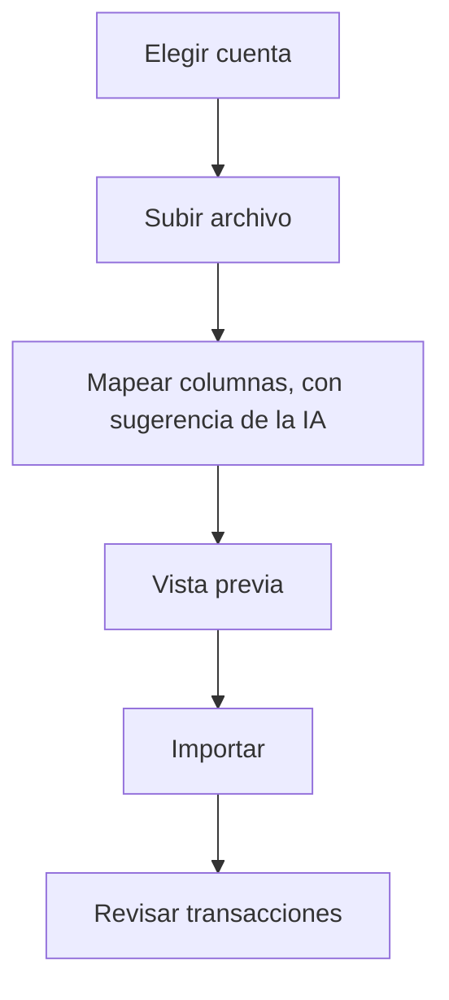
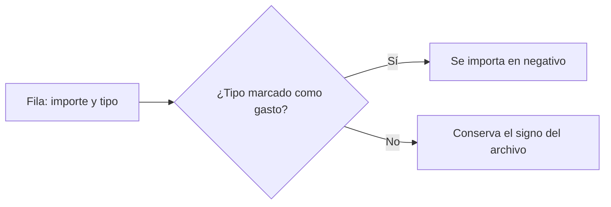

# Importar transacciones

Importar trae un archivo del banco a Whisper Money cuando la sincronización automática no está disponible para ese banco, o cuando prefieres hacerlo tú.

Así se importa un archivo a una cuenta. Para traer la exportación entera de otra
app, con muchas cuentas y sus categorías, usa
[Importar desde otra app](/documentation/import-from-another-app).

{{TOC}}

## Inicio rápido

1. Elige la cuenta.
2. Sube el archivo del banco.
3. Revisa el mapeo de columnas. Lo sugiere la IA; tú corriges lo que esté mal.
4. Revisa la vista previa.
5. Importa las transacciones seleccionadas.
6. Revisa categorías y duplicados después de importar.

## Flujo de importación

El panel pregunta primero a qué cuenta pertenece el archivo, y después pide el
archivo: CSV, XLS, XLSX o Numbers. Los CSV en UTF-8 se leen como tales, lleven o
no marca de orden de bytes (BOM), así que las tildes de cabeceras y
descripciones llegan intactas; los archivos antiguos en Latin-1 siguen
funcionando como antes.

## Mapea las columnas

Whisper Money lee la fila de cabecera y deduce qué columna es cada cosa. Antes
de importar nada, puedes corregir lo que haga falta.

### La IA sugiere el mapeo

La primera vez que importas a una cuenta un archivo con unas columnas
concretas, la IA mira esas columnas y sugiere cuál tiene la fecha, la
descripción, el importe y los campos opcionales. Mientras el mapeo sea
exactamente el que sugirió, el paso muestra **Sugerencia hecha con IA**. Si
cambias cualquier campo, la etiqueta se convierte en el botón **Detectar
columnas con IA**, que vuelve a aplicar la sugerencia a todos los campos.

- **Qué ve.** Solo la fila de cabecera, con los nombres de las columnas, y una
  descripción del formato de cada columna, que se envía en inglés, como
  `date (dd.mm.yyyy)` o `number, 2 decimals with ",", mixed signs`. Ninguna de
  las filas que hay debajo de la cabecera: ni descripciones, ni importes, ni
  fechas. El proveedor de IA es TypeSafe AI, y figura en la
  [política de privacidad](/privacy).
- **No necesita tu consentimiento de IA.** Como tus transacciones no se envían,
  funciona tengas o no activada la categorización con IA.
- **Si no puede responder**, el mapeo se queda con lo que se dedujo de las
  cabeceras y sigues como siempre.
- **Un campo que ya elegiste a mano** no se toca si la sugerencia llega después
  de cambiarlo.

Cuando una importación trae al menos una transacción, su mapeo se guarda para
esa cuenta. El siguiente archivo que tenga las columnas que usa el mapeo
guardado recibe ese mapeo directamente, sin volver a preguntar a la IA. Una importación que abandonas o
que no trae nada no guarda nada, así que nunca se recuerda un mapeo erróneo.

### Campos obligatorios y opcionales

### Fecha

La fecha de la transacción, obligatoria.

El formato se detecta; cuando las fechas se pueden leer de dos maneras, el paso
dice **Revisa esto — se lee como** para que lo confirmes. Si la fecha lleva una
hora detrás (`2026-10-01 12:30`, `25/10/17, 1:47`, `10/08/26 20:04h`), la hora
se descarta y se guarda el día tal como está escrito.

### Descripción

El texto que explica la transacción, obligatorio.

Puedes combinar columnas de descripción cuando el banco separa detalles en varios campos.

### Valor

El importe de la transacción, obligatorio.

Los gastos tienen que acabar en negativo. Si el archivo escribe todos los
importes en positivo, usa el campo **Tipo** de más abajo.

### Campos opcionales

**Moneda**, **Balance** (no en tarjetas de crédito, que no tienen saldo),
**Acreedor** (a quién se pagó), **Deudor** (quién pagó) y **Tipo**.

## Cuando todos los importes son positivos: la columna de tipo

Algunas apps y bancos escriben todos los importes en positivo y dicen en otra
columna si el dinero entró o salió: `Gasto` / `Ingreso`, `Cargo` / `Abono`,
`Debit` / `Credit`. Asigna esa columna a **Tipo**, dentro de **Campos
opcionales**, y el paso lista sus valores con cuántas filas tiene cada uno.
Marca los valores que indican dinero que sale.

| Tipo en el archivo | ¿Marcado? | Importe en el archivo | Se importa como |
| ------------------ | --------- | --------------------- | --------------- |
| Gasto              | Sí        | 45,90                 | −45,90          |
| Gasto              | Sí        | −45,90                | −45,90          |
| Ingreso            | No        | 2.500,00              | 2.500,00        |
| Devolución         | No        | −12,00                | −12,00          |

- Una fila marcada es siempre un gasto, tenga el signo que tenga en el archivo.
  Cualquier otra fila conserva el importe tal cual viene.
- Cabeceras como «Tipo», «Tipo de transacción», «Tipo de movimiento»,
  «Debit/Credit» o «DR/CR» se reconocen solas. Los valores que claramente son
  un gasto (gasto, cargo, débito, expense, debit, withdrawal, DR y similares)
  vienen marcados; revisa el resto.
- Los valores se comparan sin distinguir mayúsculas ni espacios alrededor. Se
  listan hasta 20, los más frecuentes primero; un valor que hayas marcado
  siempre sigue en la lista.
- Sin columna de tipo, o sin nada marcado, los importes se importan tal cual.

La columna de tipo y los valores marcados se guardan con el mapeo de la cuenta,
así que el siguiente archivo del mismo banco entra igual.

## Fechas que no se pueden leer

Una fila cuya fecha no se puede leer no se importa, y el paso de mapeo cuenta
esas filas como **ilegibles** para que corrijas el formato o el archivo antes.
Eso incluye las fechas con un año anterior a 1900 o posterior a 9999, que suelen
indicar que una hora o un carácter suelto se ha pegado al año.

## Saldos e importaciones

Algunos archivos incluyen una columna de saldo y otros no.

Cuando el archivo la tiene, mapéala y el historial de saldos acompaña a la
importación. Cuando no la tiene, la importación trae solo las transacciones, y la
cuenta conserva los saldos que hayas introducido tú.

Calcular el historial de saldos a partir de las transacciones y un saldo conocido
todavía no está disponible. Hasta que lo esté, pon los saldos tú: un archivo de
saldos se puede traer desde [Importar saldos](/documentation/accounts/import-balances),
y una cifra concreta se corrige en [Editar saldos](/documentation/accounts/edit-balances).

## Vista previa antes de importar

Revisa siempre la vista previa. Las filas que se parecen a transacciones que ya
tienes salen marcadas y desmarcadas, así que importar el mismo archivo dos veces
no duplica tu historial.

Busca:

- Filas marcadas como duplicadas que en realidad son dos pagos reales del mismo
  importe el mismo día.
- Fechas incorrectas.
- Importes con el signo equivocado.
- Descripciones vacías.
- Filas vacías inesperadas.

## Automatización durante la importación

Las reglas de automatización pueden ayudar a categorizar transacciones importadas.

Funciona mejor cuando las descripciones son consistentes. Si siempre importas el mismo formato de archivo bancario, las reglas son muy útiles.

## Preguntas frecuentes

### ¿Qué archivo debería usar?

Usa la exportación más limpia que ofrezca tu banco. CSV y archivos tipo hoja de cálculo suelen ser los más fáciles.

### ¿Por qué los importes están invertidos?

Algunos bancos exportan los gastos como números positivos. Si el archivo tiene
una columna que dice si cada fila es dinero que entra o que sale, asígnala a
**Tipo** y marca los valores de gasto. Si no la tiene, revisa la vista previa
antes de importar.

### ¿La IA ve mis transacciones?

No. Para sugerir el mapeo solo recibe la cabecera de cada columna y el formato
de sus datos, ninguna de las filas que hay debajo de la cabecera. El archivo se
lee en tu navegador.

### La IA ha sugerido un mapeo equivocado. ¿Qué hago?

Cambia los campos que estén mal antes de continuar. El mapeo con el que importas
es el que se guarda para la cuenta, así que la próxima vez se usa tal como lo
dejaste.

### ¿Puedo importar el mismo archivo dos veces?

Sí. Antes de la vista previa, Whisper Money compara cada fila con las
transacciones que ya tiene la cuenta y marca las que coinciden en el mismo día,
importe y descripción. Las filas marcadas se desmarcan por ti, así que volver a
importar el archivo trae solo lo nuevo. El número se muestra encima de la vista
previa, y puedes volver a marcar una fila si de verdad es un pago repetido.
