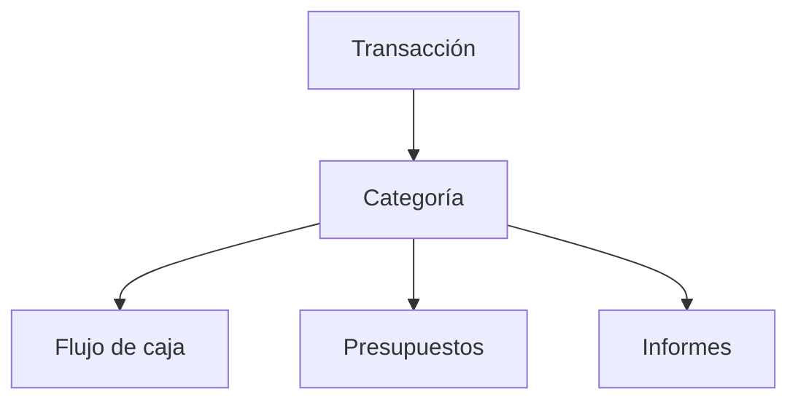

# Categorías

Las categorías explican qué significa cada transacción. Elige bien la categoría y tus informes serán más fáciles de confiar.

{{TOC}}

## Inicio rápido

1. Decide si la transacción es ingreso, gasto, transferencia, ahorro o inversión.
2. Usa categorías de transferencia para dinero que se mueve entre tus propias cuentas.
3. Revisa las transacciones sin categoría a menudo.
4. Crea reglas de automatización para comercios repetidos.
5. Añade subcategorías cuando una categoría necesite más detalle, como
   Supermercado y Restaurantes dentro de Comida.

> ¿No sabes qué elegir? Empieza por el tipo. Puedes cambiar el nombre de la categoría después.

## Mapa de categorías

Ejemplos:

- Supermercado → Gasto → informes de gasto y presupuestos.
- Salario → Ingreso → informes de ingresos y flujo de caja.
- Cuenta corriente a ahorro → Transferencia → evita contar dos veces.

## Tipos de categoría

Cada categoría tiene un tipo.

### Gasto

Usa este tipo para dinero que sale de tus finanzas.

Ejemplos:

- Supermercado
- Alquiler
- Transporte
- Suscripciones
- Impuestos

### Ingreso

Usa este tipo para dinero que entra en tus finanzas.

Ejemplos:

- Salario
- Ingresos freelance
- Reembolsos
- Dividendos
- Intereses

### Transferencia

Usa este tipo cuando el dinero se mueve entre cuentas que son tuyas.

Ejemplos:

- Cuenta corriente a ahorro
- Cuenta bancaria a tarjeta de crédito
- Cuenta bancaria a inversión

### Ahorro

Usa este tipo cuando el dinero sale de tus finanzas del día a día para guardarlo.

Ejemplos:

- Traspaso mensual al fondo de emergencia
- Dinero apartado para un objetivo

Las categorías de ahorro no son gasto. Alimentan la tarjeta «Ahorrado e
invertido» de la página de [Flujo de caja](/documentation/cashflow), y se restan
de lo que queda Disponible allí.

### Inversión

Usa este tipo cuando el dinero sale de tus finanzas del día a día para
invertirlo.

Ejemplos:

- Aportación al bróker
- Aportación a un plan de pensiones
- Compra de un fondo indexado

Igual que el ahorro, las inversiones cuentan como dinero apartado y no como
gasto. La tarjeta «Ahorrado e invertido» muestra cómo se reparte entre los dos
lo que has apartado.

## Transferencias y dirección de flujo de caja

Las categorías de transferencia pueden mostrarse u ocultarse en flujo de caja.

Opciones:

- **No mostrar**: oculta la transferencia del flujo de caja.
- **Mostrar como entrada de efectivo**: muestra la transferencia como dinero que entra.
- **Mostrar como salida de efectivo**: muestra la transferencia como dinero que sale.

Para la mayoría de movimientos entre tus propias cuentas, **No mostrar** es la opción más segura.

La dirección solo la eliges tú en las categorías de transferencia. Las de ahorro
e inversión cuentan siempre como dinero que sale, y las de ingreso y gasto se
cuentan por su tipo y no por una dirección.

## Subcategorías

Las categorías se pueden anidar hasta tres niveles: una categoría, sus
subcategorías y las de estas. Comida puede contener Supermercado y Restaurantes,
y Restaurantes puede contener Comidas de trabajo.

Las categorías están en **Configuración → Categorías**. Hay dos formas de crear
una subcategoría:

- **Desde la fila de la categoría.** Abre el menú **...** de la fila, o haz clic
  derecho sobre ella, y elige **Crear subcategoría**. El diálogo se abre con esa
  fila ya elegida como categoría padre y con su color. El color se puede
  cambiar; el tipo no.
- **Desde Crear Categoría.** Elige una **Categoría padre** en el diálogo.

Una subcategoría tiene siempre el tipo y la configuración de flujo de caja de su
categoría padre; el diálogo indica el tipo como "Heredado de la categoría
padre". Las categorías del tercer nivel no ofrecen
**Crear subcategoría**, porque no pueden tener más.

Lo que cambia al anidarlas:

- **Los informes suman hacia arriba.** El total de una categoría padre en el
  flujo de caja incluye sus subcategorías, y puedes abrirla para verlas una a
  una.
- **Los presupuestos siguen el árbol.** Un presupuesto que sigue una categoría
  padre sigue también todas sus subcategorías.
- **La búsqueda encuentra a la familia.** Al escribir el nombre de una categoría
  padre en cualquier selector de categorías aparecen también sus subcategorías,
  así que puedes elegir Supermercado buscando "Comida".

## Transacciones sin categoría

Las transacciones importadas o sincronizadas pueden empezar sin categoría.

Prueba esta rutina:

1. Abre las transacciones sin categoría.
2. Asigna primero las más obvias.
3. Deja las confusas para más tarde si hace falta.
4. Crea reglas de automatización para comercios o descripciones repetidas.

Cuando el mes en curso tiene transacciones sin categoría, Whisper Money te lo
recuerda una vez por sesión con un aviso en una esquina de la pantalla.
**Categorizar** abre las transacciones sin categoría de ese mes; **Ahora no**
oculta el aviso durante tres días, en todos tus dispositivos.

## Quién asignó la categoría

Cada transacción categorizada registra cómo obtuvo su categoría:

- **Tú**, al elegirla.
- **Una regla de automatización** que coincidió con ella.
- **Whisper Money**, si has activado la categorización con IA.
- **Tu banco**, si la conexión la proporcionó.

Los filtros de transacciones pueden acotar la lista por cualquiera de estas
opciones, que es la forma más rápida de revisar lo que se asignó automáticamente
antes de fiarte de los informes del mes.

## Categorización con IA

Whisper Money puede sugerir categorías para las transacciones que aún no has
categorizado. Está desactivada hasta que tú la actives, porque implica enviar la
descripción de la transacción a un proveedor de IA.

Lo que conviene saber:

- Tú decides si la activas, y puedes desactivarla en cualquier momento.
- Solo rellena categorías vacías. Nunca sobrescribe una que hayas elegido.
- Lo que asigna queda marcado como puesto por Whisper Money, así que puedes
  encontrarlo y revisarlo después.
- Corregir una de sus categorías se puede convertir en una regla de
  automatización, para que el mismo comercio se resuelva sin IA la próxima vez.

También puedes empezar una regla desde cualquier transacción: su menú de fila
tiene **Automatizar categorización**, que prepara una regla con la descripción y
la categoría de esa transacción. Consulta
[Reglas de automatización](/documentation/automation-rules).

## Cambiar una categoría

Cambiar la categoría de una transacción actualiza los informes que incluyen esa transacción.

Esto puede afectar:

- Totales de gasto
- Progreso de presupuestos
- Totales de ingresos
- Flujo de caja

Cambiar la categoría en sí, como su nombre o tipo, afecta a todas las transacciones que usan esa categoría.

## Preguntas frecuentes

### ¿Qué pasa si elijo la categoría equivocada?

Puedes cambiarla después. Los informes se actualizan cuando la transacción se recategoriza.

### ¿Los pagos de tarjeta de crédito deberían ser gastos?

Normalmente no. Si ya registras las compras de la tarjeta, el pago es dinero moviéndose entre tus propias cuentas. Usa una categoría de transferencia.

### ¿Cuántas categorías debería crear?

Empieza con pocas. Demasiadas categorías hacen que los informes sean más difíciles de leer. Añade más solo cuando necesites más detalle.

### ¿Puede una subcategoría tener un tipo distinto al de su categoría padre?

No. Una subcategoría toma el tipo de su categoría padre. Si quieres registrar
algo con otro tipo, créalo como una categoría independiente.

## Buenos hábitos con categorías

- Usa nombres cortos y claros.
- Evita categorías duplicadas para el mismo tipo de gasto.
- Usa categorías de transferencia para movimientos entre tus propias cuentas.
- Revisa las transacciones sin categoría antes de confiar en los informes mensuales.
- Automatiza comercios y descripciones repetidas.
