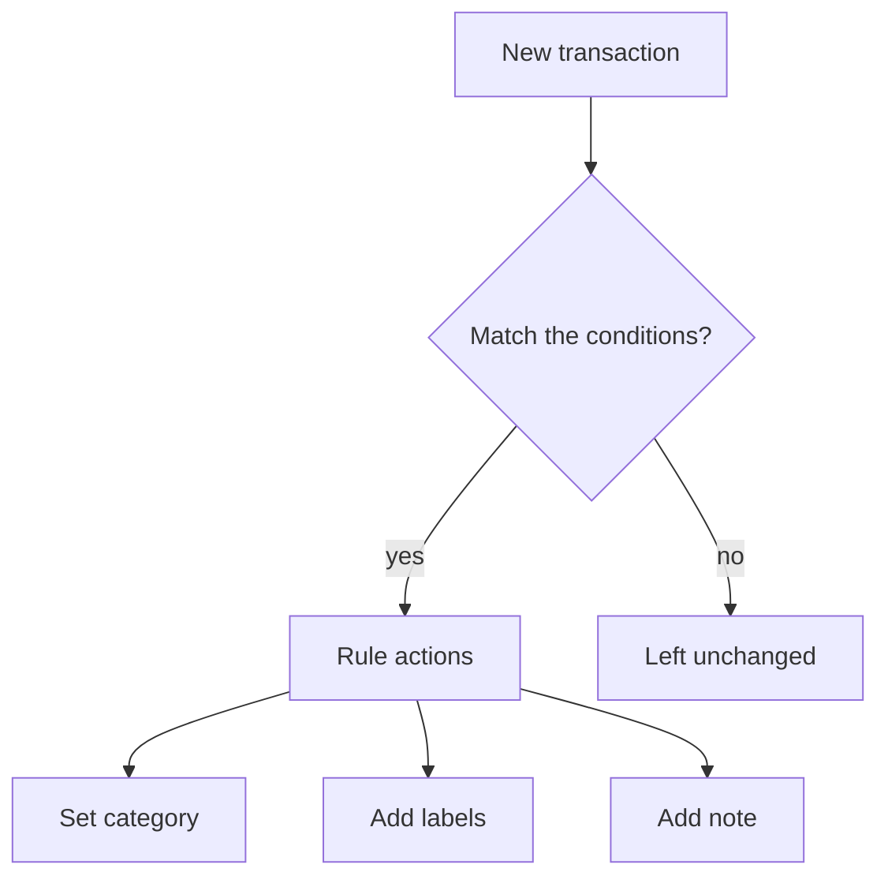

# Automation rules

Automation rules save time by updating matching transactions for you. They can set a category, add labels, and add a note.

{{TOC}}

## Quick start

1. Open Automation rules from settings or from the transaction tools.
2. Create a rule with one or more conditions.
3. Choose at least one action: category or labels.
4. Set a priority if it should run before your other rules. Lower numbers run
   first.
5. Save the rule.
6. Apply it to existing transactions if you want old matches updated too.

Already looking at the transaction you want automated? Start the rule from its
row menu instead. See [Starting from a transaction](#starting-from-a-transaction).

## How rules work

Rules are checked in priority order, lowest number first. The first rule that
matches applies its actions.

## Conditions

Conditions decide whether a rule matches a transaction.

### Description

Match text from the bank description.

Good for merchants, subscriptions, and repeated payments.

### Amount

Match an exact amount or compare amounts.

Good for fixed subscriptions or recurring transfers.

### Bank name

Match transactions from a specific bank.

Good when the same merchant appears differently by bank.

### Account name

Match a specific account.

Good when one account needs special handling.

### Creditor name

Match who was paid, when the bank supplies it separately from the description.

This field can also be matched on being empty or not empty.

### Debtor name

Match who paid, when the bank supplies it separately from the description.

Good for incoming transfers from the same person or company.

Each condition compares a field with a value. Text fields can _contain_ or
_equal_ a value, or the opposite — _does not contain_ and _does not equal_ —
which is how you write an exception. Amounts can _equal_, _not equal_, be
_greater than_ or _less than_ one, and creditor and debtor name can also be
_empty_ or _not empty_.

Amounts keep their sign: an expense is negative, so a 14 charge is -14.

A negative condition is also true when the field is empty. "Creditor name does
not contain Amazon" matches a transaction whose creditor the bank never sent.

## Actions

Actions are what the rule changes.

A rule can:

- Set a category.
- Add one or more labels.
- Add a note.

At least one category or label action is required.

## Groups and priority

Use groups when a rule needs more than one condition.

Examples:

- Description contains "Netflix" **and** amount is less than 20.
- Description contains "Uber" **or** description contains "Cabify".
- Description contains "Amazon" **and** description does not contain "Amazon
  Prime" — everything from the shop except the subscription.
- Description contains "GitHub" **and** amount does not equal -14 — every GitHub
  charge except the monthly subscription.

Priority controls which rule wins when multiple rules could match.

- Each rule has a **Priority** number, set in the create and edit dialogs. New
  rules start at 0.
- Rules with a lower number are checked first. A rule at 1 runs before a rule
  at 10.
- Rules with the same number have no guaranteed order between them. When two
  rules could match the same transaction, give them different numbers.

The rules table shows the priority in its first column and opens sorted by it,
so the list reads in the order rules are checked; rules with the same number are
listed by title. Click the column header to
reverse it. Long titles are cut short in the table; hover one to read it whole.

Put specific rules before broad rules: give the specific one the lower number.

## Reordering conditions and groups

The order of conditions and groups does not change what a rule matches, but a
rule you can read top to bottom is easier to keep right. You can rearrange both
in the rule builder without deleting anything:

- **Conditions inside a group.** Once a group has two or more conditions, each
  one gets a drag handle. Drag it with the mouse, or focus the handle and use
  the keyboard: Space to pick it up, the arrow keys to move it, Space to drop
  it, Escape to cancel.
- **Groups.** Once a rule has two or more groups, each group header gets up and
  down arrows next to its delete button.

On a phone there is no dragging. Groups and conditions are labelled
**Group 1**, **Condition 1** and so on, and each one has its own up and down
arrows.

A condition stays in its group. Moving it into another group would change what
the rule matches, so to do that, delete it and add it again where you want it.

## Starting from a transaction

You do not have to open the rules screen to write a rule. Two shortcuts start
one from a transaction you are looking at:

- **After you categorize a transaction**, a message offers **Automatize** for a
  few seconds.
- **At any time**, the transaction's row menu (the **...** button or a right
  click) has **Automatize categorization**. It works on any transaction,
  categorized or not, parts of a split included.

Both open the same dialog, with two choices:

- **Create a new rule** that starts from the transaction's description and its
  category, if it has one.
- **Modify an existing rule** to add this description to a rule you already
  have.

## Applying rules to existing transactions

Rules run as new transactions arrive. Transactions that already existed need a manual apply step.

Use apply or re-evaluate when:

- You create a new rule.
- You change a rule.
- You imported old transactions.
- You want to clean a backlog.

## Suggested rules

Instead of writing every rule yourself, Whisper Money can read the merchants that
repeat in your transactions and suggest rules for them. You review each
suggestion and decide whether to keep it, and nothing is created until you
accept it.

Suggestions come from two places:

- **Your history**, when there is enough of it to spot a pattern.
- **Your corrections**, when you change a category that was set automatically.
  The next transaction from that merchant is then handled by a rule.

Suggested rules are part of the paid plan. Rules you write yourself are not.

## What rules do not do

Rules run on transactions, not on your accounts or budgets. A rule can only set
a category, add labels, and add a note.

Three things worth knowing:

- A rule never runs twice over the same transaction on its own. Changing a rule
  does not re-run it over your history until you apply it.
- Only the first matching rule applies. A transaction is never touched by two
  rules in the same pass.
- A rule does not overrule a category you chose as the transaction was created:
  a transaction you add by hand with a category, the parts of a
  [split](/documentation/transactions/split), or one an assistant creates
  through the [AI Connector](/documentation/ai-connector).

## FAQ

### Why did a rule not run?

Check the description, amount, account, and priority. If another rule with a
lower priority number also matched, that one applied instead. And if the
transaction already existed when you wrote the rule, it needs the apply step.

### Should I create broad or specific rules?

Start specific. Broad rules are useful, but they can match too much.

### Can a rule add multiple labels?

Yes. A rule can add more than one label.

### Does the order of conditions matter?

No. Conditions in a group are combined the same way whatever their order, and so
are groups. Reorder them only to make the rule easier to read.
