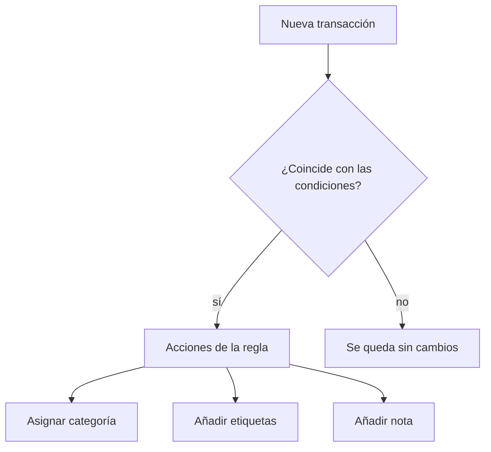

# Reglas de automatización

Las reglas de automatización ahorran tiempo actualizando transacciones coincidentes por ti. Pueden asignar una categoría, añadir etiquetas y añadir una nota.

{{TOC}}

## Inicio rápido

1. Abre Reglas de automatización desde ajustes o desde herramientas de transacciones.
2. Crea una regla con una o más condiciones.
3. Elige al menos una acción: categoría o etiquetas.
4. Dale una prioridad si debe ejecutarse antes que tus otras reglas. Los números
   más bajos van primero.
5. Guarda la regla.
6. Aplícala a transacciones existentes si quieres actualizar coincidencias antiguas.

¿Ya tienes delante la transacción que quieres automatizar? Empieza la regla
desde su menú de fila. Consulta [Empezar desde una transacción](#empezar-desde-una-transaccion).

## Cómo funcionan las reglas

Las reglas se revisan por orden de prioridad, del número más bajo al más alto.
La primera regla que coincide aplica sus acciones.

## Condiciones

Las condiciones deciden si una regla coincide con una transacción.

### Descripción

Coincide con texto de la descripción bancaria.

Útil para comercios, suscripciones y pagos repetidos.

### Importe

Coincide con un importe exacto o compara importes.

Útil para suscripciones fijas o transferencias recurrentes.

### Nombre del banco

Coincide con transacciones de un banco específico.

Útil cuando el mismo comercio aparece distinto según el banco.

### Nombre de la cuenta

Coincide con una cuenta específica.

Útil cuando una cuenta necesita tratamiento especial.

### Nombre del acreedor

Coincide con quién recibió el pago, cuando el banco lo envía aparte de la
descripción.

Este campo también admite comprobar si está vacío o no.

### Nombre del deudor

Coincide con quién pagó, cuando el banco lo envía aparte de la descripción.

Útil para transferencias entrantes de la misma persona o empresa.

Cada condición compara un campo con un valor. Los campos de texto pueden
_contener_ o ser _igual a_ un valor, o lo contrario — _no contiene_ y _no es
igual a_ —, que es como se escribe una excepción. Los importes se comparan con
_es igual a_, _no es igual a_, _mayor que_ o _menor que_, y el nombre del
acreedor y del deudor admiten además _está vacío_ y _no está vacío_.

Los importes conservan su signo: un gasto es negativo, así que un cargo de 14
se escribe -14.

Una condición negativa también se cumple cuando el campo está vacío. "El nombre
del acreedor no contiene Amazon" coincide con una transacción cuyo acreedor el
banco nunca envió.

## Acciones

Las acciones son lo que cambia la regla.

Una regla puede:

- Asignar una categoría.
- Añadir una o más etiquetas.
- Añadir una nota.

Hace falta al menos una acción de categoría o etiqueta.

## Grupos y prioridad

Usa grupos cuando una regla necesita más de una condición.

Ejemplos:

- La descripción contiene "Netflix" **y** el importe es menor que 20.
- La descripción contiene "Uber" **o** la descripción contiene "Cabify".
- La descripción contiene "Amazon" **y** la descripción no contiene "Amazon
  Prime": todo lo de la tienda menos la suscripción.
- La descripción contiene "GitHub" **y** el importe no es igual a -14: todos los
  cargos de GitHub menos la suscripción mensual.

La prioridad controla qué regla gana cuando varias podrían coincidir.

- Cada regla tiene un número de **Prioridad**, que se fija en los diálogos de
  crear y editar. Las reglas nuevas empiezan en 0.
- Las reglas con un número más bajo se revisan primero. Una regla con 1 se
  ejecuta antes que una con 10.
- Las reglas con el mismo número no tienen un orden garantizado entre ellas.
  Cuando dos reglas puedan coincidir con la misma transacción, dales números
  distintos.

La tabla de reglas muestra la prioridad en su primera columna y se abre
ordenada por ella, así que la lista se lee en el orden en que se revisan las
reglas; las que tienen el mismo número aparecen por título. Pulsa la cabecera de la columna para invertirlo. Los títulos largos se
recortan en la tabla; pasa el ratón por encima para leerlos enteros.

Pon reglas específicas antes que reglas amplias: dale el número más bajo a la
específica.

## Reordenar condiciones y grupos

El orden de las condiciones y de los grupos no cambia con qué coincide una
regla, pero una regla que se lee de arriba abajo es más fácil de mantener bien.
Puedes reordenar ambos en el editor de reglas sin borrar nada:

- **Condiciones dentro de un grupo.** Cuando un grupo tiene dos o más
  condiciones, cada una muestra un asa para arrastrarla. Arrástrala con el ratón,
  o enfoca el asa y usa el teclado: Espacio para cogerla, las flechas para
  moverla, Espacio para soltarla y Escape para cancelar.
- **Grupos.** Cuando una regla tiene dos o más grupos, la cabecera de cada grupo
  muestra flechas arriba y abajo junto a su botón de borrar.

En el móvil no se arrastra. Los grupos y las condiciones se rotulan **Grupo 1**,
**Condición 1**, etc., y cada uno tiene sus propias flechas arriba y abajo.

Una condición se queda en su grupo. Moverla a otro grupo cambiaría con qué
coincide la regla, así que para eso bórrala y vuelve a añadirla donde la
quieras.

## Empezar desde una transacción

No hace falta abrir la pantalla de reglas para escribir una. Dos atajos la
empiezan desde la transacción que estás mirando:

- **Después de categorizar una transacción**, un mensaje ofrece
  **Automatizar** durante unos segundos.
- **En cualquier momento**, el menú de fila de la transacción (el botón **...**
  o el clic derecho) tiene **Automatizar categorización**. Funciona en cualquier
  transacción, categorizada o no, incluidas las partes de una división.

Los dos abren el mismo diálogo, con dos opciones:

- **Crear una nueva regla** que parte de la descripción de la transacción y de
  su categoría, si la tiene.
- **Modificar una regla existente** para añadir esta descripción a una regla que
  ya tienes.

## Aplicar reglas a transacciones existentes

Las reglas se ejecutan a medida que llegan transacciones nuevas. Las que ya existían necesitan un paso manual de aplicación.

Usa aplicar o reevaluar cuando:

- Creas una regla nueva.
- Cambias una regla.
- Importaste transacciones antiguas.
- Quieres limpiar una acumulación de transacciones.

## Reglas sugeridas

En lugar de escribir todas las reglas a mano, Whisper Money puede leer los
comercios que se repiten en tus transacciones y sugerir reglas para ellos. Tú
revisas cada sugerencia y decides si la quieres, y no se crea nada hasta que la
aceptas.

Las sugerencias vienen de dos sitios:

- **Tu historial**, cuando hay suficiente para detectar un patrón.
- **Tus correcciones**, cuando cambias una categoría que se asignó
  automáticamente. La siguiente transacción de ese comercio la resuelve ya una
  regla.

Las reglas sugeridas forman parte del plan de pago. Las que escribes tú, no.

## Lo que las reglas no hacen

Las reglas actúan sobre transacciones, no sobre tus cuentas ni tus presupuestos.
Una regla solo puede asignar una categoría, añadir etiquetas y añadir una nota.

Tres cosas que conviene saber:

- Una regla nunca se ejecuta dos veces sobre la misma transacción por su cuenta.
  Cambiar una regla no la vuelve a pasar por tu historial hasta que la aplicas.
- Solo se aplica la primera regla que coincide. Una transacción nunca la tocan
  dos reglas en la misma pasada.
- Una regla no corrige la categoría que elegiste al crear la transacción: una
  transacción que añades a mano con categoría, las partes de una
  [división](/documentation/transactions/split) o una que crea un asistente con
  el [Conector de IA](/documentation/ai-connector).

## Preguntas frecuentes

### ¿Por qué no se ejecutó una regla?

Revisa la descripción, el importe, la cuenta y la prioridad. Si otra regla con
un número de prioridad más bajo también coincidía, se aplicó esa. Y si la
transacción ya existía cuando escribiste la regla, necesita el paso de aplicar.

### ¿Debería crear reglas amplias o específicas?

Empieza con reglas específicas. Las reglas amplias son útiles, pero pueden coincidir con demasiado.

### ¿Una regla puede añadir varias etiquetas?

Sí. Una regla puede añadir más de una etiqueta.

### ¿Importa el orden de las condiciones?

No. Las condiciones de un grupo se combinan igual sea cual sea su orden, y lo
mismo pasa con los grupos. Reordénalas solo para que la regla se lea mejor.
