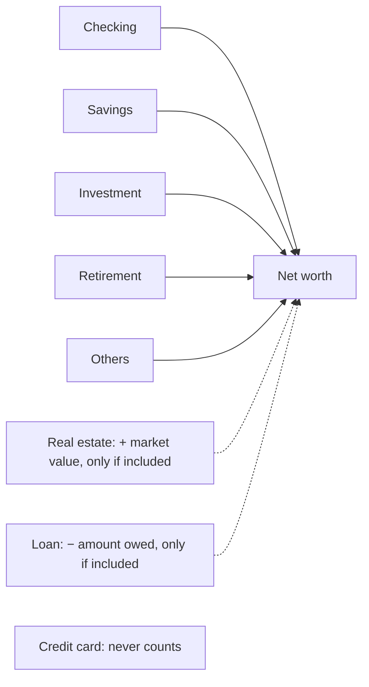

# Dashboard

The dashboard is the first screen after you sign in: your net worth and how it
has moved, every account at a glance, and what you have been spending on
lately. Each block is a summary with a way into the page that has the detail.

{{TOC}}

## Quick start

1. Open **Dashboard** from the sidebar.
2. Read **Net Worth Evolution** at the top: the total, and how it changed this
   month and over the last 12 months.
3. Look down the **Accounts** cards for a balance that moved more than you
   expected.
4. Check **Top spending categories** and **Cashflow** to see where this
   month's money is going.
5. Switch on **privacy mode** from the user menu before you open the app in
   public.

## What is on the dashboard

From top to bottom:

| Block                       | What it shows                                                       | Where to go for more                                        |
| --------------------------- | ------------------------------------------------------------------- | ----------------------------------------------------------- |
| **Monthly summary notice**  | That last month's report is ready, with its headline                | [Monthly summary](/documentation/monthly-summary)           |
| **Net Worth Evolution**     | Your net worth over the last 12 months or 30 days                   | [Accounts › Net worth](/documentation/accounts#net-worth)   |
| **Accounts**                | One card per account: balance, change against last month, sparkline | [Accounts](/documentation/accounts)                         |
| **Monthly savings**         | This month across your monthly savings goals                        | [Savings goals](/documentation/savings-goals#monthly-goals) |
| **Top spending categories** | Where your spending went in the last 30 days                        | [Categories](/documentation/categories)                     |
| **Top labels**              | Spending per label in the last 30 days                              | [Labels](/documentation/labels)                             |
| **Cashflow**                | This month's income, expenses, net and savings rate                 | [Cashflow](/documentation/cashflow)                         |

Some blocks only appear when they have something to say: the notice when there
is a report you have not dismissed, **Monthly savings** when you have a monthly
goal, and **Top labels** when something you spent in the last 30 days carries a
label.

## Net worth

### What goes into it

Net worth adds up your accounts' balances, converted to your currency:

- **Checking, savings, investment, retirement and other accounts** always add
  their balance. An overdrawn account takes away from the total.
- **Real estate** adds its market value, and **loans** subtract what you owe,
  but only when you include them. Both start off for new users.
- **Credit cards** never count, whatever you owe on them.
- An **archived** account stops counting from the day it was archived. The
  months before keep it.

The rules, and why credit cards are left out, are on the
[Accounts page](/documentation/accounts#net-worth). Accounts hidden from the
dashboard still count: hiding only takes the card away.

### Including loans and real estate

Open the settings button on the chart (the sliders icon, top right) and switch
**Include loans** or **Include real estate**. The choice is saved to your
account and applies to your net worth everywhere, not only to this chart: the
achievements and the monthly summary use it too.

### Reading the chart

The large figure is your net worth today. Under it, two trends:

- **this month** compares today with the end of last month.
- **for the last 12 months** compares today with a year ago.

Hover or tap a trend to see the same change as an amount.

Each bar is a month, stacked by account, so you can see which accounts make up
the total and which one grew. With loans included, the bars are scaled so their
height is your net worth, and hovering a month lists what is owed next to the
assets. If what you owe is more than what you have, the month is drawn as a bar
below zero.

The controls next to the title change the view:

- **Monthly / Daily** switches between the last 12 months and the last 30 days.
  In the daily view the trends read **today** and **for the last 30 days**.
- **Aggregate** draws the stacked balances, **MoM** the change from one month
  (or day) to the next as an amount, and **MoM%** the same change as a
  percentage.

On a phone, the period and the chart type move into the settings button.

## Account cards

Under the chart there is one card per account, in the order you choose. Each
card shows:

- **The balance today**, in your currency.
- **The change against last month**, green when it went up and red when it went
  down. Hover or tap it for the change as a percentage.
- **A sparkline** of the last 12 months. Hover it to read a month's balance,
  and for investment, retirement and savings accounts what you had invested.

A few cards work differently:

- **Credit cards** show how much of the limit is in use instead of a balance.
  See [Credit cards](/documentation/accounts/credit-cards).
- **Real estate with a linked mortgage** shows its equity: the market value
  minus what is still owed, with the bank that holds the mortgage under the
  name. The loan itself gets no card of its own.

Click an account's name to open it. On a manual account, click the balance to
open **Update balance** (**Update owed amount** on a loan) and record a new figure without leaving the
dashboard. Connected accounts update their balance on their own, so theirs is
not clickable.

### Hiding and reordering accounts

Press the pencil next to **Accounts** to open **Edit accounts**:

- The eye on each row hides that account from the dashboard, or brings it back.
- The handle on the right drags it to a new position.

The order is shared with the Accounts page. Hiding only affects the dashboard:
the account still counts towards net worth and appears everywhere else. To put
away an account you no longer use, [archive it](/documentation/accounts#archiving-an-account)
instead.

## Spending blocks

### Top spending categories

Your ten largest spending categories over the **last 30 days**, each with its
share of the total and a bar to compare them. The arrow next to a category
compares it with the 30 days before, and is left out when there was no spending
to compare with.

- A parent category with subcategories can be expanded to see how it splits.
- Clicking a row opens the transactions behind it, already filtered.
- **Analyze** opens **Category analysis**: a category's spending month by month
  over the last 12 months, its monthly average, and whether the last six months
  were higher or lower than the six before.

### Top labels

The same view for [labels](/documentation/labels): the ten labels you spent
most on in the last 30 days. A transaction with two labels counts under both,
so the labels can add up to more than you spent. The labels behind savings
goals are left out, because they track saving, not spending.

### Cashflow

This calendar month in four figures: **Income**, **Expenses**, **Net** and the
**Savings rate**. The savings rate turns green at 20% or more, yellow between 0%
and 20%, and red when you spent more than you earned. **View details** opens the
full [Cashflow](/documentation/cashflow) page, which explains how each figure is
worked out.

### Monthly savings

When you have a monthly savings goal, a card shows this month across all of
them: what you have saved against the sum of their targets, the days left, how
many goals you met last month, and a line per goal. **See all** opens Planning.
The [savings goals page](/documentation/savings-goals#where-else-monthly-goals-show-up)
explains the figures.

### The monthly summary notice

Once your [monthly summary](/documentation/monthly-summary) for the month before
has been sent, a notice at the top of the dashboard says
it is ready and gives its headline. **Open it** shows the report; the cross
puts the notice away on every device.

## Privacy mode

Privacy mode hides your amounts so you can open Whisper Money on a train, in a
café, or while sharing your screen.

### Turning it on and off

Open the user menu (your name at the bottom of the sidebar) and choose **Enable
privacy mode**. Choose **Disable privacy mode** in the same place to switch it
off. While it is on, the logo turns into a birdhouse, so you can tell at a
glance.

The setting belongs to the browser, not to your account: turning it on in your
laptop leaves your phone as it was, and it stays on in that browser until you
turn it off.

### What it hides

- **Every amount, everywhere in the app.** The digits are replaced by asterisks,
  so `$1,234.56` reads `$*,***.**`. Chart tooltips are masked too.
- **Transaction descriptions.** Each one is swapped for a made-up description
  such as "Grocery Store" or "Coffee Shop Purchase", in your language. A
  transaction always gets the same made-up description, so the list still
  reads like a list. Categories, labels and dates are left as they are.

Percentages stay visible: the trends, the savings rate and shares give no
amount away, and they keep the dashboard useful with the numbers hidden.

### Revealing one block

Sometimes you need one figure, not all of them. With privacy mode on, each
dashboard block gets an eye button next to its title: the net worth chart,
every account card, **Top spending categories**, **Top labels** and
**Cashflow**. Press it to show that block's amounts, tooltips included, while
the rest of the page stays hidden. Press it again to hide them.

A reveal is never remembered. Reloading the page, leaving the dashboard, or
turning privacy mode off and on hides every block again.

## FAQ

### Why doesn't my net worth match the sum of my account cards?

The cards include accounts that net worth leaves out: credit cards always, and
loans and real estate unless you include them. A real estate card with a
mortgage also shows equity rather than market value.

### Why is my loan or my flat missing from net worth?

Loans and real estate start off for new users. Switch on **Include loans** or
**Include real estate** in the chart's settings.

### I hid an account. Why is it still in the chart?

Hiding takes the card off the dashboard and nothing else. The account still
counts towards net worth. Archive it if you no longer use it.

### Why is the Top labels card missing?

Nothing you spent in the last 30 days carries a label, or the only labels are
savings goals'. The card appears as soon as there is labelled spending.

### Does privacy mode hide my data from Whisper Money?

No. It only changes what the screen shows, in that browser. Your data is stored
the same way with privacy mode on or off.

### Why did a block hide its amounts again?

Revealing a block lasts until you reload, leave the dashboard, or toggle privacy
mode. Press its eye button again.

### Does privacy mode follow me to my other devices?

No. It is saved in the browser where you turned it on. Turn it on in each
browser you want it in.
