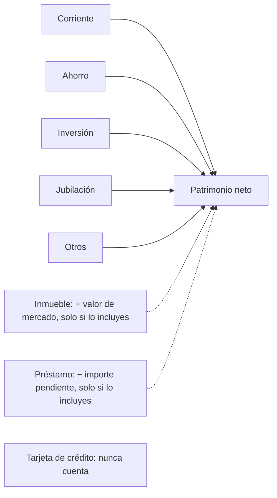

# Panel

El panel es la primera pantalla después de entrar: tu patrimonio neto y cómo se
ha movido, todas tus cuentas de un vistazo y en qué has gastado últimamente.
Cada bloque es un resumen con un acceso a la página que tiene el detalle.

{{TOC}}

## Inicio rápido

1. Abre **Panel** desde la barra lateral.
2. Lee **Evolución del Patrimonio Neto** arriba del todo: el total y cómo ha
   cambiado este mes y en los últimos 12 meses.
3. Repasa las tarjetas de **Cuentas** por si algún saldo se ha movido más de lo
   que esperabas.
4. Mira **Principales categorías de gasto** y **Flujo de Caja** para ver a dónde
   va el dinero este mes.
5. Activa el **modo privado** desde el menú de usuario antes de abrir la
   aplicación en público.

## Qué hay en el panel

De arriba abajo:

| Bloque                              | Qué muestra                                                                  | Dónde ver más                                                           |
| ----------------------------------- | ---------------------------------------------------------------------------- | ----------------------------------------------------------------------- |
| **Aviso del resumen mensual**       | Que el informe del mes pasado está listo, con su titular                     | [Resumen mensual](/documentation/monthly-summary)                       |
| **Evolución del Patrimonio Neto**   | Tu patrimonio neto en los últimos 12 meses o 30 días                         | [Cuentas › Patrimonio neto](/documentation/accounts#patrimonio-neto)    |
| **Cuentas**                         | Una tarjeta por cuenta: saldo, cambio respecto al mes anterior y minigráfico | [Cuentas](/documentation/accounts)                                      |
| **Ahorro mensual**                  | Este mes en tus objetivos de ahorro mensuales                                | [Objetivos de ahorro](/documentation/savings-goals#objetivos-mensuales) |
| **Principales categorías de gasto** | En qué se fue tu gasto en los últimos 30 días                                | [Categorías](/documentation/categories)                                 |
| **Principales etiquetas**           | El gasto por etiqueta en los últimos 30 días                                 | [Etiquetas](/documentation/labels)                                      |
| **Flujo de Caja**                   | Ingresos, gastos, neto y tasa de ahorro de este mes                          | [Flujo de caja](/documentation/cashflow)                                |

Algunos bloques solo aparecen cuando tienen algo que contar: el aviso, cuando
hay un informe que no has descartado; **Ahorro mensual**, cuando tienes un
objetivo mensual; y **Principales etiquetas**, cuando algo que has gastado en
los últimos 30 días lleva una etiqueta.

## Patrimonio neto

### Qué entra en él

El patrimonio neto suma los saldos de tus cuentas, convertidos a tu moneda:

- **Las cuentas corrientes, de ahorro, inversión, jubilación y otras** siempre
  suman su saldo. Una cuenta en números rojos resta del total.
- **Los inmuebles** suman su valor de mercado y **los préstamos** restan lo que
  debes, pero solo si los incluyes. Los dos empiezan desactivados para los
  usuarios nuevos.
- **Las tarjetas de crédito** nunca cuentan, debas lo que debas en ellas.
- Una cuenta **archivada** deja de contar desde el día en que la archivaste. Los
  meses anteriores la mantienen.

Las reglas, y por qué las tarjetas de crédito se quedan fuera, están en la
[página de cuentas](/documentation/accounts#patrimonio-neto). Las cuentas
ocultas en el panel siguen contando: ocultarlas solo quita la tarjeta.

### Incluir préstamos e inmuebles

Abre el botón de ajustes del gráfico (el icono de controles, arriba a la
derecha) y activa **Incluir préstamos** o **Incluir bienes raíces**. La
elección se guarda en tu cuenta y vale para tu patrimonio neto en todas partes,
no solo en este gráfico: los logros y el resumen mensual también la usan.

### Leer el gráfico

La cifra grande es tu patrimonio neto hoy. Debajo, dos tendencias:

- **este mes** compara hoy con el final del mes pasado.
- **en los últimos 12 meses** compara hoy con hace un año.

Pasa el ratón o toca una tendencia para ver el mismo cambio como importe.

Cada barra es un mes, apilada por cuenta, así que ves qué cuentas forman el
total y cuál ha crecido. Con los préstamos incluidos, las barras se escalan para
que su altura sea tu patrimonio neto, y al pasar por un mes se ve lo que debes
junto a los activos. Si debes más de lo que tienes, el mes se dibuja como una
barra por debajo de cero.

Los controles junto al título cambian la vista:

- **Mensual / Diario** alterna entre los últimos 12 meses y los últimos 30
  días. En la vista diaria las tendencias dicen **hoy** y **en los últimos 30
  días**.
- **Aggregate** dibuja los saldos apilados, **MoM** el cambio de un mes (o día)
  al siguiente como importe y **MoM%** el mismo cambio en porcentaje.

En el móvil, el periodo y el tipo de gráfico pasan al botón de ajustes.

## Tarjetas de cuentas

Debajo del gráfico hay una tarjeta por cuenta, en el orden que elijas. Cada una
muestra:

- **El saldo de hoy**, en tu moneda.
- **El cambio respecto al mes anterior**, en verde si ha subido y en rojo si ha
  bajado. Pasa el ratón o tócalo para verlo en porcentaje.
- **Un minigráfico** de los últimos 12 meses. Pasa por encima para leer el saldo
  de un mes y, en las cuentas de inversión, jubilación y ahorro, lo que tenías
  invertido.

Algunas tarjetas funcionan distinto:

- **Las tarjetas de crédito** muestran cuánto del límite está en uso en lugar de
  un saldo. Consulta [Tarjetas de crédito](/documentation/accounts/credit-cards).
- **Un inmueble con hipoteca vinculada** muestra su valor neto: el valor de
  mercado menos lo que queda por pagar, con el banco de la hipoteca bajo el
  nombre. El préstamo no tiene tarjeta propia.

Pulsa el nombre de una cuenta para abrirla. En una cuenta manual, pulsa el saldo
para abrir **Actualizar balance** (**Actualizar monto adeudado** en un
préstamo) y apuntar una cifra nueva sin salir del panel. Las cuentas conectadas
actualizan su saldo solas, así que el suyo no se puede pulsar.

### Ocultar y reordenar cuentas

Pulsa el lápiz junto a **Cuentas** para abrir **Editar cuentas**:

- El ojo de cada fila oculta esa cuenta del panel o la vuelve a mostrar.
- El asa de la derecha la arrastra a otra posición.

El orden es el mismo que en la página de Cuentas. Ocultar solo afecta al panel:
la cuenta sigue contando en el patrimonio neto y aparece en todo lo demás. Para
guardar una cuenta que ya no usas,
[archívala](/documentation/accounts#archivar-una-cuenta).

## Bloques de gasto

### Principales categorías de gasto

Tus diez categorías con más gasto en los **últimos 30 días**, cada una con su
parte del total y una barra para compararlas. La flecha junto a una categoría
la compara con los 30 días anteriores, y no aparece cuando no había gasto con
el que comparar.

- Una categoría padre con subcategorías se puede desplegar para ver cómo se
  reparte.
- Al pulsar una fila se abren sus transacciones, ya filtradas.
- **Analizar** abre **Análisis de categoría**: el gasto de una categoría mes a
  mes en los últimos 12 meses, su media mensual y si los últimos seis meses
  fueron más altos o más bajos que los seis anteriores.

### Principales etiquetas

La misma vista para las [etiquetas](/documentation/labels): las diez etiquetas
en las que más has gastado en los últimos 30 días. Una transacción con dos
etiquetas cuenta en las dos, así que las etiquetas pueden sumar más de lo que
gastaste. Las etiquetas de los objetivos de ahorro se quedan fuera, porque
siguen lo que ahorras, no lo que gastas.

### Flujo de Caja

Este mes natural en cuatro cifras: **Ingresos**, **Gastos**, **Neto** y la
**Tasa de ahorro**. La tasa de ahorro se pone verde a partir del 20 %, amarilla
entre el 0 % y el 20 % y roja cuando has gastado más de lo que has ganado. **Ver
detalles** abre la página completa de [Flujo de caja](/documentation/cashflow),
que explica cómo se calcula cada cifra.

### Ahorro mensual

Cuando tienes un objetivo de ahorro mensual, una tarjeta muestra este mes en
todos ellos: lo que has ahorrado frente a la suma de sus objetivos, los días que
quedan, cuántos cumpliste el mes pasado y una línea por objetivo. **Ver todo**
abre Planificación. La
[página de objetivos de ahorro](/documentation/savings-goals#donde-mas-aparecen)
explica las cifras.

### El aviso del resumen mensual

Cuando se ha enviado tu [resumen mensual](/documentation/monthly-summary) del mes
anterior, un aviso arriba del panel dice que está listo y muestra su titular.
**Abrirlo** enseña el informe; la cruz guarda el aviso en todos tus
dispositivos.

## Modo privado

El modo privado oculta tus importes para que puedas abrir Whisper Money en el
tren, en una cafetería o mientras compartes pantalla.

### Activarlo y desactivarlo

Abre el menú de usuario (tu nombre, abajo en la barra lateral) y elige
**Activar modo privado**. Elige **Desactivar modo privado** en el mismo sitio
para quitarlo. Mientras está activo, el logo se convierte en una casita de
pájaros, así lo reconoces de un vistazo.

El ajuste es del navegador, no de tu cuenta: activarlo en el portátil deja el
móvil como estaba, y sigue activo en ese navegador hasta que lo quites.

### Qué oculta

- **Todos los importes, en toda la aplicación.** Las cifras se sustituyen por
  asteriscos, así que `1.234,56 €` se lee `*.***,** €`. Los tooltips de los
  gráficos también se ocultan.
- **Las descripciones de las transacciones.** Cada una se cambia por una
  inventada, como «Supermercado» o «Compra en cafetería», en tu idioma. Una
  transacción recibe siempre la misma descripción inventada, así que la lista
  sigue pareciendo una lista. Categorías, etiquetas y fechas no cambian.

Los porcentajes siguen visibles: las tendencias, la tasa de ahorro y los
repartos no revelan ningún importe, y mantienen el panel útil con las cifras
ocultas.

### Mostrar un solo bloque

A veces necesitas una cifra, no todas. Con el modo privado activo, cada bloque
del panel tiene un botón con un ojo junto al título: el gráfico de patrimonio
neto, cada tarjeta de cuenta, **Principales categorías de gasto**,
**Principales etiquetas** y **Flujo de Caja**. Púlsalo para ver los importes de
ese bloque, tooltips incluidos, mientras el resto de la página sigue oculto.
Vuelve a pulsarlo para ocultarlos.

Lo que muestras nunca se recuerda. Recargar la página, salir del panel o
desactivar y volver a activar el modo privado oculta otra vez todos los bloques.

## Preguntas frecuentes

### ¿Por qué mi patrimonio neto no coincide con la suma de las tarjetas de cuentas?

Las tarjetas incluyen cuentas que el patrimonio neto deja fuera: siempre las
tarjetas de crédito, y los préstamos y los inmuebles salvo que los incluyas. Un
inmueble con hipoteca, además, muestra su valor neto y no su valor de mercado.

### ¿Por qué mi préstamo o mi piso no aparecen en el patrimonio neto?

Los préstamos y los inmuebles empiezan desactivados para los usuarios nuevos.
Activa **Incluir préstamos** o **Incluir bienes raíces** en los ajustes del
gráfico.

### He ocultado una cuenta. ¿Por qué sigue en el gráfico?

Ocultarla quita la tarjeta del panel y nada más. La cuenta sigue contando en el
patrimonio neto. Archívala si ya no la usas.

### ¿Por qué no aparece la tarjeta de Principales etiquetas?

Nada de lo que has gastado en los últimos 30 días lleva una etiqueta, o las
únicas son las de los objetivos de ahorro. La tarjeta aparece en cuanto hay
gasto etiquetado.

### ¿El modo privado oculta mis datos a Whisper Money?

No. Solo cambia lo que se ve en pantalla, en ese navegador. Tus datos se guardan
igual con el modo privado activo o no.

### ¿Por qué un bloque ha vuelto a ocultar sus importes?

Mostrar un bloque dura hasta que recargas, sales del panel o cambias el modo
privado. Vuelve a pulsar su botón del ojo.

### ¿El modo privado me sigue en mis otros dispositivos?

No. Se guarda en el navegador donde lo activaste. Actívalo en cada navegador en
el que lo quieras.
