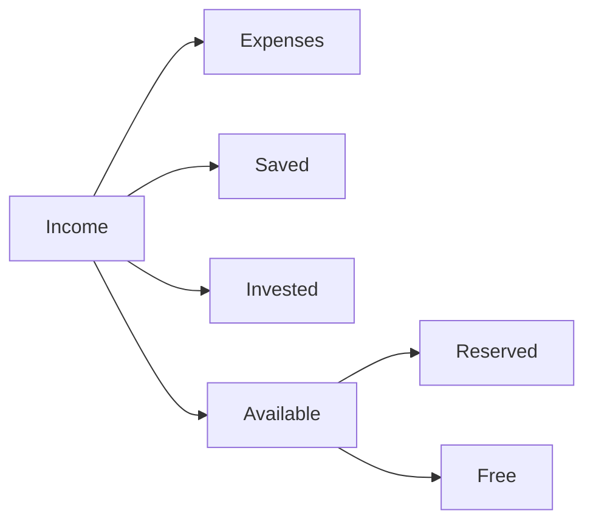

# Cashflow

Cashflow shows how money moves in and out during a month, a quarter or a year: what came in, what went out, what you set aside, and what is still free to spend.

{{TOC}}

## Quick start

1. Pick **Month**, **Quarter** or **Year**, and move between periods with the arrows.
2. Read **Net Cashflow**: income minus expenses.
3. Read **Available** and its **Free** figure: what is left once spending and money set aside are counted, and how much of it your budgets still need.
4. Check **Expenses** to see how much of your spending was fixed, variable or outside any budget.
5. Open **View details** for the full picture, and follow a block's arrow to its transactions when something looks off.

## How the money splits



The formulas behind the cards:

```text
Net cashflow = Income - Expenses
Available    = Income - Expenses - Saved - Invested
Free         = Available - Reserved
```

## Period navigation

Choose a view at the top of the page:

- **Month**: one calendar month.
- **Quarter**: three months, from Q1 (January to March) to Q4.
- **Year**: a calendar year.

The arrows move to the previous or next period of the same kind. Every card
compares the period with the one before it: the previous month, quarter or year.

The URL keeps the view and the period, so you can refresh or share the same view.

## Summary cards

<div class="cards-wrapper">

<div class="card">
### Net Cashflow

Income minus expenses, with the savings rate next to it: the share of income
that was not spent.

Below it you see the income and expense totals it comes from, each compared
with the previous period. Negative means you spent more than you earned.

</div>

<div class="card">
### Saved & Invested

How much of the net cashflow you set aside, and what share of it that was.

**Saved** and **Invested** are shown apart. When you put money into both, a
pill next to each shows its share and a bar draws the split.

The figures come from transactions in savings and investment categories, so
they only fill in once you use those category types.

</div>

<div class="card">
### Available

What is left of your income once expenses and the money you saved or invested
are counted, and the share of income that is.

It is compared with the previous period. Below it, **Income** and **Allocated**
(expenses plus what you contributed) show where it comes from.

</div>

<div class="card">
### Expenses

Your spending for the period, with its share of income, split into **Fixed**,
**Variable** and **General** by the budgets that track it.

Each row has an arrow to its transactions. **View details** opens the full
breakdown.

</div>
</div>

## Available and Free

**Available** is what your income did not go to: not spent, not saved, not
invested.

```text
Available = Income - Expenses - Saved - Invested
```

Part of it may already be spoken for. If a budget still has money left this
week or this month, you will most likely spend it before the period ends. That
is the **reserved** amount, and what remains is **Free**:

```text
Free = Available - Reserved
```

The Available card shows Free at the bottom, with the amount reserved in
budgets, or "Nothing reserved in budgets" when there is none.

### What counts as reserved

Reserved adds up what is left in each budget period that:

- overlaps the period you are looking at, and
- is **in progress today**.

A budget period that is over does not reserve anything: whatever it left
unspent is already part of Available. One that has not started yet does not
reserve anything either. A budget that went over adds nothing, rather than
taking money from the others. Archived budgets and carried-over amounts are not
counted.

Which budgets count depends on the view:

- **Month** and **Quarter**: weekly, bi-weekly and monthly budgets.
- **Year**: yearly budgets only.

A yearly budget's margin is not money held back from one month's income, and a
monthly budget says little about a whole year, so each is kept to the view it
fits. See [budget periods](/documentation/budgets#budget-periods) and
[budgets on the Cashflow page](/documentation/budgets#budgets-on-the-cashflow-page).

When you look at a past period, no budget period is in progress any more, so
nothing is reserved and Free equals Available.

## Expenses: fixed, variable and general

The Expenses card splits your spending by the
[expense type](/documentation/budgets#expense-type) of the budgets that track
it:

- **Fixed**: spending tracked by a budget marked as a fixed expense. Rent,
  subscriptions, insurance: the same amount every period.
- **Variable**: spending tracked by a budget marked as a variable expense, and
  by no fixed one. Groceries, restaurants: spending you can adjust.
- **General**: spending no budget tracks.

A transaction counts as tracked when its category (or a parent category) or
one of its labels is tracked by a budget that has a period in the view. A
transaction tracked by both a fixed and a variable budget counts once, as
fixed.

The [catch-all budget](/documentation/budgets#a-budget-for-everything-else) does
not count here: it tracks whatever nothing else does, so its spending stays in
**General**.

New budgets are variable by default. If everything shows up as variable or
general, set the expense type on your budgets.

The three parts always add up to the total. Unlike reserved, the split works
just as well for a past period as for the current one.

## Where your money goes

**View details** on the Expenses card opens a panel with the whole period:

- **Tiles**: Income, Allocated, Available and Free, with the amount reserved.
- **Income bar**: your income split into Fixed, Variable, General, Saved,
  Invested, Reserved and Free. If you allocated more than you earned, the panel
  says by how much.
- **Blocks table**: each block with its **% of income**, its amount, and the
  change against the previous period. Spending less is shown as good news;
  contributing less to savings or investments is not.
- **Fixed budgets** and **Variable budgets**: the budget periods in progress in
  this view, each with what you spent of what you allocated and what is left,
  and how much each group reserves.

A note at the bottom reminds you which budgets the view reserves: yearly
budgets in the Year view, weekly and monthly ones in the Month view.

## View a block's transactions

Every block on the Expenses card and in the blocks table has an arrow. It opens
the transactions list filtered to that block (fixed, variable, general, saved or
invested) and to the dates of the period you were looking at, so the list adds
up to the figure you clicked.

The filter shows as a chip you can remove. See
[the cashflow block filter](/documentation/transactions#cashflow-block).

## Trend chart

**Cashflow Trend** shows income, expenses and net cashflow month by month. In
the Month view it covers the last 12 months; in the Quarter and Year views, the
months of the selected period.

Use it to spot patterns: a month with an unusual bill, income that changes with
the seasons.

## Money flow

**Money Flow** draws the period as one diagram: income categories on the left,
**Available** in the middle, and where the money went on the right, expense,
savings and investment categories alike.

The width of each band is its amount. Small categories are grouped under
**Other**. Click a category with subcategories to open them, or a category
without them to see its transactions.

## Income and expense breakdowns

Two lists: **Income Sources** (where your money comes from) and **Expense
Categories** (where your money goes), each category with its share of the total
and its change against the previous period.

Open a category with subcategories to see them, or click a category to see its
transactions. Uncategorized transactions appear as their own row, which is
usually the first thing to fix when a total looks wrong.

## Monthly savings

In the Month view, a card shows how the month's net cashflow went towards your
[monthly savings goals](/documentation/savings-goals), against the sum of their
targets.

## Transfers in cashflow

Transfers are special.

Most transfers between your own accounts should not count as income or spending. If a transfer should appear in cashflow, set its cashflow direction on the category.

Options:

- Do not show.
- Show as cash inflow.
- Show as cash outflow.

## Money you set aside

Savings and investment categories are counted as money going out of your
day-to-day finances, the same as an expense, but they are kept separate from
spending: they are what fills the Saved & Invested card, and they are taken out
of Available.

Use them for a transfer to an emergency fund or a deposit at a broker, and use a
plain transfer category for movement that is not either of those.

## When cashflow looks wrong

Check these first:

1. Are transactions categorized correctly?
2. Are transfers using the right cashflow direction?
3. Are dates in the expected period?
4. Are imported amounts positive and negative the right way around?
5. Are there uncategorized transactions?
6. Do your budgets have the right expense type, fixed or variable?
7. Are you in the view that matches your budgets: Month or Quarter for weekly and monthly budgets, Year for yearly ones?

## FAQ

### Why is the savings rate negative?

Expenses were higher than income for the selected period.

### Why is Available lower than Net Cashflow?

Available also takes out what you saved and invested. Net Cashflow only takes
out expenses.

### Why is everything in General?

General is spending no budget tracks. Create budgets for your regular spending
and set each one's [expense type](/documentation/budgets#expense-type) to fixed
or variable. Spending tracked by the catch-all budget always stays in General.

### Why is reserved 0?

Reserved only counts budget periods in progress today. In a past period none is
in progress, so nothing is reserved and Free equals Available. In the current
period, it is 0 when your budgets for this view have nothing left or you have no
budgets of that periodicity.

### Why doesn't my yearly budget appear in the month's reserved?

The Month and Quarter views only reserve weekly, bi-weekly and monthly budgets.
Switch to the Year view to see what your yearly budgets reserve.

### Why does a yearly budget count in a month's fixed or variable expenses, then?

The expense split follows every budget with a period in the view, whatever its
periodicity: a transaction tracked by a yearly fixed budget is a fixed expense
in any month. Only reserved is limited by the view.

### Why are transfers missing?

Transfer categories are usually hidden from cashflow. Change cashflow direction if you want them shown.

### Why does the current period look incomplete?

The period may not be finished yet. Income or bills may still be missing.
