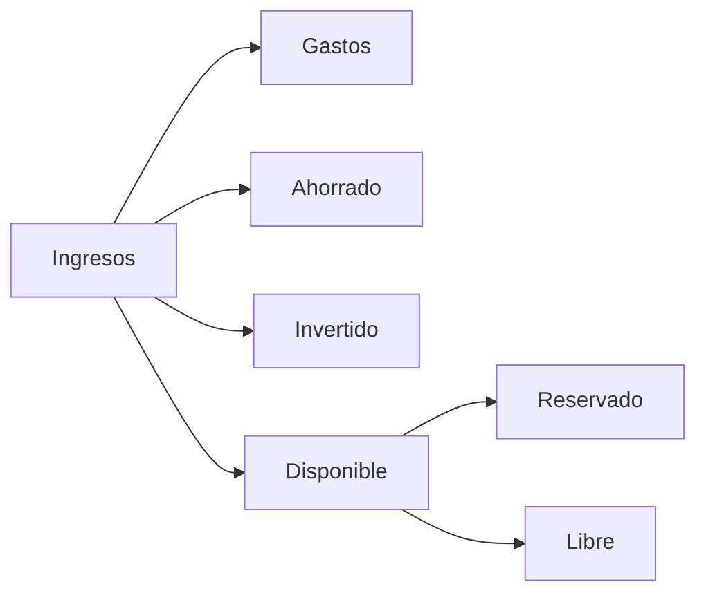

# Flujo de caja

El flujo de caja muestra cómo entra y sale el dinero en un mes, un trimestre o un año: lo que entró, lo que salió, lo que apartaste y lo que aún tienes libre para gastar.

{{TOC}}

## Inicio rápido

1. Elige **Mes**, **Trimestre** o **Año** y muévete entre periodos con las flechas.
2. Mira el **Flujo Neto**: ingresos menos gastos.
3. Mira **Disponible** y su cifra **Libre**: lo que queda después de gastos y de lo que has apartado, y cuánto de eso aún necesitan tus presupuestos.
4. Revisa **Gastos** para ver cuánto de tu gasto fue fijo, variable o fuera de cualquier presupuesto.
5. Abre **Ver detalles** para verlo todo y sigue la flecha de un bloque hasta sus transacciones cuando algo no cuadre.

## Cómo se reparte el dinero



Las fórmulas que hay detrás de las tarjetas:

```text
Flujo neto = Ingresos - Gastos
Disponible = Ingresos - Gastos - Ahorrado - Invertido
Libre      = Disponible - Reservado
```

## Navegación por periodo

Elige una vista en la parte superior de la página:

- **Mes**: un mes natural.
- **Trimestre**: tres meses, del T1 (enero a marzo) al T4.
- **Año**: un año natural.

Las flechas pasan al periodo anterior o siguiente del mismo tipo. Cada tarjeta
compara el periodo con el anterior: el mes, el trimestre o el año previo.

La URL guarda la vista y el periodo, así que puedes recargar o compartir la misma
vista.

## Tarjetas de resumen

<div class="cards-wrapper">

<div class="card">
### Flujo Neto

Ingresos menos gastos, con la tasa de ahorro al lado: la parte de los ingresos
que no se gastó.

Debajo verás los totales de ingresos y gastos de los que sale, cada uno
comparado con el periodo anterior. Si es negativo, gastaste más de lo que
ganaste.

</div>

<div class="card">
### Ahorrado e invertido

Cuánto del flujo neto apartaste y qué porcentaje supone.

**Ahorrado** e **Invertido** se muestran por separado. Cuando apartas dinero,
un indicador junto a cada uno muestra su parte y una barra dibuja el reparto.

Las cifras salen de las transacciones con categorías de ahorro e inversión, así
que solo se rellenan cuando usas esos tipos de categoría.

</div>

<div class="card">
### Disponible

Lo que queda de tus ingresos después de contar los gastos y lo que ahorraste o
invertiste, y qué porcentaje de los ingresos representa.

Se compara con el periodo anterior. Debajo, **Ingresos** y **Destinado** (gastos
más lo aportado) muestran de dónde sale.

</div>

<div class="card">
### Gastos

Tu gasto del periodo, con su porcentaje sobre los ingresos, repartido entre
**Fijo**, **Variable** y **General** según los presupuestos que lo siguen.

Cada fila tiene una flecha a sus transacciones. **Ver detalles** abre el
desglose completo.

</div>
</div>

## Disponible y Libre

**Disponible** es lo que no se llevaron tus ingresos: ni gastado, ni ahorrado,
ni invertido.

```text
Disponible = Ingresos - Gastos - Ahorrado - Invertido
```

Una parte puede tener ya destino. Si a un presupuesto le queda dinero esta
semana o este mes, lo más probable es que lo gastes antes de que acabe el
periodo. Eso es lo **reservado**, y lo que queda es **Libre**:

```text
Libre = Disponible - Reservado
```

Por ejemplo, un presupuesto de supermercado de 200 con 120 gastados hasta ahora
reserva 80.

La tarjeta Disponible muestra Libre en la parte de abajo, junto a lo reservado
en presupuestos, o «Nada reservado en presupuestos» si no hay nada.

### Qué cuenta como reservado

Lo reservado suma lo que le queda a cada periodo de presupuesto que:

- se solapa con el periodo que estás viendo, y
- está **en curso hoy**.

Un periodo de presupuesto que ya terminó no reserva nada: lo que dejó sin gastar
ya forma parte de Disponible. Uno que aún no ha empezado tampoco. Un presupuesto
que se ha pasado no suma nada, en lugar de restar dinero a los demás. Los
presupuestos archivados y los importes arrastrados no cuentan.

Qué presupuestos cuentan depende de la vista:

- **Mes**: presupuestos semanales, quincenales y mensuales.
- **Trimestre**: presupuestos semanales, quincenales, mensuales y trimestrales.
- **Año**: solo presupuestos anuales.

Lo que le queda a un presupuesto trimestral o anual no es dinero retenido de los
ingresos de un mes, y un presupuesto mensual dice poco de un año entero, así que cada uno se
queda en la vista que le corresponde. Consulta
[periodos de presupuesto](/documentation/budgets#periodos-de-presupuesto) y
[presupuestos en el flujo de caja](/documentation/budgets#presupuestos-en-el-flujo-de-caja).

Cuando miras un periodo pasado o futuro, normalmente no hay nada en curso en
él, así que no hay nada reservado y Libre es igual a Disponible. La excepción es
un periodo de presupuesto semanal o quincenal que llega hasta hoy, como uno que
va de los últimos días del mes pasado a este.

## Gastos: fijos, variables y generales

La tarjeta Gastos reparte tu gasto según el
[tipo de gasto](/documentation/budgets#tipo-de-gasto) de los presupuestos que lo
siguen:

- **Fijo**: gasto que sigue un presupuesto marcado como gasto fijo. Alquiler,
  suscripciones, seguros: el mismo importe cada periodo.
- **Variable**: gasto que sigue un presupuesto marcado como gasto variable, y
  ninguno fijo. Supermercado, restaurantes: gasto que puedes ajustar.
- **General**: gasto que no sigue ningún presupuesto.

Una transacción cuenta como seguida cuando su categoría (o una categoría padre)
o una de sus etiquetas la sigue un presupuesto con un periodo dentro de la
vista. Si la siguen a la vez un presupuesto fijo y uno variable, cuenta una sola
vez, como fija.

El [presupuesto para todo lo demás](/documentation/budgets#un-presupuesto-para-todo-lo-demas)
no cuenta aquí: sigue lo que no sigue ningún otro, así que su gasto se queda en
**General**.

Los presupuestos nuevos son variables por defecto. Si todo aparece como variable
o general, indica el tipo de gasto en tus presupuestos.

Las tres partes siempre suman el total. A diferencia de lo reservado, el reparto
funciona igual de bien en un periodo pasado que en el actual.

## A dónde va tu dinero

**Ver detalles** en la tarjeta Gastos abre un panel con todo el periodo:

- **Recuadros**: Ingresos, Destinado, Disponible y Libre, con lo reservado.
- **Barra de ingresos**: tus ingresos repartidos entre Fijo, Variable, General,
  Ahorrado, Invertido, Reservado y Libre. Si asignaste más de lo que ingresaste,
  el panel te dice cuánto.
- **Tabla de bloques**: cada bloque con su **% de ingresos**, su importe y el
  cambio respecto al periodo anterior. Gastar menos se muestra como buena
  noticia; aportar menos a ahorro o inversión, no.
- **Presupuestos fijos** y **Presupuestos variables**: los periodos de
  presupuesto en curso en esta vista, cada uno con lo que gastaste de lo
  asignado y lo que le queda, y cuánto reserva cada grupo.

Una nota al final te remite a las otras vistas: en Mes te recuerda que los
presupuestos trimestrales se reservan en la vista Trimestre y los anuales en la
vista Año; en Trimestre, que los anuales se reservan en la vista Año; y en Año,
que los semanales y mensuales se reservan en la vista Mes y los trimestrales en
la vista Trimestre.

## Ver las transacciones de un bloque

Cada bloque de la tarjeta Gastos y de la tabla de bloques tiene una flecha. Abre
la lista de transacciones filtrada por ese bloque (fijo, variable, general,
ahorrado o invertido) y por las fechas del periodo que estabas viendo, así que
la lista suma la cifra en la que hiciste clic.

El filtro aparece como un chip que puedes quitar. Consulta
[el filtro por bloque de flujo de caja](/documentation/transactions#bloque-de-flujo-de-caja).

## Gráfico de tendencia

**Tendencia del Flujo de Caja** muestra ingresos, gastos y flujo neto mes a mes.
En la vista Mes cubre los 12 meses hasta el mes elegido; en las vistas Trimestre y Año, los
meses del periodo elegido.

Úsalo para detectar patrones: un mes con una factura fuera de lo normal,
ingresos que cambian según la temporada.

## Movimiento de dinero

El diagrama **Flujo de Caja** dibuja el periodo de un vistazo: las categorías de
ingresos a la izquierda, **Disponible** en el centro y a dónde fue el dinero a la
derecha, tanto categorías de gasto como de ahorro e inversión.

El ancho de cada banda es su importe. Debajo del importe de cada categoría ves su
porcentaje: el de una categoría de ingreso sobre el total de ingresos, y el de
una de gasto sobre el total de gastos. El nodo central añade qué parte de tus
ingresos te quedó. Los porcentajes se redondean a enteros, así que un lado puede
sumar 99 % o 101 %, y uno demasiado pequeño para redondear aparece como `<1%`.
En el modo privacidad los importes se ocultan y los porcentajes se quedan,
porque un porcentaje no revela ningún importe.

Haz clic en una categoría con subcategorías para abrirlas, o en una sin ellas
para ver sus transacciones. Dentro de una categoría abierta, el porcentaje de
cada subcategoría es sobre esa categoría padre, no sobre todo el lado: al abrir
Comida ves cuánto de tu gasto en comida fue el supermercado.

### Otros

Cuando un lado tiene más de cinco categorías, las que están por debajo del 3 %
de ese lado se agrupan en **Otros**, para que el diagrama se pueda leer. Las tres
más grandes se muestran siempre por separado, y Otros solo aparece cuando
reuniría al menos dos categorías. Otros se abre como cualquier categoría padre: haz clic
en él, o enfócalo y pulsa Intro, y se divide en las categorías que contenía. El
lado de ingresos y el de gastos tienen cada uno su propio Otros, y se abren por
separado.


### Devoluciones y compensaciones

Una devolución cuenta contra la categoría a la que pertenece. Una cuenta de
restaurante de 60 en mayo y una devolución de 40 en junio dejan la categoría de
restaurantes en -40 en junio, en lugar de hacerla desaparecer del mes.

Cuando una categoría entera queda en el lado contrario, pasa a ese lado del
diagrama y lo indica en su nombre: **(devolución)** para una categoría de gasto
que trajo dinero, **(reintegro)** para una categoría de ingreso que sacó dinero,
y **(retirada)** para dinero que vuelve a salir de ahorro o inversión.

Dentro de una categoría abierta, una subcategoría que fue en sentido contrario
aparece como compensación: una línea con importe y porcentaje negativos, debajo
de las subcategorías, con una marca discontinua en lugar de banda. Una categoría
Banco con comisiones de 1.238, cargos de 284 e intereses cobrados de 28 suma
1.494; al abrirla muestra Comisiones 83 %, Cargos 19 % e Intereses -2 %, que
vuelven a sumar lo de la categoría padre.

## Desgloses de ingresos y gastos

Dos listas: **Fuentes de Ingresos** (de dónde viene tu dinero) y **Categorías de
Gastos** (a dónde va tu dinero), cada categoría con su parte del total y su
cambio respecto al periodo anterior.

Abre una categoría con subcategorías para verlas, o haz clic en una categoría
para ver sus transacciones. Las transacciones sin categoría aparecen como una
fila propia, que suele ser lo primero que hay que arreglar cuando un total
parece raro.

Una categoría cuyas devoluciones superaron a su gasto en el periodo se queda en
su lista con importe negativo, sin barra ni porcentaje. Así las filas siguen
sumando el total que tienen encima.

## Ahorro mensual

En la vista Mes, una tarjeta muestra cuánto del flujo neto del mes fue a tus
[objetivos de ahorro mensuales](/documentation/savings-goals), frente a la suma
de sus objetivos.

## Transferencias en el flujo de caja

Las transferencias son especiales.

La mayoría de transferencias entre tus propias cuentas no deberían contar como ingreso ni gasto. Si una transferencia debe aparecer en el flujo de caja, ajusta su dirección en la categoría.

Opciones:

- No mostrar.
- Mostrar como entrada de dinero.
- Mostrar como salida de dinero.

## El dinero que apartas

Las categorías de ahorro e inversión cuentan como dinero que sale de tus finanzas
del día a día, igual que un gasto, pero se mantienen separadas del gasto: son lo
que rellena la tarjeta «Ahorrado e invertido» y se restan de Disponible.

Úsalas para un traspaso al fondo de emergencia o una aportación al bróker, y usa
una categoría de transferencia normal para el movimiento que no sea ninguna de
las dos cosas.

## Cuando el flujo de caja parece incorrecto

Revisa esto primero:

1. ¿Las transacciones están bien categorizadas?
2. ¿Las transferencias usan la dirección correcta?
3. ¿Las fechas están en el periodo esperado?
4. ¿Los importes importados tienen el signo correcto?
5. ¿Hay transacciones sin categoría?
6. ¿Tus presupuestos tienen el tipo de gasto correcto, fijo o variable?
7. ¿Estás en la vista que corresponde a tus presupuestos: Mes o Trimestre para los semanales y mensuales, Trimestre para los trimestrales, Año para los anuales?

## Preguntas frecuentes

### ¿Por qué la tasa de ahorro es negativa?

Los gastos fueron mayores que los ingresos en el periodo seleccionado.

### ¿Por qué Disponible es menor que el Flujo Neto?

Disponible también resta lo que ahorraste e invertiste. El Flujo Neto solo
resta los gastos.

### ¿Por qué todo aparece en General?

General es el gasto que no sigue ningún presupuesto. Crea presupuestos para tu
gasto habitual y elige en cada uno su
[tipo de gasto](/documentation/budgets#tipo-de-gasto), fijo o variable. El gasto
que sigue el presupuesto para todo lo demás siempre se queda en General.

### ¿Por qué lo reservado es 0?

Lo reservado solo cuenta los periodos de presupuesto en curso hoy. Un periodo
pasado normalmente no tiene ninguno, así que no hay nada reservado y Libre es
igual a Disponible. En el periodo actual, es 0 cuando a tus presupuestos de esta vista
no les queda nada o no tienes presupuestos de esa periodicidad.

### ¿Por qué mi presupuesto anual no aparece en lo reservado del mes?

La vista Mes solo reserva presupuestos semanales, quincenales y mensuales, y la
vista Trimestre añade los trimestrales. Cambia a la vista Año para ver lo que
reservan tus presupuestos anuales, o a la vista Trimestre para los trimestrales.

### ¿Por qué un presupuesto anual sí cuenta en los gastos fijos o variables del mes?

El reparto del gasto sigue todos los presupuestos con un periodo dentro de la
vista, sea cual sea su periodicidad: una transacción que sigue un presupuesto
anual o trimestral fijo es un gasto fijo en cualquier mes. Solo lo reservado depende de la
vista.

### ¿Por qué una categoría muestra un importe negativo?

En el periodo le volvió más dinero del que salió, normalmente por la devolución
de algo comprado en un periodo anterior. Las devoluciones cuentan contra su
propia categoría, así que los totales coinciden con lo que de verdad gastaste.
Consulta [Devoluciones y compensaciones](#devoluciones-y-compensaciones).

### ¿Por qué faltan transferencias?

Las categorías de transferencia suelen estar ocultas del flujo de caja. Cambia la dirección si quieres mostrarlas.

### ¿Por qué el periodo actual parece incompleto?

Puede que el periodo aún no haya terminado. Pueden faltar ingresos o facturas.
