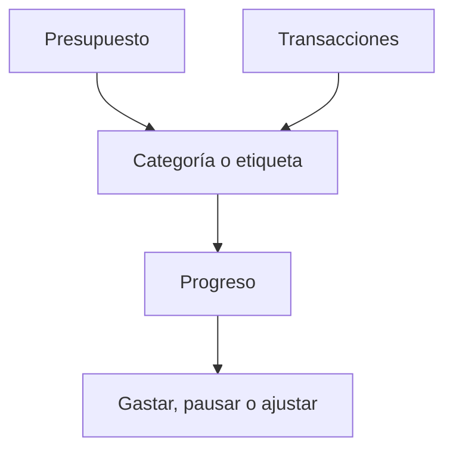

# Presupuestos

Los presupuestos te ayudan a planificar gastos y ver cuánto margen queda en un periodo.

{{TOC}}

## Inicio rápido

1. Crea un presupuesto para un área que quieres controlar.
2. Elige la categoría o etiqueta que debe seguir.
3. Define el importe del periodo.
4. Márcalo como gasto fijo o variable.
5. Revisa el progreso durante el mes.
6. Ajusta el presupuesto cuando tu gasto real cambie.

## Flujo de un presupuesto

## Qué sigue un presupuesto

Un presupuesto puede seguir gastos que coinciden con una categoría o etiqueta.

Usa una categoría cuando el gasto tiene un significado claro.

Usa una etiqueta cuando el gasto cruza varias categorías.

Ejemplo:

- Presupuesto por categoría: Supermercado.
- Presupuesto por etiqueta: Vacaciones, Proyecto, Viaje de trabajo.

## Buenos ejemplos de presupuesto

### Supermercado

Útil para gasto diario que ocurre a menudo.

Revisar semanalmente.

### Restaurantes

Útil para gasto opcional que puede crecer rápido.

Revisar a mitad de mes.

### Viajes

Útil para gastos que cruzan varias categorías.

Un presupuesto basado en etiqueta puede funcionar bien aquí.

### Suscripciones

Útil para gastos repetidos.

Las reglas de automatización pueden ayudar a mantenerlos categorizados.

## Leer el progreso del presupuesto

El progreso compara transacciones coincidentes con el importe del presupuesto.

Si el progreso es alto al principio del periodo, reduce el gasto o sube el presupuesto si el plan era demasiado bajo.

Si el progreso es bajo, puede que el presupuesto sea generoso o que el periodo no haya terminado.

## Periodos de presupuesto

Un presupuesto se repite en el periodo que elijas: **mensual**, **semanal**,
**cada dos semanas** o **anual**. El mensual encaja con la mayoría del gasto; el
semanal va bien para la compra; el anual sirve para cosas como seguros o
impuestos que llegan una vez.

Al revisar un presupuesto, asegúrate de mirar el periodo correcto.

### Qué pasa al final de un periodo

Cada presupuesto decide qué hacer con lo que sobra:

- **Reiniciar**: el periodo siguiente empieza de nuevo con el importe del
  presupuesto. Es la opción habitual para el gasto corriente.
- **Arrastrar**: lo que no has gastado se suma al periodo siguiente, y pasarte se
  lo come. Mejor para un presupuesto en el que vas acumulando, como un
  presupuesto anual de viajes.

## Tipo de gasto

Cada presupuesto tiene un **Tipo de gasto**: **Gasto fijo** o **Gasto
variable**. Lo eliges al crear el presupuesto y puedes cambiarlo siempre que lo
edites. Los presupuestos nuevos empiezan como variables. El presupuesto general
no tiene tipo de gasto: lo que recoge cuenta siempre como gasto general (lo ves
más abajo).

- **Fijo**: la misma cantidad cada periodo, como el alquiler o las
  suscripciones. Marca como fijo lo que no puedes recortar de un mes para otro:
  el alquiler o la hipoteca, las suscripciones, los seguros, el móvil e
  internet, las cuotas de un préstamo, el gimnasio.
- **Variable**: gastos que puedes ajustar, como el supermercado o los
  restaurantes.

El tipo de gasto no cambia cómo funciona el presupuesto. El progreso, los avisos
y lo que pasa al final de un periodo son iguales en los dos. Solo le dice a la
página de [Flujo de caja](/documentation/cashflow) cómo repartir tus gastos.

## Un presupuesto para todo lo demás

Un presupuesto se puede marcar como general. En lugar de seguir una categoría o
una etiqueta, absorbe todo el gasto que ningún otro presupuesto esté siguiendo ya.

Responde a la pregunta que un conjunto de presupuestos normalmente no puede:
cuánto estoy gastando fuera de lo que había planificado.

## Presupuestos en el flujo de caja

La página de [Flujo de caja](/documentation/cashflow) lee tus presupuestos de dos
formas.

### Gasto fijo, variable y general

La [tarjeta de Gastos](/documentation/cashflow#gastos-fijos-variables-y-generales)
reparte los gastos del periodo en tres partes:

- **Fijo**: lo gastado en las categorías y etiquetas que sigue un presupuesto
  fijo.
- **Variable**: lo gastado en lo que sigue un presupuesto variable.
- **General**: lo que no sigue ningún presupuesto. Lo que recoge el presupuesto
  general también cuenta aquí: por definición, es todo lo que tus otros
  presupuestos dejan fuera.

Una transacción que siguen a la vez un presupuesto fijo y uno variable cuenta
una sola vez, como fija. El reparto mira los presupuestos que tenían un periodo
dentro del rango que estás viendo, también los archivados, así que archivar un
presupuesto no pasa su gasto pasado a general.

### Reservado

La [tarjeta de Disponible](/documentation/cashflow#disponible-y-libre) muestra lo
que queda de tus ingresos después de gastos, ahorro e inversión. Parte de ese
dinero sigue comprometido con presupuestos que aún no has terminado de gastar:
eso es lo **Reservado**, y lo que queda es lo **Libre**.

Lo reservado suma lo que queda en cada periodo de presupuesto que está en curso
hoy y se solapa con la vista:

- Un presupuesto que ya está superado no suma nada. Nunca resta de los demás.
- Un periodo que ya terminó no suma nada, y uno que aún no ha empezado tampoco.
  Por eso un mes anterior no suele tener nada reservado.
- Los presupuestos archivados no suman nada.
- Solo cuenta el importe del presupuesto. Lo arrastrado de periodos anteriores
  se deja fuera.

Qué presupuestos cuentan depende de la vista. Las vistas **Mes** y **Trimestre**
cuentan los presupuestos semanales, de cada dos semanas y mensuales. La vista
**Año** cuenta solo los anuales.

## Avisos

Un presupuesto puede avisarte cuando necesita atención:

- Cuando entra una transacción nueva.
- Cuando se acerca a su límite.
- Cuando se pasa.

Llegan por correo y se configuran por presupuesto en Configuración →
Notificaciones, donde también puedes decidir con qué empiezan los presupuestos nuevos. Así puedes
vigilar los dos que importan y dejar el resto en silencio.

## Errores comunes

- Presupuestar antes de categorizar transacciones.
- Crear demasiados presupuestos de golpe.
- Mezclar compras puntuales con gasto mensual normal.
- Olvidar que las etiquetas pueden ser mejores para proyectos o viajes.

## Preguntas frecuentes

### ¿Los presupuestos cambian mis transacciones?

No. Los presupuestos leen transacciones. No las cambian.

### ¿Cada categoría debería tener un presupuesto?

No. Presupuesta solo lo que quieras controlar activamente.

### ¿Tengo que marcar cada presupuesto como fijo o variable?

No. Deja como variables los que no tengas claros. Cambia a fijos los pocos que
cubren facturas que no puedes recortar, como el alquiler o las suscripciones.

### ¿Por qué no hay nada reservado en el flujo de caja?

O no hay ningún periodo de presupuesto en curso hoy, o todos están ya agotados o
superados. Los presupuestos archivados nunca reservan nada. Un presupuesto anual
solo cuenta en la vista Año, y uno mensual solo en las vistas Mes y Trimestre.

### ¿Por qué un presupuesto aparece vacío?

Las transacciones coincidentes pueden estar sin categoría, usar otra etiqueta o estar en otro periodo.
