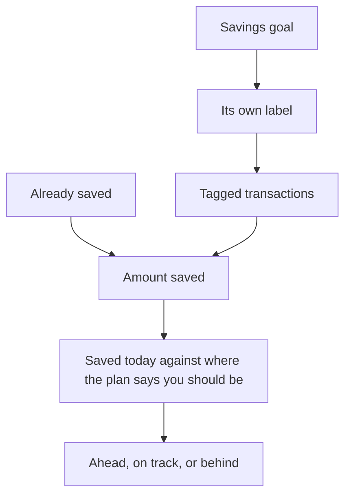
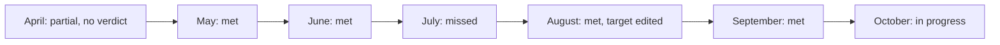

# Savings goals

A savings goal is an amount you are working towards, and a way of watching whether you will get there in time. A budget puts a ceiling on spending; a goal puts a floor under saving.

{{TOC}}

## Two kinds of goal

When you create a goal you pick its **Type**:

- **One-off (with a target)** — one amount to reach, such as a deposit for a
  flat, with an optional date. Most of this page is about these.
- **Monthly (recurring)** — an amount to put aside _every_ month, such as "save
  300 a month" or "save 20% of what I earn". Each month is judged on its own.
  See [Monthly goals](#monthly-goals).

Both kinds are a label underneath, and the rules for linking transactions and
for which way a transaction counts are the same for both. The kind is fixed once
the goal exists: to switch, create a new goal.

## Quick start

1. Open **Planning**, press **Create** and choose **Savings Goal**.
2. Leave the type on **One-off**, name it, set the amount you are aiming for,
   and pick a date if you have one.
3. Tell it what you had already put aside, if anything.
4. Link the transactions that fund it.
5. Come back and see whether you are ahead or behind.

## How a goal counts

## A goal is a label

Creating a goal creates a [label](/documentation/labels) with the same name, and
the goal tracks whatever carries it. That is the whole mechanism, and it is why
goals need so little setting up: labelling is something you already do.

The label belongs to the goal, so it does not clutter your label settings and
cannot be renamed out from under the goal. Renaming the goal renames it. You
also cannot create a goal with the name of a label you already have — pick
another name, or use a budget if that label is already doing this job.

## Linking transactions

**Link transactions** shows everything already tagged, plus a window of your
recent transactions, and you tick the ones that funded the goal. What you leave
ticked when you save is the complete set — unticking one takes it back out.

The window starts at your fifty most recent transactions and widens as you ask
for more. If what you are looking for is further back than that, tag it from the
transaction list instead: the goal's label is there like any other, and bulk
actions can tag a whole group at once.

### Letting a rule do it

An [automation rule](/documentation/automation-rules) can also attach the label,
which is the least effort of all when the same standing order funds the goal
every month. One rule keyed on the savings account files everything that lands
in it, the history included, and every transfer from then on arrives already
counted.

## Which way a transaction counts

This is the one part worth reading slowly, because the sign depends on the
account the transaction is in.

**On a savings account, the money arriving is the saving.** A 500 deposit into
your savings account adds 500 to the goal. Taking 200 back out subtracts 200.

**On any other account, the money leaving is the saving.** A 500 transfer out of
your current account is what funded the goal, so it adds 500. Money coming back
the other way subtracts.

Both read the same way round in the end: put money aside and the goal goes up,
take it back and the goal goes down. You just do not have to think about which
side of the transfer you happened to tag.

What you should not do is tag _both_ sides. A transfer from current account to
savings is two transactions, and each of them counts as a contribution on its
own terms, so tagging the pair counts the same 500 twice. Tag the leg you think
of as the saving and leave the other one alone.

## What you had already saved

Most goals do not start from zero. The **already saved** amount is what was in
the pot on the day you created the goal, and it counts towards the total without
you having to hunt down years of old transfers.

It is deliberately left out of your saving _pace_: it was there on day one, so
counting it would read as an enormous daily rate and project you finished by
next week. Only what you have added since sets the pace. You can adjust the
figure later if you got it wrong.

## Reading the progress

The card at the top is where you stand. Underneath it, the chart draws what you
have actually saved against the straight line the plan would need, and continues
your current pace as a dotted line so you can see where it lands.

When the goal has a target date, it also tells you:

- **Where you should be today.** The point on that straight line, from what you
  had already saved to the target, for today's date.
- **Ahead, on track or behind.** How your real total compares with that point.
  There is a small tolerance either side, so a few coins do not flip the badge.
- **What you need per month.** What is left, spread over the days remaining.

Without a target date you still get the total, the percentage, and an estimated
completion date based on the pace you have kept so far.

Your pace is measured from the earlier of the day you created the goal and your
oldest linked transaction. That matters when you tag savings you had already
made: the elapsed time comes with them, so the goal does not report a pace you
never actually kept.

## Goals and budgets together

Goals sit next to [budgets](/documentation/budgets) under Planning, and the list
can be filtered to one or the other. Monthly goals have their own **Monthly
savings** section above the list; the **Budgets** filter hides it. They are complementary rather than
alternatives: a budget tells you how much room is left this month, a goal tells
you how far along you are overall.

A goal card fills up as you save. A budget card drains as you spend. That is how
you tell them apart at a glance in a mixed list.

## Finishing a goal

When a goal is done — or when you have given up on it — **archive** it. That
puts it away without deleting anything, and it is worth knowing exactly what it
does, because **archiving cannot be undone**:

- The amount saved is frozen at whatever it is that day, whatever happens to
  those transactions afterwards.
- The goal's label goes away. The transactions that carried it keep their
  history but stop showing it, and the label can never be picked again.
- Any automation rule that was attaching that label stops attaching it.
- You can no longer edit the goal or link more transactions to it. You can still
  open it and look at what you saved.

**Deleting** a goal is the other option: it removes the goal and its label
entirely, and nothing is kept. The transactions are untouched either way —
neither archiving nor deleting a goal changes a single amount, date or category.

## Monthly goals

A monthly goal is for the saving you do every month rather than towards one
date: "put 300 aside each month", or "save 20% of what comes in". There is no
total to reach and no end date. Every calendar month gets its own target and its
own verdict, and the goal keeps the score: months met, streaks, and how far
ahead or behind you are overall.

### Creating one

1. Open **Planning**, press **Create** and choose **Savings Goal**.
2. Set the type to **Monthly (recurring)** and name the goal.
3. Under **I want to save every month**, pick **Fixed amount** or **% of
   income** and fill in the figure.
4. Optionally tick **Tag contributions automatically** and pick the savings
   account the money goes into.
5. Leave **Month-end reminder** on if you want an email when a month is running
   out and the goal is not met yet.

The goal starts with the current month. Like a one-off goal, it gets a label
with its own name, and whatever carries that label counts as saved in the month
of the transaction's date. There is no "already saved" figure: a monthly goal
starts from zero every month.

### The target: a fixed amount or a share of income

**Fixed amount** is the simple one: the same figure every month.

**% of income** sets the target as a share of what you usually earn. Your usual
income is the **average monthly income of the three complete months before**
the one that is starting. It is worked out when the month opens and then
**frozen**: income that lands during the month does not move that month's
target. This is deliberate. Many people are paid at the end of the month, and a
target built on the month's own income would read zero until payday.

- With less than three months of history, the average uses the months there
  are.
- With no complete month of income at all, the target follows the current
  month's income as it comes in, and freezes when the month ends. Until some
  income arrives the goal reads "the target grows as income comes in" instead
  of claiming the month is met.

Income here is what [Cashflow](/documentation/cashflow) counts as income.

### How each month is judged

Each month stands alone. What you saved in a month is compared with **that
month's** target, and nothing carries over: saving double in May does not cover
June. A month ends in one of these states:

| Status | When |
| --- | --- |
| **Met** | The month is over and you saved at least its target. A target of zero is met. |
| **Missed** | The month is over and you saved less than its target. |
| **In progress** | The current month. You see what is saved, what is left, and the days remaining. |
| **Partial month** | You created the goal in the **last five days** of the month. It shows what you saved, with no target and no verdict. The first verdict comes next month. |
| **Archived** | You archived the goal during that month. Same as a partial month: what you saved, no verdict. |

Partial and archived months are left out of everything that adds months up:
they neither extend nor break a streak, and they do not count in months met or
in the overall figure.

### Reading a monthly goal

The goal's page shows:

- **The month in progress** — saved against the target, what is left and how
  many days remain.
- **Months met** — how many of the judged months were met, for example "4 of 5",
  and that as a percentage since you created the goal.
- **Overall vs target** — everything saved in the judged months against the sum
  of their targets, and the **cumulative difference**: how far ahead (+) or
  behind (−) of the plan you are in total.
- **Current streak** — consecutive met months up to the last one judged, with
  your best streak underneath.
- **Saved each month** — a bar per month against that month's target line,
  coloured by status.
- **History** — a table with each month's target, saved amount, difference and
  status. For a share-of-income target it also shows the income it was worked
  out from.
- **Contributions** — the transactions tagged in each month, with arrows to move
  between months.

A chip under the name shows the account the automatic tagging watches, if any.

### Contributions that arrive late

What a month saved is never stored: it is added up from the tagged transactions
every time you look. A transfer that syncs a few days late, or one you tag
weeks afterwards, lands in the month of its own date, and that month's verdict
is recalculated — even if the month has already closed. Only the target is
frozen.

The notification for a closed month is the exception: it is a snapshot taken
when the month closed, and it does not change afterwards.

### Tagging contributions automatically

**Tag contributions automatically** creates an
[automation rule](/documentation/automation-rules) that adds the goal's label to
every transaction coming **into** the savings account you pick. It is off by
default. When you tick it:

- It also tags what already came into that account since the 1st of the current
  month.
- It tags everything incoming — interest and refunds included — so if you only
  want some deposits to count, leave it off and link them by hand.
- Only savings accounts are offered, because on a savings account the money
  arriving is what counts as saved.
- **A savings account can feed only one running monthly goal.** Rules stop at
  the first one that matches, so a second goal on the same account would never
  see a transfer. Accounts already in use are greyed out with the name of the
  goal using them. Archiving that goal frees the account.
- The rule goes last in your rule order, so a rule you already have that
  matches the same transfers wins. In that case, link the contributions from
  the goal's page instead.

You can edit or delete the rule in **Settings › Automation rules**. The
automatic tagging can only be set up when you create the goal.

### Editing a monthly goal

You can rename the goal, change its target and turn the reminder on or off. The
kind cannot change.

**A new target applies from the current month on.** Past months keep the target
they were judged against, so raising the bar in August does not turn May into a
miss. For a share-of-income goal, changing only the percentage keeps the income
the month opened with and applies the new rate to it.

### Notifications

- **When a month closes**, the bell gets a notice per goal: "Emergency fund:
  September goal met +120.00" or "missed −30.00", with "3 months in a row" when
  you are on a streak. Clicking it opens the goal. Only the month that has just
  ended is announced.
- **Month-end reminder email.** When five days are left in the month (today
  included) and a goal is still short of its target, you get one email listing
  every goal behind, with how far along each one is as a percentage. It carries
  no amounts. It is not sent for a partial month or while the target is still
  zero.

The reminder can be turned off per goal from the goal's edit dialog or from
**Settings › Notifications › Monthly savings goals**, where you can also set
the default for new monthly goals.

### Where else monthly goals show up

- **Dashboard** — a **Monthly savings** card with this month across your running
  goals: saved against the sum of targets, days left, how many goals were met
  last month, and a line per goal.
- **Cashflow** — in the Month view, a card with what went to monthly goals that
  month against the sum of their targets, the difference against the plan, how
  many goals were met, and the share of the month's net cashflow that went to
  them. See [Cashflow](/documentation/cashflow#monthly-savings).
- **Monthly summary** — the [monthly summary](/documentation/monthly-summary)
  report says how many monthly goals you met and by how much the furthest-off
  ones missed or beat their target. The email only shows the count.

These cards only appear once you have a monthly goal.

### Archiving a monthly goal

Archiving works as for a one-off goal, with a few differences:

- The current month becomes an **archived** month: what you saved stays, with no
  verdict.
- Month-end reminders stop, and the automation rule stops tagging transfers.
- Every past month keeps its target and result, and you can still open the goal
  to look at its history.

## Good goals

### Emergency fund

A large target with no particular date.

Watch the pace rather than the deadline.

### Deposit for a flat

A target and a date you actually mean.

The needed-per-month figure is the useful one here.

### Next year's holiday

Funded by a standing order every month.

An automation rule can tag it for you.

### New laptop

Small, quick, and easy to see finish.

Archive it when it is bought.

### Save every month

A monthly goal with a fixed amount.

Let it tag the savings account for you.

### Save a share of what you earn

A monthly goal at 10% or 20% of income.

The target moves with your pay, month by month.

## Common mistakes

- **Tagging both legs of a transfer.** The same money is counted twice. Tag one
  side.
- **Putting the money you already had into the linked transactions instead of
  the starting amount.** It works, but it distorts the pace and the projection.
- **Archiving to tidy up.** Archiving is one-way and takes the label with it. If
  you might come back to the goal, leave it alone.
- **Pointing two monthly goals at the same savings account.** Only one running
  goal can tag an account automatically. Split the saving into separate
  accounts, or link the second goal's contributions by hand.
- **Expecting a good month to cover a bad one.** Monthly goals have no
  carry-over. The cumulative difference shows the overall picture; each
  month's verdict does not.
- **Expecting a goal to move money.** It reads your transactions, exactly like a
  budget does. Nothing is transferred anywhere.

## FAQ

### Does a savings goal move money between my accounts?

No. Nothing in Whisper Money moves money. A goal reads the transactions you tag
and adds them up.

### Why is my goal at zero when I have linked transactions?

Check the account the transactions are in. On a savings account the deposits
count; anywhere else the payments _out_ count. If you have tagged deposits into
a current account, they are reading as money coming back out of the goal.

### Can two goals track the same transaction?

Yes. A transaction can carry as many labels as you like, so it can contribute to
more than one goal.

### Does the goal's label show up in my label settings?

No. It belongs to the goal and is managed from there, so it stays out of the
list in Settings → Labels.

### Can I turn a one-off goal into a monthly one?

No. The kind is fixed when the goal is created. Create a monthly goal alongside
it, or archive the old one first.

### Why does my share-of-income target not change when my salary arrives?

Because it is built on the average of the three complete months before, and
frozen when the month opens. This month's salary feeds next month's target.

### Why does the first month say "Partial month"?

You created the goal in the last five days of a month. Holding you to a whole
month's target for a few days would be unfair, so that month shows what you
saved without a verdict. The first verdict comes the month after.

### I tagged a transfer from last month. Will it change last month's result?

Yes. A month's saved amount is always added up from its tagged transactions, so
the month's status, the streak and the overall figure update. The bell notice
sent when the month closed does not.

### Can I reopen an archived goal?

No. Archiving is one-way. Create a new goal and link the transactions you want
it to count.

### What happens to my transactions if I delete a goal?

Nothing, beyond losing the goal's label. Amounts, dates, categories and every
other label are untouched.
