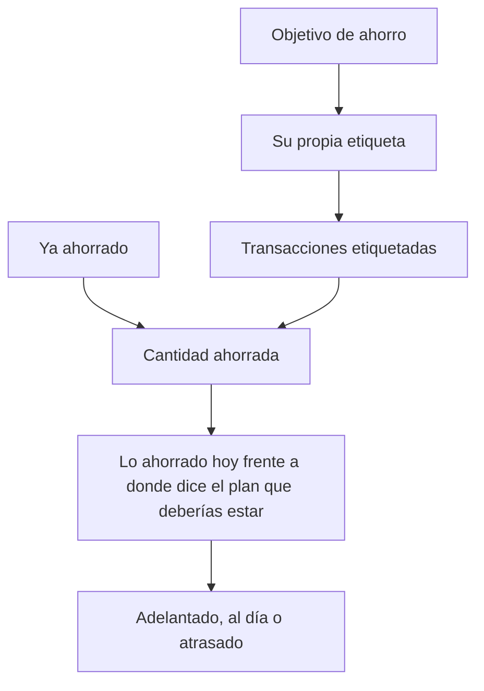
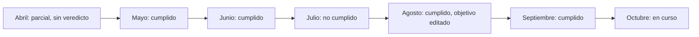

# Objetivos de ahorro

Un objetivo de ahorro es una cantidad a la que quieres llegar, y una forma de vigilar si llegarás a tiempo. Un presupuesto pone un techo al gasto; un objetivo pone un suelo al ahorro.

{{TOC}}

## Dos tipos de objetivo

Al crear un objetivo eliges su **Tipo**:

- **Puntual (con objetivo)**: una cantidad a la que llegar, como la entrada de
  un piso, con una fecha opcional. Casi toda esta página trata de estos.
- **Mensual (recurrente)**: una cantidad que apartar _cada_ mes, como «ahorrar
  300 al mes» o «ahorrar el 20 % de lo que gano». Cada mes se evalúa por
  separado. Mira [Objetivos mensuales](#objetivos-mensuales).

Los dos son una etiqueta por debajo, y las reglas para vincular transacciones y
para saber en qué sentido cuenta cada una son las mismas. El tipo no se puede
cambiar una vez creado el objetivo: para pasar de uno a otro, crea uno nuevo.

## Inicio rápido

1. Abre **Planificación**, pulsa **Crear** y elige **Objetivo de ahorro**.
2. Deja el tipo en **Puntual**, ponle nombre, define la cantidad a la que
   aspiras y elige una fecha si la tienes.
3. Indica lo que ya tenías apartado, si había algo.
4. Vincula las transacciones que lo alimentan.
5. Vuelve y comprueba si vas adelantado o atrasado.

## Cómo cuenta un objetivo

## Un objetivo es una etiqueta

Crear un objetivo crea una [etiqueta](/documentation/labels) con el mismo nombre,
y el objetivo sigue todo lo que la lleve. Ese es todo el mecanismo, y por eso los
objetivos necesitan tan poca preparación: etiquetar ya es algo que haces.

La etiqueta pertenece al objetivo, así que no te llena los ajustes de etiquetas
ni se puede renombrar a espaldas del objetivo. Renombrar el objetivo la renombra.
Tampoco puedes crear un objetivo con el nombre de una etiqueta que ya tienes:
elige otro nombre, o usa un presupuesto si esa etiqueta ya hace este trabajo.

## Vincular transacciones

**Vincular transacciones** muestra todo lo que ya está etiquetado, más una
ventana de tus transacciones recientes, y tú marcas las que alimentaron el
objetivo. Lo que quede marcado al guardar es el conjunto completo: desmarcar una
la saca.

La ventana empieza en tus cincuenta transacciones más recientes y se amplía a
medida que pides más. Si lo que buscas está más atrás, etiquétalo desde la lista
de transacciones: la etiqueta del objetivo está ahí como cualquier otra, y las
acciones masivas pueden etiquetar un grupo entero de una vez.

### Deja que lo haga una regla

Una [regla de automatización](/documentation/automation-rules) también puede
poner la etiqueta, que es lo que menos esfuerzo cuesta cuando la misma
transferencia periódica alimenta el objetivo todos los meses. Una regla sobre la
cuenta de ahorro archiva todo lo que entra en ella, el histórico incluido, y
cada traspaso a partir de entonces llega ya contado.

## En qué sentido cuenta una transacción

Esta es la parte que conviene leer despacio, porque el signo depende de la cuenta
en la que está la transacción.

**En una cuenta de ahorro, el dinero que entra es el ahorro.** Un ingreso de 500
en tu cuenta de ahorro suma 500 al objetivo. Sacar 200 resta 200.

**En cualquier otra cuenta, el dinero que sale es el ahorro.** Una transferencia
de 500 que sale de tu cuenta corriente es la que alimentó el objetivo, así que
suma 500. El dinero que vuelve en sentido contrario resta.

Al final las dos se leen igual: apartas dinero y el objetivo sube, lo recuperas y
el objetivo baja. Simplemente no tienes que pensar en qué lado de la
transferencia etiquetaste.

Lo que no debes hacer es etiquetar _los dos_ lados. Una transferencia de la
cuenta corriente al ahorro son dos transacciones, y cada una cuenta como
aportación por su cuenta, así que etiquetar el par cuenta dos veces los mismos 500. Etiqueta el lado que tú consideras el ahorro y deja el otro en paz.

## Lo que ya tenías ahorrado

La mayoría de los objetivos no empiezan de cero. La cantidad **ya ahorrado** es
lo que había en el bote el día que creaste el objetivo, y cuenta para el total
sin que tengas que rastrear años de transferencias antiguas.

Se deja fuera del _ritmo_ de ahorro a propósito: ya estaba ahí el primer día, así
que contarlo se leería como un ritmo diario enorme y te proyectaría terminado la
semana que viene. Solo lo que has añadido desde entonces marca el ritmo. Puedes
ajustar la cifra más tarde si te equivocaste.

## Leer el progreso

La tarjeta de arriba es dónde estás. Debajo, el gráfico dibuja lo que llevas
ahorrado de verdad frente a la línea recta que necesitaría el plan, y continúa tu
ritmo actual con una línea punteada para que veas dónde acaba.

Cuando el objetivo tiene fecha, además te dice:

- **Dónde deberías estar hoy.** El punto de esa línea recta, desde lo que ya
  tenías ahorrado hasta el objetivo, para la fecha de hoy.
- **Adelantado, al día o atrasado.** Cómo se compara tu total real con ese punto.
  Hay un pequeño margen a cada lado, para que unas monedas no cambien la
  etiqueta.
- **Cuánto necesitas al mes.** Lo que falta, repartido entre los días que quedan.

Sin fecha objetivo sigues teniendo el total, el porcentaje y una fecha estimada
según el ritmo que has llevado hasta ahora.

Tu ritmo se mide desde la más antigua de estas dos fechas: el día que creaste el
objetivo o tu transacción vinculada más antigua. Eso importa cuando etiquetas
ahorros que ya habías hecho: el tiempo transcurrido viene con ellos, así que el
objetivo no informa de un ritmo que nunca llevaste.

## Objetivos y presupuestos juntos

Los objetivos van al lado de los [presupuestos](/documentation/budgets) en
Planificación, y la lista se puede filtrar por unos u otros. Los objetivos
mensuales tienen su propia sección, **Ahorro mensual**, encima de la lista; el
filtro **Presupuestos** la oculta. Son complementarios,
no alternativas: un presupuesto te dice cuánto margen queda este mes, un objetivo
te dice cuánto llevas recorrido en total.

La tarjeta de un objetivo se llena a medida que ahorras. La de un presupuesto se
vacía a medida que gastas. Así los distingues de un vistazo en una lista mixta.

## Terminar un objetivo

Cuando un objetivo está cumplido, o cuando lo has dejado, **archívalo**. Eso lo
guarda sin borrar nada, y conviene saber exactamente qué hace, porque
**archivar no se puede deshacer**:

- La cantidad ahorrada se congela en lo que sea ese día, pase lo que pase después
  con esas transacciones.
- La etiqueta del objetivo desaparece. Las transacciones que la llevaban
  conservan su historial pero dejan de mostrarla, y esa etiqueta no se podrá
  volver a elegir.
- Cualquier regla de automatización que pusiera esa etiqueta deja de ponerla.
- Ya no podrás editar el objetivo ni vincularle más transacciones. Sí podrás
  abrirlo y ver lo que ahorraste.

**Eliminar** es la otra opción: quita el objetivo y su etiqueta por completo, y no
se guarda nada. Las transacciones quedan intactas en los dos casos: ni archivar
ni eliminar un objetivo cambia un solo importe, fecha o categoría.

## Objetivos mensuales

Un objetivo mensual es para el ahorro que haces todos los meses, no hacia una
fecha: «apartar 300 cada mes» o «ahorrar el 20 % de lo que entra». No hay un
total al que llegar ni fecha de fin. Cada mes natural tiene su propio objetivo
y su propio veredicto, y el objetivo lleva la cuenta: meses cumplidos, rachas y
cuánto vas por delante o por detrás en total.

### Crear uno

1. Abre **Planificación**, pulsa **Crear** y elige **Objetivo de ahorro**.
2. Pon el tipo en **Mensual (recurrente)** y dale un nombre.
3. En **Quiero ahorrar cada mes**, elige **Importe fijo** o **% de ingresos** y
   escribe la cifra.
4. Si quieres, marca **Etiquetar automáticamente** y elige la cuenta de ahorro a
   la que va el dinero.
5. Deja activado el **Recordatorio de fin de mes** si quieres un email cuando
   el mes se esté acabando y el objetivo aún no esté cumplido.

El objetivo empieza en el mes en curso. Como uno puntual, tiene una etiqueta con
su mismo nombre, y todo lo que la lleve cuenta como ahorrado en el mes de la
fecha de la transacción. No hay cifra de «ya ahorrado»: un objetivo mensual
empieza de cero cada mes.

### El objetivo: un importe fijo o una parte de tus ingresos

**Importe fijo** es lo sencillo: la misma cifra todos los meses.

**% de ingresos** fija el objetivo como una parte de lo que sueles ganar. Lo que
sueles ganar es la **media de ingresos de los tres meses completos anteriores**
al que empieza. Se calcula al abrirse el mes y después **se congela**: los
ingresos que entran durante el mes no mueven el objetivo de ese mes. Es a
propósito. Mucha gente cobra a final de mes, y un objetivo calculado con los
ingresos del propio mes estaría a cero hasta el día de la nómina.

- Con menos de tres meses de historial, la media usa los meses que haya.
- Sin ningún mes completo con ingresos, el objetivo sigue los ingresos del mes
  en curso según van llegando y se congela al terminar el mes. Hasta que entra
  algo, el objetivo dice «el objetivo sube según entran ingresos» en vez de dar
  el mes por cumplido.

Los ingresos son los mismos que cuenta el [flujo de caja](/documentation/cashflow).

### Cómo se evalúa cada mes

Cada mes va por su cuenta. Lo que ahorraste en un mes se compara con el
objetivo de **ese** mes, y no se arrastra nada: ahorrar el doble en mayo no cubre
junio. Un mes acaba en uno de estos estados:

| Estado | Cuándo |
| --- | --- |
| **Cumplido** | El mes ha terminado y ahorraste al menos su objetivo. Un objetivo de cero se da por cumplido. |
| **No cumplido** | El mes ha terminado y ahorraste menos que su objetivo. |
| **En proceso** | El mes en curso. Ves lo ahorrado, lo que falta y los días que quedan. |
| **Mes parcial** | Creaste el objetivo en los **últimos cinco días** del mes. Muestra lo que ahorraste, sin objetivo ni veredicto. El primer veredicto llega el mes siguiente. |
| **Archivada** | Archivaste el objetivo durante ese mes. Igual que un mes parcial: lo ahorrado, sin veredicto. |

Los meses parciales y archivados se quedan fuera de todo lo que suma meses: ni
alargan ni rompen una racha, y no cuentan en los meses cumplidos ni en el
acumulado.

### Leer un objetivo mensual

La página del objetivo muestra:

- **El mes en curso**: lo ahorrado frente al objetivo, lo que falta y los días
  que quedan.
- **Meses cumplidos**: cuántos de los meses evaluados se cumplieron, por ejemplo
  «4 de 5», y ese porcentaje desde que lo creaste.
- **Acumulado vs objetivo**: todo lo ahorrado en los meses evaluados frente a la
  suma de sus objetivos, y la **diferencia acumulada**: cuánto vas por delante
  (+) o por detrás (−) del plan en total.
- **Racha actual**: meses cumplidos seguidos hasta el último evaluado, con tu
  mejor racha debajo.
- **Ahorrado cada mes**: una barra por mes frente a la línea del objetivo de ese
  mes, con el color de su estado.
- **Historial**: una tabla con el objetivo, lo ahorrado, la diferencia y el
  estado de cada mes. Si el objetivo es un porcentaje de los ingresos, también
  muestra los ingresos de los que salió.
- **Aportaciones**: las transacciones etiquetadas en cada mes, con flechas para
  moverte de un mes a otro.

Si el objetivo etiqueta automáticamente, una etiqueta bajo el nombre indica la
cuenta que vigila.

### Aportaciones que llegan tarde

Lo que ahorró un mes no se guarda: se suma a partir de las transacciones
etiquetadas cada vez que lo miras. Una transferencia que se sincroniza con unos
días de retraso, o una que etiquetas semanas después, cae en el mes de su
propia fecha, y el veredicto de ese mes se recalcula, aunque el mes ya esté
cerrado. Solo el objetivo se congela.

La excepción es la notificación de un mes cerrado: es una foto del momento en
que se cerró el mes y no cambia después.

### Etiquetar las aportaciones automáticamente

**Etiquetar automáticamente** crea una
[regla de automatización](/documentation/automation-rules) que pone la etiqueta
del objetivo en cada transacción que **entra** en la cuenta de ahorro que elijas.
Viene desactivado. Si lo marcas:

- También etiqueta lo que ya ha entrado en esa cuenta desde el día 1 del mes en
  curso.
- Etiqueta todo lo que entra, intereses y devoluciones incluidos, así que si
  solo quieres que cuenten algunos ingresos, déjalo desactivado y vincúlalos a
  mano.
- Solo se ofrecen cuentas de ahorro, porque en una cuenta de ahorro lo que
  cuenta como ahorrado es el dinero que entra.
- **Una cuenta de ahorro solo puede alimentar un objetivo mensual activo.** Las
  reglas se detienen en la primera que coincide, así que un segundo objetivo
  sobre la misma cuenta nunca vería una transferencia. Las cuentas ya en uso
  aparecen desactivadas con el nombre del objetivo que las usa. Archivar ese
  objetivo libera la cuenta.
- La regla va la última en el orden de tus reglas, así que si ya tienes una que
  coincide con esas transferencias, gana la tuya. En ese caso, vincula las
  aportaciones desde la página del objetivo.

Puedes editar o borrar la regla en **Configuración › Reglas de automatización**.
El etiquetado automático solo se puede configurar al crear el objetivo.

### Editar un objetivo mensual

Puedes cambiarle el nombre, cambiar su objetivo y activar o desactivar el
recordatorio. El tipo no se puede cambiar.

**Un objetivo nuevo se aplica desde el mes en curso.** Los meses anteriores
mantienen el objetivo con el que se evaluaron, así que subir el listón en agosto
no convierte mayo en un mes no cumplido. En un objetivo por porcentaje de
ingresos, cambiar solo el porcentaje conserva los ingresos con los que se abrió
el mes y les aplica el nuevo porcentaje.

### Notificaciones

- **Cuando se cierra un mes**, la campana recibe un aviso por objetivo: «Fondo
  de emergencia: objetivo de septiembre cumplido +120,00» o «no cumplido
  −30,00», con «3 meses seguidos» cuando llevas racha. Al pulsarlo se abre el
  objetivo. Solo se avisa del mes que acaba de terminar.
- **Email de recordatorio de fin de mes.** Cuando quedan cinco días para que
  acabe el mes (hoy incluido) y un objetivo aún no llega, recibes un único email
  con todos los objetivos que van por detrás y el porcentaje que lleva cada uno.
  No incluye importes. No se envía en un mes parcial ni mientras el objetivo siga
  a cero.

El recordatorio se puede desactivar por objetivo desde el diálogo de edición o
desde **Configuración › Notificaciones › Objetivos de ahorro mensual**, donde
también eliges el valor por defecto para los objetivos mensuales nuevos.

### Dónde más aparecen

- **Panel**: una tarjeta **Ahorro mensual** con este mes de todos tus objetivos
  activos: lo ahorrado frente a la suma de objetivos, los días que quedan,
  cuántos objetivos se cumplieron el mes pasado y una línea por objetivo.
- **Flujo de caja**: en la vista de mes, una tarjeta con lo que fue a objetivos
  mensuales ese mes frente a la suma de sus objetivos, la diferencia respecto al
  plan, cuántos se cumplieron y qué parte del flujo neto del mes se llevaron.
  Mira [Flujo de caja](/documentation/cashflow#ahorro-mensual).
- **Resumen mensual**: el informe del [resumen mensual](/documentation/monthly-summary)
  dice cuántos objetivos mensuales cumpliste y por cuánto fallaron o superaron
  su objetivo los que más se desviaron. El email solo muestra el recuento.

Estas tarjetas solo aparecen cuando tienes algún objetivo mensual.

### Archivar un objetivo mensual

Archivar funciona igual que en un objetivo puntual, con algunas diferencias:

- El mes en curso pasa a ser un mes **archivado**: lo que has ahorrado se
  queda, sin veredicto.
- Se acaban los recordatorios de fin de mes y la regla de automatización deja
  de etiquetar transferencias.
- Cada mes pasado conserva su objetivo y su resultado, y puedes seguir abriendo
  el objetivo para ver su historial.

## Buenos objetivos

### Fondo de emergencia

Una cantidad grande y sin fecha concreta.

Vigila el ritmo más que el plazo.

### Entrada de un piso

Una cantidad y una fecha que van en serio.

Aquí lo útil es la cifra de lo necesario al mes.

### Vacaciones del año que viene

Alimentado por una transferencia periódica cada mes.

Una regla de automatización puede etiquetarlo por ti.

### Portátil nuevo

Pequeño, rápido y con final a la vista.

Archívalo cuando lo compres.

### Ahorrar todos los meses

Un objetivo mensual con un importe fijo.

Deja que etiquete la cuenta de ahorro por ti.

### Ahorrar una parte de lo que ganas

Un objetivo mensual del 10 % o el 20 % de los ingresos.

El objetivo se mueve con tu nómina, mes a mes.

## Errores habituales

- **Etiquetar los dos lados de una transferencia.** El mismo dinero cuenta dos
  veces. Etiqueta un lado.
- **Meter el dinero que ya tenías en las transacciones vinculadas en lugar de en
  la cantidad inicial.** Funciona, pero distorsiona el ritmo y la proyección.
- **Archivar para ordenar.** Archivar no tiene vuelta atrás y se lleva la
  etiqueta. Si es posible que vuelvas al objetivo, déjalo en paz.
- **Apuntar dos objetivos mensuales a la misma cuenta de ahorro.** Solo un
  objetivo activo puede etiquetar una cuenta automáticamente. Reparte el ahorro
  en cuentas distintas o vincula a mano las aportaciones del segundo.
- **Esperar que un buen mes compense uno malo.** Los objetivos mensuales no
  arrastran nada de un mes a otro. La diferencia acumulada da la foto de
  conjunto; el veredicto de cada mes, no.
- **Esperar que un objetivo mueva dinero.** Lee tus transacciones, igual que un
  presupuesto. No se transfiere nada a ninguna parte.

## Preguntas frecuentes

### ¿Un objetivo de ahorro mueve dinero entre mis cuentas?

No. Nada en Whisper Money mueve dinero. Un objetivo lee las transacciones que
etiquetas y las suma.

### ¿Por qué mi objetivo está a cero si tengo transacciones vinculadas?

Mira en qué cuenta están. En una cuenta de ahorro cuentan los ingresos; en
cualquier otra cuentan los pagos que _salen_. Si has etiquetado ingresos en una
cuenta corriente, se están leyendo como dinero que vuelve a salir del objetivo.

### ¿Pueden dos objetivos seguir la misma transacción?

Sí. Una transacción puede llevar tantas etiquetas como quieras, así que puede
contribuir a más de un objetivo.

### ¿La etiqueta del objetivo aparece en mis ajustes de etiquetas?

No. Pertenece al objetivo y se gestiona desde ahí, así que se queda fuera de la
lista de Configuración → Etiquetas.

### ¿Puedo convertir un objetivo puntual en mensual?

No. El tipo se fija al crear el objetivo. Crea uno mensual junto a él, o archiva
antes el antiguo.

### ¿Por qué mi objetivo por porcentaje de ingresos no cambia cuando cobro?

Porque se calcula con la media de los tres meses completos anteriores y se
congela al abrirse el mes. La nómina de este mes alimenta el objetivo del mes
que viene.

### ¿Por qué el primer mes dice «Mes parcial»?

Creaste el objetivo en los últimos cinco días de un mes. Exigirte el objetivo de
un mes entero por unos pocos días no sería justo, así que ese mes muestra lo que
ahorraste sin veredicto. El primer veredicto llega el mes siguiente.

### He etiquetado una transferencia del mes pasado. ¿Cambia el resultado de ese mes?

Sí. Lo ahorrado en un mes se suma siempre a partir de sus transacciones
etiquetadas, así que el estado del mes, la racha y el acumulado se actualizan.
El aviso de la campana que llegó al cerrarse el mes, no.

### ¿Puedo reabrir un objetivo archivado?

No. Archivar no tiene vuelta atrás. Crea un objetivo nuevo y vincula las transacciones que
quieras que cuente.

### ¿Qué les pasa a mis transacciones si elimino un objetivo?

Nada, más allá de perder la etiqueta del objetivo. Importes, fechas, categorías y
el resto de etiquetas quedan intactos.
